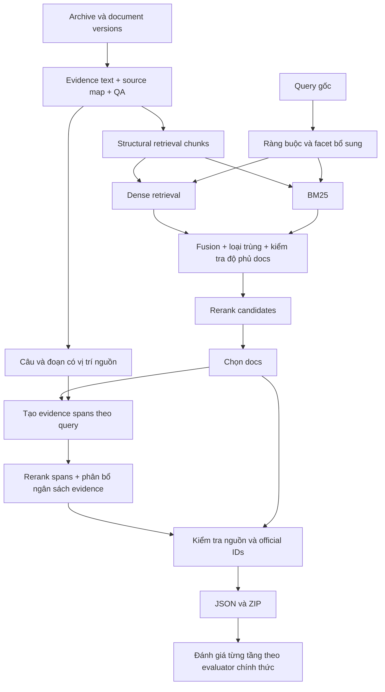

# ViBioMIR: pipeline hiện tại, các hạn chế và lộ trình cải tiến

**Tài liệu thảo luận cho cả nhóm — cập nhật ngày 01/11/2026.**

**Thông điệp chính:** nhóm đã có một hệ thống truy hồi chạy được và một bản nộp đạt
**0.1706**. Phần cần làm tiếp là xác định evidence bị mất ở bước nào, cải thiện cách chọn
đoạn trả về và đánh giá từng thay đổi. Có thể tận dụng phần lớn dữ liệu, embeddings,
candidates và điểm rerank hiện có; chưa cần xây lại toàn bộ hệ thống.

Tài liệu phân biệt ba mức độ chắc chắn:

- **Đã xác nhận:** có số liệu, mã nguồn hoặc metadata cụ thể.
- **Giả thuyết:** cơ chế có thể gây lỗi, cần đối chiếu đáp án và kết quả từng query.
- **Đề xuất:** thay đổi chưa được chứng minh cải thiện điểm trên bộ dữ liệu này.

Các điểm thi là do người dùng cung cấp. Nhóm cần lưu thêm file kết quả chấm,
phiên bản evaluator và hash ZIP để biến chúng thành bằng chứng thực nghiệm tái lập được.

## 1. Hiểu pipeline bằng một ví dụ đơn giản

Hãy hình dung hệ thống như một thư viện y sinh rất lớn:

| Khái niệm | Cách hiểu | Vai trò trong project |
|---|---|---|
| Document / doc | Một tài liệu trong thư viện | Đối tượng được chấm ở cấp tài liệu |
| Chunk | Một đoạn được chia sẵn trong tài liệu | Đơn vị dùng để truy hồi và rerank |
| Evidence span | Đoạn nguyên văn làm bằng chứng trả lời | Có thể là cả chunk hoặc một đoạn con có vị trí nguồn |
| Embedding | Biểu diễn số của văn bản | Tìm các đoạn gần nhau về ngữ nghĩa |
| Candidate pool | Danh sách ứng viên ban đầu | Quyết định những đoạn nào có cơ hội được chọn |
| Reranker | Model đọc đồng thời câu hỏi và đoạn ứng viên | Xếp lại thứ tự ứng viên |
| Source map | Địa chỉ truy ngược về văn bản gốc | Kiểm tra evidence có thật, đúng tài liệu và đúng phiên bản |
| Qrels / span labels | Nhãn tài liệu đúng / vị trí đoạn đúng | Dùng để đo lỗi và điều chỉnh hệ thống |
| Ablation | So sánh chỉ thay một yếu tố | Giúp biết chính xác thay đổi nào có tác dụng |

Ví dụ: hệ thống tìm đúng tài liệu nói về xét nghiệm Beta-HCG, nhưng trả về một đoạn dài
chủ yếu nói về quy trình lấy mẫu. Kết quả có thể đúng ở cấp doc nhưng sai ở cấp chunk.
Vì vậy, “tìm đúng tài liệu” và “chỉ ra đúng bằng chứng” là hai bài toán liên quan nhưng khác nhau.

## 2. Nhóm thực sự đang chạy pipeline nào?

Bản được báo cáo đạt **0.1706** chạy qua notebook
[`stage9_dense_recovery_colab.ipynb`](../colab/stage9_dense_recovery_colab.ipynb):

```text
6 ZIP đầu vào Stage 8
        ↓ khôi phục, đối chiếu checksum
5.512.624 structural chunks / 855.745 documents / 1.712 batches
        ↓
Candidates BGE V1: tối đa 500/query
        ↓ chọn tối đa 400/query
BGE reranker v2-m3
        ↓
Xếp hạng docs + chọn nguyên chunk theo điểm
        ↓
Giới hạn: 120 docs / 120 chunks / 6 chunks mỗi doc / overlap IoU 0,8
        ↓
Kiểm tra nguồn + ID chính thức → submission.json → submission.zip
```

Điều cần thống nhất trong nhóm:

- Lần chạy này sử dụng **nhánh dense BGE**. BM25 chưa được kết nối vào lần chạy này.
- Model embedding chưa đổi sang Qwen. Model reranker cũng chưa đổi sang Qwen.
- Evidence xuất ra vẫn là **nguyên chunk gốc**; chưa có bước tìm ranh giới đoạn con theo query.
- Structural store có **5.512.624 chunks**. Semantic store có **9.036.279 chunks** là một
  cách chia khác của cùng tập tài liệu; không hoán đổi chúng bằng cách sửa hash.
- Chức năng chọn docs và chunks đã có trong code. Hạn chế cần cải thiện nằm ở
  **chính sách xếp hạng/chọn đoạn**, không phải hoàn toàn chưa có bước này.

Sơ đồ kiến trúc đầy đủ có BM25, fusion và ICD-10 là **thiết kế mục tiêu**. Không nên mô tả
mọi khối trong sơ đồ đó là thành phần đã được chạy và đóng góp vào điểm 0.1706.

## 3. Kết quả nói gì — và chưa nói được gì?

| Chỉ số | Bản trước | Dense recovery | Chênh lệch tuyệt đối |
|---|---:|---:|---:|
| FINAL_SCORE | 0.1626 | **0.1706** | +0.0080 |
| DOCS_F2MACRO | 0.2378 | **0.2534** | +0.0156 |
| CHUNKS_F2MACRO | 0.0875 | **0.0877** | +0.0002 |
| DOCS_PRECISION | 0.1709 | **0.1842** | +0.0133 |
| DOCS_RECALL | 0.3226 | **0.3336** | +0.0110 |
| CHUNKS_PRECISION | 0.0647 | **0.0669** | +0.0022 |
| CHUNKS_RECALL | **0.1226** | 0.1160 | −0.0066 |

**Nếu cùng evaluator và cùng giai đoạn chấm**, mức tăng điểm tổng là khoảng **4,9% tương đối**.
Phần cải thiện chủ yếu nằm ở tài liệu; F2 của chunk gần như đứng yên.

Cách hiểu các chỉ số:

- **Precision:** trong các kết quả trả về, tỷ lệ được xem là đúng.
- **Recall:** trong các kết quả đúng cần tìm, tỷ lệ hệ thống tìm được.
- **F2:** kết hợp precision và recall, ưu tiên recall hơn nhưng vẫn phạt kết quả dư sai.
- **Macro:** tổng hợp ở cấp query; không suy ra số tài liệu đúng toàn bộ bằng cách lấy
  precision trung bình nhân tổng số kết quả, và không lấy P/R trung bình để tái tạo chính xác F2 macro.

**Chưa thể kết luận “bỏ BM25 giúp tăng điểm”.** Hai lần chạy đã thay đổi cả nguồn pool
và ngân sách rerank 200 → 400. Ngoài ra BTC đã cập nhật luật chunk; cần ghi rõ mỗi kết quả
dùng evaluator nào trước khi so sánh trực tiếp.

## 4. Bộ query tạo ra những yêu cầu gì cho hệ thống?

Đã đọc toàn bộ `query/query.parquet`: **1.200 query**, không rỗng, không trùng nguyên văn
hoặc trùng sau chuẩn hóa cơ bản. Hash trùng query snapshot S09.

| Đặc điểm quan sát được | Số query | Ý nghĩa với thiết kế |
|---|---:|---|
| Có chữ số | 521 | Cần bảo toàn tuổi, số đo, ngày tháng, liều và kết quả xét nghiệm |
| Có cụm thời gian theo regex | 266 | Cần phân biệt diễn biến, bệnh sử và tình trạng hiện tại |
| Ngữ cảnh trẻ em | 162 | Không bỏ điều kiện đối tượng khi rút gọn query |
| Thai kỳ, cho bú hoặc sau sinh | 117 | Có thể làm thay đổi loại evidence phù hợp |
| Cụm phủ định theo regex hẹp | 76 | Nhắc tên bệnh không đồng nghĩa có bệnh |
| Khớp từ hai nhóm nội dung trở lên | 473 | Nên rà soát khả năng nhiều ý hỏi |
| Không có dấu hỏi | 248 | Không dùng dấu `?` làm điều kiện bắt buộc |

Ngoại trừ các phép đếm trực tiếp như chữ số/dấu hỏi, các nhóm ngữ cảnh là **dấu hiệu bằng
quy tắc**, có thể sai hoặc bỏ sót và có thể chồng lấp. Con số 473 không phải nhãn xác nhận
473 query đều có nhiều ý định. Các quy tắc không đưa ra chẩn đoán.

Ví dụ cụ thể từ bộ query:

- **ID 3:** có `Beta-HCG`, `dưới 0.10 U/L`. Chỉ giữ từ khóa “xét nghiệm” làm mất
  tên chỉ số, quan hệ so sánh và đơn vị.
- **ID 15:** có `không bị HIV`. Nhận diện thực thể HIV mà bỏ phạm vi phủ định sẽ làm sai nghĩa.
- **ID 219:** có các ý đánh số về tuổi tiêm vaccine, tiền sử dị ứng của người hỏi và
  tình trạng người chồng. Tìm một đoạn chung về vaccine chưa chắc bao phủ mọi ý.
- **ID 271:** mô tả trẻ gần hai tháng và diễn biến từng ngày. Truy hồi chỉ bằng “sốt ở trẻ”
  có thể thiếu điều kiện tuổi và diễn biến.

Độ dài trung vị là 18 đơn vị tách bằng khoảng trắng, lớn nhất là 281 ở ID 219.
**Các số này không phải token của model.** Code BGE reranker hiện tại đã chia cửa sổ
để bao phủ query/passage; không có bằng chứng từ thống kê này rằng nó đang cắt mất đuôi query.
Khi đổi model/template, vẫn cần đo token và kiểm tra riêng tính bao phủ.

## 5. Các hạn chế hiện tại và cách xử lý

### 5.1. Chưa xác định được evidence thất bại ở tầng nào

**Đã xác nhận:** Chunks F2 thấp hơn Docs F2; notebook kiểm tra tính hợp lệ và nguồn,
nhưng không tự đo relevance hoặc luật LCS chính thức. Chưa có evaluator mới và gold spans
được cung cấp trong công việc này. Project có các báo cáo thử nghiệm/proxy trước đó;
chúng không thay thế nhãn chính thức cho toàn bộ query đang nộp.

**Vấn đề:** nếu không biết đáp án mất ở đâu, nhóm có thể đổi model tốn GPU trong khi
nguyên nhân thật là pool thiếu evidence hoặc đoạn xuất ra có ranh giới chưa phù hợp.

**Giải pháp:** trên tập nhãn được phép sử dụng, truy vết một query qua từng bước:

```text
Evidence đúng có trong corpus không?
    → Có trong top 500 candidates không?
    → Có trong top 400 đưa vào rerank không?
    → Xếp hạng bao nhiêu sau rerank?
    → Vì sao được chọn hoặc bị loại?
    → Chunk xuất ra có khớp LCS hai chiều không?
```

**Đo thành công:** phân loại được lỗi theo tầng, thay vì chỉ có một FINAL_SCORE.
Với corpus thu thập từ web, nhãn có thể chưa đầy đủ: chưa được gán đúng không có nghĩa chắc chắn sai.

### 5.2. Một nhánh dense có thể thiếu các ứng viên theo từ/cụm chính xác

**Đã xác nhận:** lần chạy 0.1706 chỉ dùng dense V1. Candidates BM25 của baseline cũ chưa
tìm được trong dữ liệu Drive đã kiểm tra. `artifacts.zip` được liệt kê chỉ chứa dữ liệu cleaning Stage 4.

**Giả thuyết:** tên thuốc hiếm, mã xét nghiệm, số và đơn vị có thể được lexical retrieval
bổ sung tốt hơn ở một số query. Chưa có phép đo chứng minh điều này cho bộ hiện tại.

**Giải pháp:** khôi phục hoặc dựng BM25 từ đúng structural source; giữ nhánh dense và
thử fusion bằng RRF. Loại trùng theo chunk ID, đồng thời theo dõi số tài liệu duy nhất.
Không cộng thẳng điểm BM25 với cosine vì hai thang điểm không tương đương.

**Đo thành công:** tăng recall của pool trước rerank và tăng F2 cuối trên cùng validation set.
Đừng chỉ báo cáo pool lớn hơn hoặc có nhiều docs hơn.

### 5.3. Query có nhiều điều kiện nhưng chưa có tầng biểu diễn ràng buộc rõ ràng

**Đã xác nhận:** số đo, thời gian, đối tượng và phủ định xuất hiện nhiều. Nhánh đang chạy dùng
query gốc; chưa có thí nghiệm trích xuất ràng buộc/facet tích hợp vào lần chạy này.

**Giả thuyết:** model có thể ưu tiên bệnh/triệu chứng nổi bật và ít chú ý điều kiện phụ.
Không được coi giả thuyết này là bằng chứng model hiện tại bỏ qua mọi phủ định.

**Giải pháp:** tạo bản ghi phụ cho query, giữ nguyên văn query chính thức:

```text
query_id
original_query
constraints: đối tượng, thời gian, số đo, phủ định…
facets: các ý hỏi bổ sung có start/end trong query gốc
confidence + cách tạo nhãn + phiên bản
```

Giữ nhánh query gốc và thử các facet như nhánh bổ sung. Với ID 219, tách theo các ý đánh số
để chuyên gia rà soát trước. Không biến giả thuyết bệnh của người hỏi thành chẩn đoán đã xác nhận.

**Đo thành công:** cải thiện nhóm query có ràng buộc/nhiều ý mà không làm giảm nhóm còn lại.
Đặc biệt review sự khác nhau giữa “không bị…” và “có … được không?”.

### 5.4. Ranh giới chunk được cố định trước khi biết query

**Đã xác nhận:** code chọn và xuất nguyên `chunk_text`. Structural chunk được tạo để dùng
chung cho nhiều query, chưa chọn đoạn con theo câu hỏi cụ thể.

**Giả thuyết:** đoạn truy hồi có thể chứa đúng evidence nhưng kèm quá nhiều nội dung khác;
hoặc evidence cần thiết nằm qua ranh giới hai chunk. Cần gold spans để đo mức độ phổ biến.

**Giải pháp:** tách lớp “chunk để tìm tài liệu” và “span để trả về”. Sau khi tìm được tài liệu,
tạo một số đoạn con liên tiếp theo câu/đoạn, giữ cả chunk gốc làm ứng viên, rồi chấm lại.
Khi cần mở rộng qua ranh giới, lấy văn bản liền kề từ đúng source region, không nối tùy ý hai
chuỗi retrieval text có overlap/context. Mọi span phải là lát cắt nguyên văn có địa chỉ nguồn.

**Đo thành công:** Chunks F2 theo luật mới tăng trong khi giữ nguyên docs để cô lập tác động.
Không chọn độ dài tối ưu chỉ từ độ dài query; query ngắn vẫn có thể cần evidence dài.

### 5.5. Luật LCS mới đòi hỏi evidence vừa đủ và đúng nội dung

**Đã xác nhận từ thông báo BTC người dùng cung cấp:** đặt L là độ dài LCS tính bằng token,
G là độ dài chunk đáp án, P là độ dài chunk dự đoán. Một cặp khớp cần đồng thời:

```text
L / G ≥ 0,4
L / P ≥ 0,4
```

Ví dụ minh họa giả định cách tokenize đã thống nhất:

| Token đáp án G | Token dự đoán P | LCS L | Kết quả |
|---:|---:|---:|---|
| 100 | 400 | 80 | Trượt: L/P = 20% |
| 100 | 150 | 80 | Đạt cả hai điều kiện |
| 100 | 30 | 30 | Trượt: L/G = 30% |

Đoạn quá dài hoặc quá ngắn đều có thể trượt. Từ L ≤ min(G,P), suy ra điều kiện cần
0,4G ≤ P ≤ 2,5G; đây không phải điều kiện đủ và khi suy luận không biết G.
LCS cũng xét thứ tự token, không phải chỉ đếm từ giống nhau bất kể thứ tự.

**Giải pháp:** tích hợp đúng evaluator BTC, gồm tokenizer, ghép cặp và cách tổng hợp điểm;
dùng ví dụ trên để giải thích cơ chế, không tự viết một bộ chấm đơn giản rồi coi là điểm chính thức.
Với các evidence spans mới, đo trên validation được phép dùng và giữ văn bản nguyên gốc.

**Lưu ý:** `overlap_iou_threshold=0.8` hiện tại đo chồng lấp vị trí giữa các dự đoán,
không phải ngưỡng LCS. Không đổi nó thành 0.4 chỉ vì thông báo mới.

### 5.6. Chọn docs theo một chunk tốt nhất và chọn chunks theo thứ tự toàn cục

**Đã xác nhận trong `stage9_core.select()`:** điểm doc là điểm chunk tốt nhất.
Chọn tối đa 120 docs, rồi duyệt chunk theo điểm, giới hạn toàn cục và mỗi doc.
Một doc có thể có mặt trong danh sách docs nhưng không có chunk được xuất.

**Giả thuyết:** nhiều chunk điểm cao của ít tài liệu có thể chiếm ngân sách; một chunk
điểm cao bất thường có thể đẩy cả tài liệu lên đầu dù không bao phủ đủ ý hỏi.

**Giải pháp thử theo từng bước:**

1. Thống kê thực tế số chunks/doc, số docs không có evidence, các lý do loại chunk.
2. Cố định docs của baseline; thử cap 2 thay vì 6 chunks/doc, giữ tổng 120.
3. Thử một chunk tốt nhất/doc trước, rồi bổ sung theo điểm.
4. Chỉ sau đó thử tổng hợp điểm doc từ một vài chunk không trùng hoặc độ phủ facet.

Không bắt buộc mỗi doc phải có evidence chỉ để làm đẹp thống kê: cách đó có thể ép chọn
đoạn kém liên quan. Không cộng mọi điểm chunk của doc vì dễ ưu tiên tài liệu dài.

**Đo thành công:** F2 chunk tăng, danh sách docs giữ nguyên ở thí nghiệm chọn evidence.
Khi thử đổi điểm doc, đo riêng ảnh hưởng đến docs và chunks.

### 5.7. Đổi model chưa phải thí nghiệm được cô lập

**Đã xác nhận:** model hiện tại là BGE; chưa có kết quả Qwen trên tập này.

**Giải pháp:** thử Qwen reranker trên cùng candidates top K, cùng query, cùng evidence và
cùng giới hạn xuất. Cần adapter đúng input, cách tính điểm, xử lý query dài và model registry.
Không so sánh thang điểm thô của BGE và Qwen hoặc dùng chung threshold chưa hiệu chỉnh.

Nếu Qwen reranker có lợi, mới cân nhắc thay embedding. Đổi embedding cần encode corpus và
query bằng model mới, dựng index và truy hồi lại. Việc đó không cần làm khi chỉ đổi reranker.
Checkpoint model/tokenizer, instruction và chính sách cửa sổ phải được pin; dùng pilot để
đo VRAM, thời gian và lượng query có thể chạy, không suy ra tốc độ từ tên gói Colab Pro.

**Đo thành công:** tăng điểm trên cùng tập/luật và chi phí suy luận chấp nhận được.
Theo đặc tả repository, kiểm tra model công khai ≤15B và revision trước mốc 01/08/2026.
Không mặc định model mới hơn hoặc lớn hơn sẽ tốt hơn trên query y sinh tiếng Việt.

### 5.8. NER/ICD-10 chưa đủ nếu không hiểu phủ định và người được nhắc đến

**Bối cảnh:** repository đã có Stage 6 gán nhóm ICD bằng quy tắc; metadata này chưa được dùng
để boost/filter trong lần dense recovery. NER chi tiết và mapping thực thể thành mã bệnh chưa
được xác nhận là thành phần của lần chạy đạt 0.1706.

**Giải pháp:** trước tiên trích xuất bệnh, triệu chứng, thuốc, xét nghiệm cùng thuộc tính:
người hỏi/người thân, hiện tại/tiền sử, xác nhận/nghi ngờ/phủ định. Mapping ICD có nhiều nhãn
và trạng thái chưa biết. Dùng như tín hiệu hỗ trợ để thử, giữ đường truy hồi không phụ thuộc nhãn.

**Đo thành công:** độ chính xác thực thể/thuộc tính trên mẫu được review, rồi đo thay đổi retrieval.
Không hard-filter chỉ vì ICD của query và tài liệu không giống nhau; query triệu chứng chưa chắc có mã rõ ràng.

### 5.9. Vận hành đã gặp lỗi do nguồn và checkpoint chưa được quản lý như một bộ

**Đã quan sát trong quá trình chạy:** chọn nhầm semantic/structural, nhầm worker với chunk
store, dùng thư mục mã rỗng, và điểm cũ không khớp hash packet mới. Những lỗi này làm mất
thời gian chạy nhưng không phải bằng chứng rằng model suy luận sai.

**Đã có sửa chữa:** khôi phục nguồn từ bundle Stage 8, nạp code cùng cell giải nén,
kiểm tra candidates trước GPU, khôi phục byte packet từ `prepared.zip`, tách worker theo packet hash.

**Cần củng cố:** mỗi lần chạy có một manifest liên kết source, query, candidate producer,
model/tokenizer, config, packet set, worker và ZIP. Cho phép resume khi cùng bộ định danh.
Nếu hash gzip khác nhưng nội dung có thể giống, phải so sánh và xác minh trước khi tái sử dụng;
không sửa trực tiếp hash trong bản điểm để ép qua kiểm tra.

**Đo thành công:** thử ngắt giữa chừng, reset runtime rồi chạy tiếp; các query hoàn tất được
khôi phục đúng, kết quả export không đổi và không lẫn source/model giữa các lần chạy.

## 6. Pipeline mục tiêu và phần nào làm trước



Hai lớp xếp hạng không bắt buộc phải dùng hai model khác nhau. Có thể dùng cùng reranker
trước trên retrieval chunks, sau trên số lượng evidence spans đã giới hạn. Tầng thứ hai
làm tăng số cặp cần chấm, nên phải đặt ngân sách và chạy pilot.

NER/ICD và mô hình embedding thứ hai là các nhánh thực nghiệm bổ sung sau khi nhóm đã có
đánh giá tốt; không phải điều kiện để bắt đầu sửa chọn evidence.

## 7. Tận dụng gì và tính lại gì?

| Artifact hiện có | Có thể tận dụng | Khi nào cần làm lại? |
|---|---|---|
| Document versions, source map | Nguồn chuẩn và xác thực evidence | Extraction/source thay đổi |
| Structural chunks trong 6 ZIP | Retrieval và tạo spans | Thay chiến lược chunking cho index |
| BGE embeddings/index/query vectors | Giữ cho nhánh BGE | Đổi model embedding, source text hoặc cách encode |
| Candidates V1 | So sánh model/chọn evidence trên cùng pool | Đổi truy hồi, query hoặc pool lớn hơn nguồn đã có |
| Candidates V2 | Thí nghiệm độc lập sau kiểm tra cách tạo pool | Không tự coi là tốt hơn chỉ vì tên V2 |
| Điểm BGE top 400 | Chọn lại docs/chunks bằng CPU | Query, passage hoặc model/policy đổi |
| Prepared packets và worker backup | Resume đúng lần chạy | Packet bytes/identity không còn tương thích |
| Kiểm tra nguồn và đóng gói | Tiếp tục dùng cho mọi biến thể | Span mới cần bổ sung kiểm tra vị trí nguồn |
| Semantic chunks | Một nhánh thử nghiệm riêng | Không thay trực tiếp structural artifacts |

Điểm rerank chỉ dùng lại cho cặp query/passage và chính sách model khớp chính xác,
có kiểm tra nguồn. Đoạn evidence con mới cần chấm điểm mới. Đổi cap hoặc cách chọn từ
cùng scores không cần inference GPU lại, nhưng vẫn cần xác thực và đóng gói.

## 8. Kế hoạch thực nghiệm để biết thay đổi nào có ích

Giữ cùng evaluator và cùng tập nhãn được phép sử dụng. Đầu tiên chạy trên tập kiểm tra
nhỏ được chọn trước, sau đó xác nhận trên tập lớn hơn/holdout. Không dùng nhãn private
hoặc dò leaderboard để suy ra đáp án. Không tự động coi đoạn chưa có nhãn là negative.

| Mã | Thay đổi so với baseline | Thành phần giữ cố định | Chi phí chính |
|---|---|---|---|
| E0 | Tái lập bản 0.1706 và lưu đủ provenance | Toàn bộ pipeline | Kiểm tra/chấm lại nếu cần |
| E1 | Cap 2 chunks/doc thay vì 6 | Docs, scores, tổng 120 chunks | CPU |
| E2 | Chọn một chunk/doc trước rồi bổ sung | Docs, scores, tổng 120 chunks | CPU |
| E3 | Evidence spans theo câu/đoạn + chấm lại | Danh sách docs baseline | GPU cho spans mới |
| E4 | Qwen reranker | Cùng pool, query, output policy | GPU chấm lại |
| E5 | Top 500 thay vì 400 | Model và cách chọn | Chấm thêm các cặp thiếu |
| E6 | BM25 + dense fusion | Model và ngân sách rerank tương đương | BM25/index và chuẩn bị pool |
| E7 | Qwen embedding | Source và tiêu chí đánh giá | Encode lại corpus/query + index |

E1 và E2 là hai biến thể thay thế nhau, không mặc định áp dụng nối tiếp.
Không gộp E3 + E4 + E6 vào một lần rồi quy công cho Qwen.

Mỗi thí nghiệm lưu tối thiểu:

```text
experiment_id, parent_baseline
query/source/candidate hashes
model revision, tokenizer revision, scoring policy
thay đổi duy nhất đang kiểm tra
output limits, số pairs thực tế, thời gian, phần cứng
submission hash, evaluator version, phase/dataset
docs/chunks precision, recall, F2, FINAL_SCORE
query cải thiện, query suy giảm, lỗi theo nhóm
```

Nếu có nhãn đầy đủ và điều kiện phù hợp, thêm so sánh theo từng query hoặc khoảng bất định.
Một mức tăng rất nhỏ trên một lần chấm chưa đủ để kết luận có cải thiện ổn định.

## 9. Phân công nhóm theo đầu ra cụ thể

Không phụ thuộc nhóm có bao nhiêu người: một người có thể nhận nhiều vai trò.

| Vai trò | Công việc | Đầu ra review được |
|---|---|---|
| Dữ liệu và vận hành | Kiểm kê artifacts, pin nguồn, kiểm thử resume | Danh sách đường dẫn/hash và run manifest |
| Phân tích query/nhãn | Review ràng buộc, facet, đối tượng và evidence | Mẫu có nhãn nguồn, hướng dẫn gán, nhóm query |
| Retrieval/model | BM25, fusion, reranker adapter | Candidate runs và bảng recall/chi phí |
| Evidence/evaluation | Span extraction, selection, evaluator | So sánh E0–E3 và lỗi theo tầng |
| Tổng hợp thí nghiệm | Kiểm tra so sánh công bằng, quyết định bản tốt | Bảng kết quả kèm hash ZIP và tiêu chí chọn |

Nếu thời gian ít: làm E0, thống kê evidence, rồi E1/E2. Có thêm GPU và nhãn review:
làm E3, tiếp đến E4. E6/E7 nên triển khai khi đã đo được hạn chế ở retrieval.
Không đưa ra số giờ chạy cố định nếu chưa đo throughput trên cấu hình thực tế.

## 10. Cách đọc một lần chạy là “tốt hơn”

Một lần chạy mới nên vượt qua ba lớp kiểm tra:

1. **Dữ liệu đúng:** cùng source/query theo thiết kế, ID hợp lệ, evidence là nguyên văn,
   không nhầm phiên bản và không lẫn checkpoint.
2. **So sánh đúng:** cùng evaluator/giai đoạn, biết thay đổi nào đang thử, không dùng gold
   không được phép và không chọn chỉ dựa trên vài ví dụ thuận lợi.
3. **Kết quả hữu ích:** tăng chỉ số mục tiêu, biết nhóm query nào được lợi/bị hại, chi phí phù hợp.

`VALIDATION.json: passed` chủ yếu chứng minh lớp kỹ thuật được kiểm tra theo phạm vi báo cáo.
Nó không đồng nghĩa mọi doc/chunk đúng về relevance, và không thay thế điểm chấm chính thức.

## 11. Những việc nên tránh

- Tăng docs/chunks liên tục mà không kiểm tra precision và chất lượng pool.
- Thay semantic cho structural chỉ vì đều có 1.712 batches.
- Sửa SHA256 hoặc trạng thái `passed` để bỏ qua dữ liệu không tương thích.
- Xóa số, đơn vị, phủ định hoặc đối tượng khi rút gọn query.
- Cho LLM viết lại evidence rồi dùng đoạn sinh ra làm bằng chứng nguyên văn.
- Kết luận query dài chắc chắn bị truncate chỉ từ số đơn vị khoảng trắng.
- Chuyển cả embedding và reranker sang Qwen cùng lúc trước khi có mốc so sánh.
- Gán cứng ICD để loại bỏ mọi tài liệu không cùng mã.
- Dùng bộ chấm LCS tự viết thiếu tokenizer/ghép cặp của BTC để công bố điểm chính thức.

## 12. Nguồn kiểm chứng trong project

| Nội dung | Nguồn |
|---|---|
| Notebook tạo lần dense recovery | [`colab/stage9_dense_recovery_colab.ipynb`](../colab/stage9_dense_recovery_colab.ipynb) |
| Cách chạy và resume | [`docs/COLAB_DENSE_RECOVERY.md`](COLAB_DENSE_RECOVERY.md) |
| Query statistics | [`SUMMARY.json`](../reports/query_analysis_20261101/SUMMARY.json) |
| Query nguyên văn và dấu hiệu từng ID | [`QUERY_FLAGS.json`](../reports/query_analysis_20261101/QUERY_FLAGS.json) |
| Regex để review các con số | [`RULES.json`](../reports/query_analysis_20261101/RULES.json) |
| Xếp hạng docs, chọn chunks, overlap | [`vibiomir/stage9_core.py`](../vibiomir/stage9_core.py) |
| Cửa sổ query/passage và tổng hợp điểm | [`vibiomir/stage9_reranker.py`](../vibiomir/stage9_reranker.py) |
| Xác minh packet, worker và kết quả | [`vibiomir/stage9_pipeline.py`](../vibiomir/stage9_pipeline.py) |
| Khôi phục structural source và kiểm tra dense candidates | [`scripts/stage9_dense_recovery.py`](../scripts/stage9_dense_recovery.py) |
| Đặc tả model và giới hạn sử dụng nhãn | [`docs/SPEC_DRIVEN_DEVELOPMENT_VIBIOMIR.md`](SPEC_DRIVEN_DEVELOPMENT_VIBIOMIR.md) |

Các giải pháp trong tài liệu là lộ trình đề xuất. Ngoài bản 0.1706 do người dùng báo cáo,
chưa có bằng chứng thực nghiệm mới xác nhận Qwen, BM25 fusion hoặc evidence spans sẽ tăng điểm.
