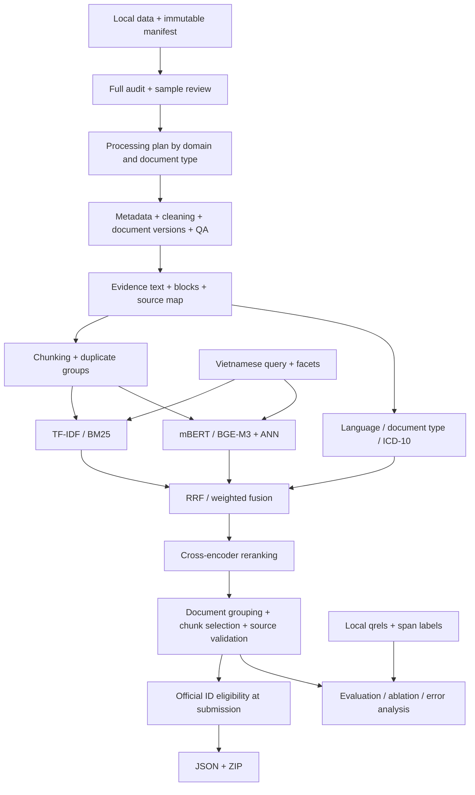

# ViBioMIR — spec-driven development from Mentor Day to a complete retrieval system

**Version:** 1.13 · **Date:** 2026-10-29 · **Status:** specification for implementation;
local-audit-first scope, with manual execution from delivery 3 onward.

Target: Vietnamese-query retrieval of original VI–EN–ZH documents and evidence,
using local CPU and Colab Pro resources. The owner revised S08 infrastructure
to up to six concurrent CUDA sessions on 2026-10-27, replacing the original
three-account planning limit for that workload. Proposed modules are not
claimed to be implemented merely because they appear in this specification.

Primary requirements source: [261012_R2_AI_S3_MentorDay1_summary.md](../261012_R2_AI_S3_MentorDay1_summary.md).
SHA-256 of the reviewed source:
`8d4a732302dc05e94584aea1fb557a9b1d6a075804911cde0742baf872dbd097`.
Competition rules: [task definition](BAI_TOAN_VIBIOMIR.md).
Existing evidence: [EDA report](../reports/eda/REPORT.md),
[corpus summary](../reports/eda/corpus_summary.json),
[reference reconciliation](../reports/eda/references_summary.json).
Language and compatibility policy: [development conventions](DEVELOPMENT_CONVENTIONS.md).

**v1.13 observed baseline, 2026-10-29:** S06 rules (855,745 document
annotations), S07 BM25/TF-IDF index (5,512,624 chunks) and S08 BGE-M3
(5,512,624 indexed vectors; 1,200 queries × 500 dense candidates) have current
technical evidence. The owner authorized execution for this closeout and then
**deferred full S07 query generation** because of local query cost. Keep its
validated index; proceed with the dense-only S09 branch when implemented.
Hybrid/RRF requires lexical candidates later. See
[baseline results and handoff](STAGES6_8_BASELINE_HANDOFF.md) and
[execution evidence](../reports/stage678_baseline_20261029/README.md).
The executed suites have 39 passes and one optional CPU pooling skip.
Semantic/combined ICD, mBERT, full fixed/comparative runs, clinical QA,
calibration, relevance metrics and ANN recall checks remain at S10. This
scheduling decision does not close the formal clinical/quality acceptance
criteria below or change pending corpus-readiness flags. Earlier delivery
notes record historical source-delivery scope, not current execution status.

Initial values, QA thresholds, budgets, and scheduling suggestions are **proposed
engineering decisions**, not organizer rules or measured benchmarks.

**v1.10 scheduling decision, 2026-10-27 — current execution priority:** the
owner requests moving directly from the existing technically validated S05
structural/semantic snapshot to S06 implementation, then S07–S09 retrieval.
Full fixed building, the QA catalog/sample/export and extended human/clinical
review, intrinsic measurements, local-label campaigns and comparative/parameter
experiments are deferred until the retrieval implementations are available.
Keep their tools; do not execute them as prerequisites for S06. Full fixed is
an optional later comparison, not a required current corpus build. See the
[current S05-to-S06 route](STAGE5_QA_AND_EXPERIMENTS.md#current-route-to-s06--owner-decision-2026-10-27).
S06 functional/source-integrity tests remain part of its implementation;
the 300-document ICD audit, threshold calibration and E09 ablation move to the
later evaluation phase. Untuned ICD metadata remains provisional, with boosts
disabled until supported by dev evidence. This changes execution order rather
than claiming A07/A08/A10/A15 acceptance or deleting quality/release checks.
Preserve source manifests and pending QA/freeze/readiness flags. Experimental
indexes may pin this validated snapshot while final corpus approval is pending.
New pipelines must still check source identity, schema, IDs and token budgets.

**v1.11 S06 source delivery, 2026-10-27:** versioned 22-chapter taxonomy,
multilingual seed rules, source-bounded BGE-M3 semantic/combined annotation,
multilabel/unknown guards, immutable document batches with automatic resume,
technical validation, query/chunk text adapter, offline fixtures and a CUDA
Colab bundle/notebook are supplied. See [the S06 runbook](ICD_STAGE6.md).
No tests, corpus processing, packaging or GPU jobs are executed by the assistant.
The fast current route is CPU rules + technical validation, then S07; a full
semantic/combined run remains optional at this transition. The bounded semantic
sampler is not exhaustive document encoding. Seed descriptions/phrases are
project-authored and await clinical review; confidence remains null, similarity
thresholds uncalibrated, and boosts/filters disabled. Input packets expose title
and body; separate abstract/category signals are not fabricated. The
300-document audit/calibration, clinical review, accuracy measurement and full
A10 acceptance remain deferred to S10. No source/chunk manifest is modified.

**v1.12 S07/S08 source delivery, 2026-10-27:** local disk-backed multilingual
BM25/TF-IDF with global statistics, a shared source/row-ID contract, pinned
BGE-M3/mBERT CUDA encoding, six disjoint weighted worker assignments, immutable
float16 vector batches, per-worker Drive backups, verified merge, CPU IVF-PQ
and blockwise exact search, query embeddings and source-backed candidate
artifacts are supplied in source. See [the parallel runbook](RETRIEVAL_STAGES7_8.md).
No tests, bundles, embeddings or indexes are executed/generated by the assistant.
S07 uses one physical inverted store for two logical scorers. S08's training
sample uses heuristic language strata; domain stratification and ANN recovery
measurements remain deferred, so full A12 is not claimed. S05/S06 review and
S10 comparisons stay deferred; no ICD text injection, filter or boost is enabled.
Six logical workers may run concurrently or on fewer physical GPUs sequentially;
the earlier three-session tables below are historical planning examples.

**2026-10-26 execution evidence:** the owner completed full structural chunking
(855,745 documents / 5,512,624 chunks)
and two-shard semantic chunking/merge (855,745 documents / 9,036,279 chunks;
full Colab validation passed). At the owner's explicit request, the assistant
recovered the four downloaded ZIPs, repaired 17 missing extraction files,
identified five misplaced loose files, verified all batch checksums and exact
merged/shard payload equivalence, and checked a bounded local tokenizer sample.
The owner subsequently authorized full local validation of both outputs:
14,548,903 chunks passed original-slice, version, ID, token-budget, coverage
and accounting checks. The local semantic report matches the full Colab report.
The stage-5 suite ran 51 tests: 50 passed, one optional CUDA integration skipped.
See [closeout evidence and handoff](STAGE5_RESULTS_AND_HANDOFF.md) and
[download recovery](../reports/maintenance/stage5_download_recovery_20261026/README.md).
This closes full technical validation for the two built full stores; clinical
QA, complete S05 experimental acceptance, full fixed comparison, parameter
pilots, corpus freeze and downstream strategy comparison remain pending.

**v1.9 implementation follow-up, 2026-10-27:** source tools, fixtures and manual
instructions now cover a resumable full fixed build/validation; a full-corpus
QA catalog with frozen random/coverage/risk cohorts; source/chunk review exports,
independent/clinical review accounting; intrinsic chunk comparisons; bounded
size/overlap/semantic-threshold pilots; human-authored local benchmark templates,
pooled judgments and original gold spans; a bounded CPU BM25 reference and exact
LCS macro-P/R/F2 comparison reports with dev freeze/holdout controls. See
[QA and experiments](STAGE5_QA_AND_EXPERIMENTS.md) and
[annotation conventions](STAGE5_ANNOTATION_GUIDE.md).
This is a code-only delivery: new tests/pipelines are not executed. Genuine
clinical decisions, measured experiment results, corpus freeze and complete
S05 acceptance remain pending owner execution/review. The reference pilot does
not implement production S07/S08 indexes or replace later S10 dense/hybrid
retrieval experiments. Existing validated source stores and their identities
remain unchanged.

**v1.7 delivery 5 (historical implementation status):** S05 now has a manual implementation and fixtures for fixed,
structural and semantic chunking; see [the stage-5 runbook](CHUNKING_STAGE5.md).
Selected stage-4 versions are verified against their original stage-3 slices
and exported as portable gzip document batches. CPU baselines share that
snapshot; semantic boundaries use the pinned public BGE-M3 CUDA encoder and a
Colab handoff. Token budgets include retrieval context and special tokens;
evidence remains a contiguous original slice. Chunk stores use per-document
JSONL records with nested chunk arrays and immutable batch checkpoints rather
than another large SQLite copy. Near-duplicate clustering, development-set
threshold selection, retrieval comparisons and clinical QA remain later work.
The source's legacy table rows do not identify true headers: first-row context
is preserved without inventing column semantics. This delivery is code-only:
the assistant has not executed tests, processing, downloads or notebooks.
Acceptance A07/A08 is **pending manual execution**, not certified by delivery.

**v1.6 execution evidence:** after the owner completed and validated the full
dry-run, they explicitly authorized the assistant to review and execute this
stage-4 apply/validation incident. The reviewed profile has six enabled approved
rules and two disabled proposals; Vinmec revision 2 preserves an attached
clinical heading. Full apply completed 913,969 versions / 855,745 documents with
0 document failures. Full source/reproducibility validation passed, as did an
independent comparison of all 147,803 applied removal events with the approved
subset of the original dry-run. Functional and checkpoint tests passed (36 + 2).
See [the execution record](../reports/cleaning_stage4_rule_review_01/EXECUTION.md).
Independent clinical/main-content QA and the working-corpus freeze remain
pending. This scoped authorization does not change later deliveries' default
manual-execution policy.

**v1.5 implementation status:** the owner completed and validated the full
stage-3 import (`artifacts/document_store_stage3_full_v2/`): 1,105,160 inputs,
913,969 versions and 855,745 document IDs. Stage-4 local CPU recovery/cleaning
code, fixtures and [manual runbook](CLEANING_STAGE4.md) are supplied against that
read-only input. This described the initial delivery; v1.6 above records the
subsequently authorized execution. Independent clinical QA remains pending.

**v1.4 execution policy:** from delivery 3 onward, the assistant supplies code,
necessary tests and run instructions; the owner runs them manually. CPU-only
deliveries contain local code/runbooks only. Colab notebooks and upload layouts
are supplied **only when GPU is required**. Written code and unexecuted tests
do not establish a completed data-processing or acceptance gate.

**v1.1 change:** the user supplied an updated reference count for
`links_corpus_vi_en_zh.parquet`: **1,194,469 URLs = 714,469 VI + 240,000 ZH +
240,000 EN**. Existing EDA uses the older snapshot; its coverage must not be
presented as coverage of the updated list. The earlier Hugging Face check still
showed the old counts; see sections 1.4–1.5.

**v1.2 scope, retained in v1.3:** start from the data actually present in `Data/`.
Published URL counts are references, not acquisition quotas or processing gates.
Defer crawler/recrawling implementation. Work in this order: **audit all local
data → evidence-based processing plan → metadata extraction/cleaning/normalization
→ chunking → indexing → retrieval**. Section 1.5 replaces v1.1's requirement to
verify the new reference before full local processing/indexing. Official IDs
still require verification for submission.

**v1.3 language change:** project-owned technical prose, code documentation,
logs, and report labels use English. Preserve source documents and VI/EN/ZH
corpus/query/fixture content. R/S/A/E IDs, schemas, formulas, paths, and accepted
scope remain stable. Translation does not imply new pipeline implementation.

## How to use this specification

1. Read sections 1–3 for existing assets, gaps, and required scope.
2. Start with S00 and section 5.1: audit all local data, then apply section 4's contracts.
3. Follow the dependencies in section 10. S03 acquisition is deferred and does not block S04.
4. Trace R01–R30 to A01–A21 and the Mentor Day matrix in section 12.
   R02/R03 and A03/A04 are deferred, not current acceptance gates.
5. Record changes in decision logs. Data/model/chunker changes require versioned
   artifacts and reevaluation of affected results.

## 1. Current state and gaps

### 1.1. Existing assets

| Component | Workspace evidence | Reuse |
| --- | --- | --- |
| Competition specification | `docs/BAI_TOAN_VIBIOMIR.md` | Rules, formulas, submission schema |
| Stored older official snapshot | `Data/official/ViBioMIR/` | Versioned query/ID–URL/README/provenance references; the new list is not a local-processing prerequisite |
| Collected snapshot | `Data/ViBioMIR/shards/{A,B,C}/` | 1,195 Parquet shards with text, titles, blocks, and crawl metadata at the previous inspection |
| Crawl state | `state_A/B/C.sqlite3` | ID/HTTP reconciliation; not a new job scheduler |
| EDA | `exploration/`, `reports/eda/` | Batched reads, metrics, ID/URL reconciliation, content hashes |
| EDA tests | `tests/test_exploration.py` | Normalization, duplicates, missing text, filenames, coverage fixtures |

`exploration.common.normalize()` implements evaluator-style normalization; do
not use it to overwrite evidence text. `language_hint()` is a heuristic.
Crawler `blocks` are not automatically valid retrieval chunks.

### 1.2. Historical baseline for the older snapshot

The following numbers come from the existing EDA against revision
`71be0e1239a19dfd7a717e2bc13e3bec21bd0334`, containing 1,220,598 IDs. Coverage,
domain counts, and missing IDs for the updated 1,194,469-URL list have not been measured.

| Metric | Older snapshot/EDA value |
| --- | ---: |
| Official queries / distinct query IDs | 1,200 / 1,200 |
| Official ID–URL records / normalized EDA domains | 1,220,598 / 94 |
| Collected rows / distinct IDs | 1,105,160 / 855,745 |
| IDs with nonempty HTTP 2xx text | 852,995 — 69.88% of the older official corpus |
| IDs without shards | 364,853 |
| IDs with conflicting normalized text versions | 28,480 |
| Empty-text / suspected block-page rows | 3,444 / 841 |
| Out-of-list IDs / IDs with only mismatched source URLs | 0 / 0 |

`HTTP 2xx + nonempty text` is a technical check, not confirmation of the correct
article. EDA reports both row and distinct-ID statistics; 1,105,160 rows do not
represent that many independent documents.

| Source missing in the older EDA | Older official IDs | IDs without shards | IDs with nonempty 2xx text |
| --- | ---: | ---: | ---: |
| PubMed | 240,000 | 239,957 | 0 |
| `nhathuoclongchau.com.vn` | 79,598 | 79,598 | 0 |
| `ask.39.net` | 32,772 | 32,772 | 0 |
| `zysjonline.com` | 6,591 | 6,548 | 0 |
| `pmc-ecm-healthblog.beta.pharmacity.io` | 5,333 | 5,292 | 0 |
| `article.iiyi.com` | 729 | 686 | 0 |

Source: [coverage by domain](../reports/eda/official_coverage_by_domain.csv).
These six sources account for all 364,853 IDs without shards **in the older
snapshot**. This historical table is not a current acquisition queue. Record
missing data and prioritize the quality of existing content; recovering these
sources is not required before cleaning, chunking, or indexing.

### 1.3. Missing components

Recrawling, a cleaned/normalized document corpus, retrieval chunkers, ICD-10
taggers, lexical analyzers, embeddings, indexes, retrievers, fusion, rerankers,
evaluation labels/evaluator, GPU notebooks, artifact coordinator and submission
validation/export remain absent. EDA/audit fixtures and the new preparation
tests are not retrieval-system acceptance tests.

**Delivery 3 implementation note:** `python -m vibiomir prepare-documents` and
`validate-documents` now have local CPU implementations and synthetic tests.
They provide audit-backed input identities, retained source-content versions,
provenance-backed metadata, exact legacy-block mappings, aliases and provisional
choices with review reasons. See [the local runbook](DOCUMENT_STORE_STAGE3.md).
The assistant did not execute this code/tests. The owner subsequently completed
the full import and source-checksum validation at `document_store_stage3_full_v2`:
1,105,160 records, 913,969 versions, 855,745 document IDs and 28,320,695 exported
legacy blocks. Selections remain provisional and clinical QA pending. This is a
subset of S01/S04, not completion of A05/A06/A09/A21 or final working-corpus QA.

**Delivery 4 implementation note:** local CPU commands `clean-documents` and
`validate-cleaned` retain the completed stage-3 store as read-only input. They
support offline block/explicit-article HTML recovery, narrow failure detection,
source-region cleaning proposals, clinical-signal vetoes, reviewed-rule apply,
per-document resume, version-choice comparisons and reproducible source checks.
See [the stage-4 runbook](CLEANING_STAGE4.md). The original config preserves
proposal status. The subsequently reviewed profile enables six approved rules
and disables two; full apply and technical validation are complete as recorded
in v1.6. Independent clinical/main-content QA remains pending. No GPU or Colab
notebook is needed. Chunking, trained LID, ICD and retrieval remain later work.

**Delivery 1 implementation note:** S00 tooling is now available as
`python -m exploration.audit`; see [the audit guide](DATA_AUDIT.md). Fixtures
and selected real shards validate inspection, provenance, and resume. Delivery 2
has subsequently completed the full automatic scan: 1,195 shards and 1,105,160
records. See [the full-audit report](../reports/data_audit/full_run_01/analysis/REPORT.md)
and [processing plan](../reports/data_audit/full_run_01/analysis/PROCESSING_PLAN.md).
The 600 random samples plus targeted cases have source-consistency checks;
independent human/clinical review and the final bulk-cleaning QA gate remain
pending. S00's automatic coverage is complete, while its full review gate is
not claimed complete. Retrieval components remain unimplemented.

### 1.4. Reconciling descriptions and actual data

| Issue | Decision |
| --- | --- |
| Mentor: 4,394,718 URLs/97 hosts; older snapshot: 1,220,598 IDs/94 domains; updated announcement: 1,194,469 URLs | Separate all three references from the observed local corpus. Process/index using its manifest; verify the applicable allowlist before submission. None is an acquisition quota. Hosts and normalized domains are not necessarily equivalent. |
| `links_corpus.parquet` versus `links_corpus_vi_en_zh.parquet` | Use the actual latter filename; retain alias support and require explicit paths for multiple copies. |
| Hugging Face split called `train` | Technical configuration name, not evidence of supervised relevance labels. |
| Published query length range 5–283 versus EDA `str.split()` 5–281 | Keep both with counting definitions; retrieval and evaluator tokenizers are separate configurations. |
| Submission examples use string IDs; description uses integers | Use internal `int64` and default JSON integer export. Confirm adapters against the official validator before submission. |
| Official LCS tokenizer and zero cases unknown | Use evaluator profiles; label local results as proxy until official parity is established. |

**Updated reference composition supplied by the user:**

| Source group | Announced URLs | Update description |
| --- | ---: | --- |
| Vietnamese | 714,469 | Retained according to the announcement |
| Chinese | 240,000 | Reduced according to the announcement |
| English | 240,000 | Added according to the announcement |
| **Total** | **1,194,469** | Reference-list size, not a collected-corpus quota |

**Earlier web verification on 2026-10-24:** the
[dataset card](https://huggingface.co/datasets/AIGuruTinix/ViBioMIR) and
[raw README](https://huggingface.co/datasets/AIGuruTinix/ViBioMIR/raw/main/README.md)
showed 1,220,598 links: 740,598 VI, 240,000 EN, and 240,000 ZH.
[Files](https://huggingface.co/datasets/AIGuruTinix/ViBioMIR/tree/main) showed
commit `71be0e1`, matching the stored snapshot prefix. That check did not verify
a revision/checksum for a 1,194,469-URL file; no download or direct count of the
updated file is claimed. The language migration does not constitute a new web check.

The difference is 26,129 URLs, equal to the difference in VI totals. Actual
added/removed/changed IDs remain unknown. The update's words “retained,” “reduced,”
and “added” do not prove EN/ZH sets are unchanged from the older snapshot merely
because their counts match. Use the user's announcement as the updated reference;
verify any adopted artifact, and never remove 26,129 arbitrary rows to match a total.

### 1.5. Local corpus scope and official references

Distinguish `observed` (all collected records), `working` (versions selected after
QA for processing/indexing), and `submission_eligible` (IDs verified against the
applicable submission allowlist). Each has a manifest and provenance relationships.

- Freeze local inputs using actual paths/checksums/schemas/counts. Counts may
  differ from published URLs because of retries, versions, HTTP errors, empty
  text, and inaccessible pages. Do not add/remove rows to meet a quota.
- Use the available ID–URL reference for informational comparison when useful.
  Missing new references or unverified IDs use `official_match=unverified` and
  do not block full local audit, processing, indexing, or evaluation.
- When a new reference is available, store its revision/checksum separately and
  diff `(id,url)` pairs: retained, added, removed, same ID/new URL, same URL/new
  ID, ambiguous. Do not merge automatically by canonical URL or assign an ID to
  unrelated content. Check the query snapshot separately; a corpus update does
  not establish that the 1,200 queries changed.
- Compute coverage only against a verified snapshot denominator; otherwise use
  `unknown` or explicitly name the old snapshot. Do not divide an old usable-ID
  count by 1,194,469. Published source-language groups are not text LID labels.
- Before submission, select eligible IDs/sources and filter or rebuild the
  competition index/run as needed; recheck qrels and mappings. Keep unverified
  documents in working archives but do not export them as valid official IDs.
  If indexed membership changes, recompute global lexical statistics and
  reevaluate comparable runs. Reuse embeddings only when content/model/tokenizer
  hashes still match.

Submission eligibility does not require acquiring every allowlisted URL. S01
records `working_snapshot_id` and `reference_status`; S11 enforces submission
eligibility. Local processing can proceed immediately. The v1.2/v1.3 specification
updates do not claim a new corpus audit or pipeline execution.

## 2. Objectives, principles, and completion criteria

### 2.1. Product objectives

- First inspect every local file/readable record for quality, offline recovery
  options, and required processing by domain/type. Do not choose bulk cleaning
  rules from a few examples or historical EDA alone.
- Retrieve relevant documents and original passages across VI/EN/ZH for VI queries.
- Handle multiple intents while preserving negation, numbers, units, Vietnamese
  diacritics, and question–answer relationships.
- Trace chunks to document IDs, content versions, and source evidence.
- Compare TF-IDF, BM25, mBERT, BGE-M3, two hybrid methods, and reranking under
  controlled corpus/query/chunk conditions; analyze language, ICD, intent, and cost.
- Recover from Colab interruptions; run sequentially on one account or partition
  work across up to six S08 workers without changing logical ID coverage;
  retain declared floating-point tolerances across hardware. Earlier workflows
  may still use their original one-to-three-session plans.
- Export all 1,200 queries in the specified JSON/ZIP format.

### 2.2. Mandatory principles

1. Use provenance-backed local data for the working corpus. The verified official
   allowlist bounds submission, not current local processing/indexing.
2. Keep raw/legacy inputs immutable. Extraction/cleaning creates new evidence
   versions with mappings/change logs; never overwrite a released version.
   Retrieval text is a separate transformable view.
3. HTTP success, ICD labels, and high cosine scores do not establish relevance.
4. Version and hash models, tokenizers, chunkers, indexes, and configurations.
5. Use no closed models in the pipeline. Public models must be ≤15B and released
   before `2026-08-01T00:00:00+07:00`. Pin pre-cutoff weights/tokenizer revisions;
   the age of a model name alone is insufficient.
6. ICD-10 is a soft signal with multilabel/unknown support. Do not discard
   candidates solely because predicted labels differ.
7. Do not optimize on private-phase labels or probe the leaderboard for answers.
   Official queries are not a self-labeled train/dev set for reporting holdout performance.

### 2.3. Completion milestones for the current scope

**First milestone — audit and processing plan:** every file has inspection status;
every readable row has audit results; read failures have separate accounting.
Deliver quality reports, reviewed samples, action categories, and evidence-based
metadata/cleaning/chunking decisions. This does not establish that data is clean
or retrieval is effective.

**Usable baseline:** QA-approved working corpus → BM25 + BGE-M3 + RRF + reranker
→ local results with provenance and metrics. Complete acquisition is unnecessary.
Competition JSON/ZIP follows with S11 eligibility checks.

**Current scope complete:** R01, R04–R30 and A01–A02, A05–A21 pass; complete the
section 7 experiment matrix, report negative results, and verify resume.
**R02/R03, S03, A03/A04 are deferred at the user's request.** Retain acquisition
design for Mentor traceability, but do not require it now. Claim complete Mentor
coverage including acquisition only if that deferred scope is later implemented
and accepted; deferred work is not completed work.

100% accounting refers to **local inputs listed in the manifest**, not all
1,194,469 announced URLs. Record failed/empty sources without triggering recrawls.
Do not set acquisition quotas or unsupported F2 targets.

## 3. Verifiable requirements

`R` identifies requirements, `S` development stages in section 10, and `A`
acceptance checks in section 11. R02/R03 are deferred. R29/R30 are the immediate
priority. Explicitly optional variants are not mandatory; hardware availability
does not require running every model on every accelerator.

| ID | Requirement and primary output | Stage | Acceptance |
| --- | --- | --- | --- |
| R01 | Actual input/working manifests, provenance, reference status; official eligibility at S11 | S00, S01, S11 | A01 |
| R02 | **Deferred:** resumable HTML/API/browser/sitemap acquisition | S03 deferred | A03 deferred |
| R03 | **Deferred:** PubMed recovery using PMID/API | S03 deferred | A04 deferred |
| R04 | Main-content extraction by document type, preserving headings/lists/tables/Q&A | S04 | A05 |
| R05 | Consistent multilingual metadata, date precision, null when missing | S04 | A05 |
| R06 | Normalization preserving negation, diacritics, numbers, units | S04 | A06 |
| R07 | Confidence-aware LID and separate VI/EN/ZH lexical analyzers | S04 | A06 |
| R08 | Fixed, structural, and semantic chunkers; overlap sweep | S05 | A07 |
| R09 | Preserve Q&A, headings, and tables within length budgets | S05 | A07 |
| R10 | Verbatim evidence and verifiable source offsets | S04–S05 | A08 |
| R11 | Deduplication with aliases; distinguish same-ID versions from cross-ID duplicates | S04–S05 | A09 |
| R12 | Versioned 22-chapter ICD-10 taxonomy | S06 | A10 |
| R13 | Rule/model ICD tagging; multilabel, unknown, soft boost | S06 | A10 |
| R14 | TF-IDF cosine and BM25 with analyzers and global corpus statistics | S07 | A11 |
| R15 | mBERT bi-encoder control with documented pooling/masking/token budgets | S08 | A12 |
| R16 | BGE-M3 embeddings and ANN checked against exact search | S08 | A12 |
| R17 | RRF and normalized weighted score fusion | S09 | A13 |
| R18 | BGE-reranker-v2-m3 on bounded candidate pools | S09 | A13 |
| R19 | Intent/facet handling preserving the original query and multiple information needs | S09 | A14 |
| R20 | Document grouping, overlap removal, original-chunk selection/export | S09–S11 | A08, A14 |
| R21 | Per-query then macro document/chunk P/R/F2 with correct LCS | S02 | A02 |
| R22 | Audited local queries/qrels/spans with train/dev/holdout splits | S02 | A02, A15 |
| R23 | Controlled experiments, slices, errors, latency/resources | S10 | A15 |
| R24 | JSON/ZIP validation and exact coverage of 1,200 query IDs | S11 | A16 |
| R25 | Model/data registry: license, revision, parameters, release date | S01 | A01 |
| R26 | Colab notebooks, partitions, checkpoints, artifact merging for 1–3 workers | S01, S12 | A17 |
| R27 | RAM/VRAM/storage/CU profiling; T4 fallback and TPU pilot | S01, S08 | A18 |
| R28 | Run manifests, reports, reproduction guide, decision log | S10–S12 | A15, A17 |
| R29 | Audit every file/readable row: metadata/text/blocks/HTML, quality slices, read-failure reasons | S00 | A19, A20 |
| R30 | Evidence-based processing plan; rule examples, before/after dry-run, change logs, source spans | S00, S04 | A21 |

## 4. Architecture and data contracts

### 4.1. End-to-end flow



Put business logic in the proposed `vibiomir/` package. Notebooks configure,
mount/copy, invoke modules, and display progress. Do not duplicate retrieval
logic across notebooks. Retain `exploration/` for inventory/audit.

### 4.2. Three text layers

| Layer | Content | Eligible as `chunk_text`? |
| --- | --- | --- |
| `raw_payload` | Original HTML/XML/JSON or available legacy material | Do not export markup directly |
| `evidence_text` | Extracted text preserving meaning/order, with source maps; immutable per version | Yes, as a verified slice |
| `retrieval_text` | Search view: normalization/tokenization and optional title/heading/context | Not directly when it contains added prefixes or assembled content |

Entity/markup decoding and line-break handling are deterministic extraction,
not rewriting. Preserve diacritics, digits, units, and negation in evidence;
avoid NFKC/lowercasing this layer. Create scorer-normalized text when scoring.
For legacy shards without HTML, set `source_fidelity=legacy_extracted` and keep
shard/row/checksum provenance. Existing text can be used without claiming raw
HTML is available; review suspicious source records and never fabricate raw payloads.

### 4.3. Required logical schemas

Use partitioned UTF-8 Parquet for large tables and JSON for small manifests.
IDs use `int64`. Offsets are **Python Unicode code points**, `[start, end)` within
the exact evidence version, not UTF-8 byte offsets.

| Entity | Key | Minimum fields |
| --- | --- | --- |
| `official_document` | `doc_id` | `official_url`, `dataset_revision`, `url_host` |
| `crawl_attempt` | `attempt_id` | Existing crawl metadata if available: doc ID, URL, timestamp, HTTP/error, method, payload URI/hash; null for missing values, no new crawler required |
| `input_record` | `record_id` | Input checksum, shard, row group/offset, raw ID/URL, schema, read/parse state, flags; address rows without IDs |
| `audit_decision` | `(audit_run, record_id)` | disposition, reasons[], supporting spans, metadata availability, offline extraction options, proposed rule, review status |
| `transformation` | `transform_id` | Input/output versions/hashes, rule revision, kept/removed spans, source map, delta metrics, validation, rollback reference |
| `document_version` | `(doc_id, version_id)` | payload/extractor hash; title/abstract/category/authors/dates; field provenance/confidence; language/type; evidence URI/hash; fidelity/scope; QA; official match/reference revision |
| `document_selection` | `(snapshot_id, doc_id)` | `selected_version_id` or null, availability, reason, duplicate_group_id |
| `block` | `(doc_id, version_id, block_id)` | kind, parent/heading path, start/end, selector/XML path/legacy reference, table/Q&A group |
| `chunk` | `chunk_id` | doc/version, start/end, heading path, block IDs, chunker revision, evidence/retrieval hashes, tokenizer-specific counts, ordinal |
| `annotation` | `annotation_id` | doc/query ID; ICD/intent/language/QA type; labels[], confidence, method, rule/model revision, evidence spans, reviewer |
| `candidate` | `(run_id, query_id, chunk_id, branch, facet_id)` | rank, raw/normalized/fused/rerank scores, duplicate group; original query uses facet ID `original` |
| `run` | `run_id` | corpus/chunk/query/qrels hashes; model/code/config revisions; seed; environment/hardware; timing/peak memory; artifact hashes |

`version_id` distinguishes both content and extractor. Chunk IDs hash doc ID, version,
start/end, and chunker config, independently of file iteration order. Missing
publication dates use `published_date=null`; year-only dates retain `date_precision=year`, not an
invented January 1. Do not invent titles, abstracts, or authors.
`content_scope`: `full_article`, `abstract`, `metadata_only`, `partial`.
`availability`: `not_attempted`, `retryable`, `usable`, `quarantine`, `unavailable`.
HTTP status and availability are independent.

### 4.4. Invariants at every stage

- Working record/doc/version mappings are stable. Quarantine/review missing or
  conflicting IDs instead of guessing. Official export requires a verified
  allowlist; working indexes may contain explicitly unverified IDs.
- Each doc has one selection per snapshot; preserve version history.
- `chunk_text == evidence_text[start:end]` with matching hash, valid offsets,
  correct version, and source maps to the payload or legacy shard.
- Keep `vector_id → chunk_id → doc_id` explicit; vector ordinals are not document IDs.
- ICD/language/method labels remain metadata, not inserted evidence.
- Do not merge incompatible model/dimension/pooling/tokenizer/normalization/chunk
  snapshots or content-affecting configurations.
- Validation failures generate reports and prevent publishing invalid snapshots,
  indexes, or submissions; never suppress them silently.

## 5. Corpus construction specification

### 5.1. S00 — audit all collected data before choosing processing rules

**Input:** current `Data/`. Historical EDA is a reference, not a substitute for
this audit. Do not hard-code 1,195 shards, 1,105,160 rows, or other old counts as
acceptance targets. Extend existing `exploration/` readers/audits as needed;
repeating the same metrics is not deeper content-quality validation.

**Full scope means:** inventory every input file; inspect the required columns
for every readable corpus row, including complete available text and blocks.
Check availability and parsing of locally stored HTML on every applicable row.
Human review is stratified sampling, not a claim of manually reading the entire
corpus. Separate `discovered/read/failed/not_applicable` counts. A `--max-files`
run is not a full audit, and failed files must remain visible.

#### 5.1.1. Inventory and integrity

- Classify shards, reference Parquet, crawl-state SQLite, archives, and copies.
  Record paths, bytes, checksums, schemas, row groups, metadata counts, and actual
  rows read. Do not double-count a ZIP and its extracted copy.
- Keep inputs read-only. Detect checksum/size changes during scanning and mark
  `unstable_input`. Read SQLite only from a consistent snapshot; with active
  writers/WAL, do not use `immutable=1` to silently omit uncheckpointed data.
  Report the limitation or use a consistent backup. Text audit can continue
  without a usable state database.
- Missing `text`, wrong types, malformed blocks, and row errors retain record
  locators. Process readable portions when possible without marking the entire
  file successfully scanned. Unknown row counts in corrupt files stay unknown,
  not zero.
- Stream batches into on-disk metrics. Read large HTML columns separately and
  adapt batch size to bytes/peak RAM; do not load all HTML/text into pandas/RAM.
- Checkpoint by input checksum, shard/row group, and audit revision. Merges and
  resumes are idempotent. Never rewrite source shards merely to align schemas.

#### 5.1.2. Required checks on actual records

| Dimension | Automatic checks on every applicable record | Decision supported |
| --- | --- | --- |
| IDs and sources | Null/invalid/duplicate IDs; URL/final URL/canonical/domain conflicts; retries and differing versions | Select a version or review; do not merge unrelated documents |
| Metadata | Missing/invalid title, desc, source, method, timestamps; website-only titles; authors/date/category availability in payload | Keep, re-extract, or mark unknown; distinguish crawl time from publication date |
| Text | Empty/whitespace-only, length/paragraph/line patterns, residual HTML/entities, replacement/encoding errors, diacritics, repeated characters | Noise/extraction errors versus valid short content; no unreviewed bulk deletion threshold |
| Main content | Error/gate/login/captcha pages; menus/footers/ads; title–body mismatch; repeated domain templates | Candidate removal rules/blocks with confidence and counterexamples |
| Blocks/structure | Parse all blocks; kinds/order; text–block agreement; headings, paragraphs, lists, Q&A, tables, orphan headings | Use existing text, reconstruct from blocks, or re-extract local HTML |
| Available HTML | Null/empty/unparseable/truncated `html_trim`; JSON-LD/meta/DOM; agreement with text/blocks | Offline recovery feasibility; trimmed HTML is not assumed complete raw HTML |
| Language/type | Full-text script ratios, mixed/unknown, domain distributions; Q&A/article/drug/news/abstract/unknown | LID/type review samples and analyzer/chunker selection; no ZH label based only on a prefix |
| Duplicates | Verbatim and normalized hashes; versions within IDs; equal text across IDs; near-duplicate candidates | Alias/version policy; distinguish templates from legitimate repeated medical content |
| Biomedical content | Numbers/units/negation, doses/drug names, table structure, incomplete sentences/Q&A | Meaning-preservation fixtures and spans that must not be removed blindly |

Automatic metrics support review; they do not prove language, medical accuracy,
or query relevance. Expensive near-duplicate/semantic checks may use candidate
generation, with their scope stated rather than claiming all-pairs comparison.
A LID model is not required for the first CPU audit; unreviewed labels remain
heuristic/unknown and must not impose language quotas.

#### 5.1.3. Action categories, not just error counts

Each record has one primary `disposition` and multiple quality flags. Document
version selection is separate; retries are not new documents.

| Disposition | Required evidence | Next action |
| --- | --- | --- |
| `usable_as_is` | Plausible main content/source, sufficient structure, no detected severe issues | Normalize metadata, create evidence version, QA before chunking |
| `needs_cleaning` | Main content present with identifiable template/entity/spacing noise | Apply reviewed rules to a derived version; compare before/after |
| `needs_reextraction` | Text incomplete/incorrect but stored blocks/HTML may repair it | Reconstruct/re-extract available artifacts without network access |
| `needs_review` | ID/version conflict, mixed language, suspected gate/encoding issue, insufficient confidence | Review samples or individual records; exclude from the QA-approved snapshot until resolved |
| `unusable_currently` | Empty/missing content or insufficient payload for offline recovery | Retain manifest/reason and exclude from the current content index; no automatic crawler activation |

Review useful bodies from non-2xx responses; 2xx can still be an error page.
Short text, missing titles, or a single noise flag do not establish unusability.
Automatic exclusion requires a validated rule and retained source/reason for recovery.

#### 5.1.4. Sample review and deliverables

Start with 600 reviewed records: a stratified random sample for error estimation
and a separate suspicious-case sample for rule discovery. Record seed, strata,
and inclusion probabilities/weights when estimating corpus rates. Cover available
domains, languages including unknown, document types, lengths, and dispositions;
use at least three records per domain where available. Weight unequal strata
appropriately and always state denominators. Re-review at least 20%; record
language-review limitations. Historical EDA's at-most-20 examples per flag are
illustrative, not an error-rate estimation sample.

Proposed outputs under `reports/data_audit/<run_id>/`:

| Artifact | Content |
| --- | --- |
| `input_manifest.json`, `scan_status.json` | Input snapshot, per-file counts/hashes/states, resume, complete/partial scope |
| `record_audit.parquet` | Per-row locator, ID/URL, metrics, flags, disposition/evidence; partition if needed |
| `domain_quality.csv`, `metadata_profile.csv` | Issues by domain/type/language; metadata coverage, validity, provenance |
| `duplicate_versions.parquet`, `structure_profile.csv` | Conflicting versions/aliases, text–block agreement, HTML recovery options |
| `review_samples.jsonl`, `review_decisions.csv` | Original snippets/locators, review findings, candidate rules; preserve inputs |
| `processing_plan.md`, `proposed_rules.yaml` | Domain/type actions, expected impact, fixtures, pass/fail criteria, priorities |
| `REPORT.md` | Usable/repairable/unusable findings, uncertainty, immediate and deferred work |

Every processing-plan proposal records an issue ID, affected domain/type,
counts/denominators, positive/negative examples, operation, raw dependency,
meaning-preservation test, CPU/RAM cost, and stop/rollback criteria. Prioritize
repairable local documents, semantic risk, and cost; absent-domain URL counts
do not turn acquisition into the immediate priority.

**S00 exit gate:** every file has a state; readable-row counts reconcile; read
failures are listed; samples are reviewed; each major issue has an action or
reasoned deferral. Freeze verified working subsets with explicit exclusions.
It is unnecessary to repair every record or revisit every URL. If audit coverage
is inadequate, fix the audit before bulk encoding with unsupported cleaning rules.

### 5.2. Source acquisition — reference design, deferred

**Deferred scope:** this entire section, R02/R03, S03, and A03/A04. Retain the
design for Mentor traceability and possible later use. Do not create crawl jobs
or invoke PubMed/browser/source APIs as part of the current pipeline. Offline
re-extraction from stored blocks/HTML belongs to S04.

1. Build a `source_registry` for domains in the adopted reference; 94 is an old
   count, not a constant. Record adapter, URL pattern, type, rate, timeout,
   retries, selectors, license/terms URL if available, fixtures, and QA status.
2. Pilot at least 20 URLs per priority source, including successes, redirects,
   errors, and long articles; use all URLs for smaller sources. Scale after A05.
3. Prefer static HTML, structured APIs when suitable, and browsers only where
   JavaScript is needed. Sitemaps support discovery/canonicalization within the allowlist.
4. Proposed default: at most one request/second/domain and two in-flight requests;
   reduce according to source responses. Use jittered backoff, at most five
   transient-error retries, respect `Retry-After`, and avoid endless 404/410
   retries. Log timeouts and redirect chains.
5. One worker owns a domain at a time, preventing three accounts from tripling
   aggregate rate. Do not rotate accounts/IPs to evade blocking.
6. Store compressed payload batches of 100–500 MB with offset indexes; avoid
   millions of small Drive files. Checkpoint each checksum-verified batch.

**PubMed:** parse PMID from allowlisted URLs and use EFetch XML in initial
batches of 100–200 PMIDs. Map each returned PMID to its official doc ID, checking
missing/reordered records. Preserve titles, structured abstracts, authors,
dates, and MeSH where present. Label `abstract` versus `metadata_only`; EFetch
abstracts are not article full text. Additional PMC/full text requires explicit
PMID–PMCID mapping, access rights, and separate provenance; PMID/PMCID do not
replace competition IDs.

NCBI reference limits are three requests/second without a key and a default ten
with a key. Apply an aggregate limit no higher than granted, not multiplied by
Colab accounts. Configure keys/email through secrets, not notebook outputs.
[NCBI guidance](https://www.ncbi.nlm.nih.gov/books/NBK25497/),
[NLM EFetch](https://www.nlm.nih.gov/dataguide/edirect/efetch.html).

Historical priority: PubMed → Long Chau → `ask.39.net` → the other three sources
→ existing IDs with faulty/missing text. If acquisition is later activated,
reprioritize using missing/poor-QA IDs in the adopted allowlist; do not recrawl
removed URLs to meet historical counts. Verify the updated EN domains before
sending all 240,000 URLs to PubMed merely because the earlier card used PubMed.
CPU/network acquisition must not hold idle GPUs.

### 5.3. Metadata extraction and cleaning

Implement the S00 `processing_plan`; pilot before bulk processing. Preserve
original text/blocks/HTML for comparison and create new versions. Rank versions
by valid article → structural completeness → error flags → acquisition time,
not just length or recency. A version change invalidates dependent chunks/vectors
unless their content hashes still match.

**Extraction source:** retain existing text/blocks when QA passes. Otherwise
try ordered/source-mapped blocks, then locally stored HTML containing sufficient
content. Compare outputs with existing versions on reviewed samples. HTML
re-extraction is not presumed better; do not fabricate DOM structure from plain
text. Insufficient payload results in explicit partial scope or
`unusable_currently`, without opening a recrawl requirement.

**Metadata:** retain raw value, normalized value, origin (`existing_column`,
`html_meta`, `jsonld`, `dom`, `text_span`, `inferred`, `unknown`), locator, and
confidence/method. Review source precedence per domain. A website title is not
an article title; `desc` is not automatically an abstract; crawl `ts` is not a
publication date. Missing author/date/category stays null. Inferred LID/type/ICD
labels remain distinct from author-provided metadata. Retain conflicts for
review rather than silently overwriting them; map schemas with versioned adapters.

- Use type-specific extraction for Q&A, disease information, books/manuals,
  drugs/herbs, news, and research/abstracts; allow `unknown` with generic extraction.
- Preserve heading hierarchy, paragraphs, lists, table rows/cells, captions,
  and Q&A groups. Remove navigation/ads/widgets by verified DOM regions rather
  than treating all short blocks as noise.
- Compare generic/domain extractors on fixtures. Quarantine undetermined main
  content rather than treating the whole HTML page as an article.
- Include the Mentor's Vinmec language-gate and Long Chau heading examples.
  Check title–URL–body agreement, not just HTTP 200.
- Normalize dates with locale and raw value/precision; leave unknown dates/authors null.
- Log removed blocks/reasons. Preserve negation, units, digits, diacritics,
  and drug names; replacement characters or missing tables trigger review.

**Validated cleaning rules:** start from audit-confirmed noise, such as repeated
domain navigation/footer templates. Frequency alone must not remove repeated
dosing guidance or medical disclaimers. Each rule has ID/revision, applicability,
positive/negative examples, changed spans, and rollback. Repair encoding only
with reliable mapping evidence; do not guess lost medical characters.

**Dry-run before bulk processing:** compare raw/evidence before and after on
reviewed examples and a held-back regression sample. Report removed characters/
blocks, changed numbers/units/negation, metadata fill/conflict rates, structural
retention, and valid offsets. Review unusual medical-content changes or large
removals. Warning thresholds come from domain/type audit findings, not one
universal deletion ratio. Same input/config must reproduce the same output hash;
repeated normalization must not progressively corrupt text. Scale only rules
passing A21.

Removing UI between content spans must preserve separate source regions in the
map. Export must not join disjoint source spans into fabricated continuous
evidence. Split at discontinuous mappings or export separate spans (R10/A08).
Missing metadata may remain unknown; verbatim evidence and meaning preservation
are mandatory.

### 5.4. Language identification and lexical analyzers

Support confidence-aware VI/EN/ZH/mixed/unknown LID using a small public model
registered under R25 or rules plus review initially. Keep document labels and
block-level exceptions for mixed documents. EDA hints are only a comparison.

Lexical analysis: Vietnamese word segmentation plus medical dictionary; English
tokenization preserving medical terms/numbers/units; Chinese word segmentation
plus medical dictionary. Version dictionaries/analyzers; use consistent analyzers
for same-language queries and documents. Do not default to negation/stopword
removal or aggressive stemming. Character n-grams may be an ablation. Dense
encoding uses its model tokenizer, not underscore-joined segmentation output.

### 5.5. Duplicates and chunking

**Deduplication:** normalized exact hashes identify groups; MinHash/shingles
produce near-duplicate candidates requiring verification. Similar titles or
cross-language embeddings alone do not justify deletion. Share embeddings only
when complete `retrieval_text`, including prefixes, matches. Retain alias
doc/version/span mappings; normalized hash equality does not authorize copying
one ID's original chunk into another ID.

**Three required chunkers:** budgets below are starting experiments after audit,
not final decisions before observing structure. Use `structure_profile`:
reliable headings/blocks → structural chunks; plain text → mapped sentence/token
windows; Q&A/table → dedicated rules. Pilot actual tokenizer lengths by language
after cleaning, reporting short chunks, split Q&A, missing headers, overlap, and
cost before bulk encoding. Semantic chunking follows the baseline; S00 needs no GPU.

| Strategy | Algorithm | Initial experiment settings |
| --- | --- | --- |
| `fixed` | Token windows mapped to evidence boundaries | target 384, max 512, overlap 64 tokens |
| `structure` | Headings/paragraphs; merge short blocks within the same section | target 384, hard max 512; sentence overlap at boundaries |
| `semantic` | Sentence embeddings; topic-shift boundaries within sections | Same length constraints; threshold selected on dev |

Semantic initial settings: min 128, target 384, max 512 tokens. Compute adjacent
sentence cosine with the pinned encoder and prefer larger similarity drops.
Select/configure a pilot/dev threshold. Final chunks and short sections may be
below min; long sections must still obey max. Do not cross sections merely to
meet min. Fixed/structural chunks need not meet min for short sources.

Default counts use the pinned BGE-M3 tokenizer. Proposed small sweeps: sizes
256/384/512 and overlap 0/32/64; do not take a full Cartesian product across all
experiments. The EDA's 34.7 million blocks are not assumed to be retrieval chunks.

Keep Q&A together if within budget. For long answers, split at sentences and
include the question only as retrieval/reranking context when it is nonadjacent;
export the original span alone. Split tables by row groups; repeated headers and
heading prefixes are marked context-only. Do not join nonadjacent sentences into
one evidence chunk. All strategies require correct offsets, including combining
diacritics and Chinese tokenizer mappings.

### 5.6. QA and corpus freeze

Start with 600 documents, at least three per domain where available, covering
languages and types. Separate random quality estimation from suspicious-case
investigation. At least 20% receive second review or independent later
adjudication; record language competence and unresolved cases.

This is **postprocessing** QA. Reuse S00 locators where useful and include
held-back examples not used for rule construction. A pre-clean report is not
post-clean validation. Before/after metrics need consistent scope and denominators.

Proposed freeze gates: 100% local-input accounting; zero orphan chunks; zero
automated source/offset errors; ≥98% correct article/main content in the reviewed
random sample; 100% meaning-preservation fixtures pass. Report sample sizes and
confidence intervals; 600 reviews do not prove all data is clean. Repair offline
adapters or quarantine failing domains with reasons. The ≥98% gate concerns the
proposed working subset, not a requirement to repair ≥98% of all collected input.
Report usable/quarantine/unusable rates over all input by domain/language/scope;
there is no acquisition or language quota.

## 6. ICD-10 and retrieval specification

### 6.1. ICD-10 taxonomy, rules, models, and use

Create `taxonomy/icd10_chapters.json` with all 22 chapters I–XXII and code ranges
from the Mentor appendix, checked against WHO ICD-10 2019. Record the reference
version; keep version/country mappings separate rather than mixing ICD-10-CM.
Use chapters for topic grouping, not diagnosis.
[WHO ICD-10](https://icd.who.int/browse10/2019/en/).

Taggers share one output schema:

- `rules`: VI/EN/ZH dictionaries/synonyms and title/abstract/category/body context;
  record matched phrases/spans and distinguish specific diseases from symptoms.
- `semantic`: BGE-M3 similarity to reviewed chapter descriptions/guidance/examples;
  calibrate thresholds on local labels. Cosine is not a probability.
- `combined`: combine confident rules and semantic scores; retain multilabel
  output and `unknown` for conflicts/insufficient evidence. Manual labels have
  separate provenance.

Required cases: type-2 diabetes in all three languages maps to chapter IV
`E00–E90`; “đau ngực” (chest pain) does not automatically establish coronary disease;
multidisease documents can have multiple labels. Audit at least 300 labeled docs,
splitting calibration and test portions. Report multilabel P/R, coverage, unknown
rates, and language-specific errors; this small set is not corpus-wide gold.

Use ICD first for EDA and metric slices; enable soft boosts only when dev ablation
supports them. Query/chunk/doc labels retain provenance. Do not penalize unknown
or use hard filtering in the default submission configuration.

### 6.2. Model registry and roles

| Model | Role | Approximate planning size | Implementation notes |
| --- | --- | --- | --- |
| `google-bert/bert-base-multilingual-cased` | Dense control | 0.18B | Masked mean pooling; raw CLS is not assumed retrieval-trained |
| `BAAI/bge-m3` | Main dense encoder; reuse for semantic chunks/ICD when appropriate | 0.57B | 1,024 dimensions; model context up to 8,192 tokens, pipeline budgets smaller |
| `BAAI/bge-reranker-v2-m3` | Multilingual cross-encoder | 0.57B | Scores query–passage pairs, not ANN embeddings |

Registry entries must count checkpoint parameters and verify ≤15B. BERT has a
2018 publication; BGE-M3 a 2024 publication; FlagEmbedding records new rerankers
on 2024-03-18. These establish model-family age, not a substitute for checking
pre-cutoff weight revisions.
[mBERT](https://huggingface.co/google-bert/bert-base-multilingual-cased),
[BGE-M3](https://huggingface.co/BAAI/bge-m3),
[reranker](https://huggingface.co/BAAI/bge-reranker-v2-m3),
[FlagEmbedding release history](https://github.com/FlagOpen/FlagEmbedding).

Register auxiliary LID, learned segmenters, ICD classifiers, and any later query
translator too. The baseline needs no generative LLM. Fine-tuning mBERT/BGE/
rerankers is conditional on data/budget, not required merely because a slide
names these models.

### 6.3. Lexical retrieval: TF-IDF and BM25

TF-IDF is a separate cosine/L2-normalized baseline with initial definitions:

```text
tf(t,d)  = 1 + ln(count(t,d)) when count > 0, otherwise 0
idf(t)   = ln((N + 1)/(df(t) + 1)) + 1
w(t,d)   = tf(t,d) × idf(t)
score    = cosine(w_query, w_chunk)
```

BM25 starts with `k1=1.2`, `b=0.75`, counting each distinct query term once:

```text
f(t,d) = count(t,d)  # raw frequency, not TF-IDF's log-tf
idf(t) = ln(1 + (N - df(t) + 0.5)/(df(t) + 0.5))
BM25(q,d) = Σ[t∈unique(q)] idf(t) ×
            f(t,d)×(k1+1) / (f(t,d)+k1×(1-b+b×|d|/avgdl))
```

These concrete formulas supplement the slides' general TF-IDF/BM25 description.
Compute `N`, `df`, and `avgdl` on the same frozen chunk corpus. Physical shards
must use global statistics for comparable scores; otherwise one coordinator
builds the global index. Do not add scores from language indexes with different
IDFs as if calibrated.

Prefer an on-disk inverted index over Python objects containing millions of
chunks' tokens. Select an engine supporting the required analyzer/scoring and
pin it after a pilot; verify against hand-calculated examples.
The lexical baseline uses original VI queries. Optional cross-language term
expansion uses a provenance-backed dictionary in a separate evaluated branch.
Do not claim cross-language BM25 matching without the corresponding vocabulary.

### 6.4. Dense encoding and vector indexes

- mBERT: masked mean hidden states excluding padding/special tokens; L2-normalize;
  use identical query/passage pooling in eval mode. Report it as an untuned
  retrieval control. Optional fine-tuning uses local train or cited open data,
  hard negatives, and checks for multilingual false negatives.
- BGE-M3: use its model-card dense output and L2 normalization. Do not borrow
  instructions from other models. Preserve query diacritics; title/heading
  additions exist only in the retrieval view.
- Never silently truncate long queries or passages exceeding an encoder's context.
  Check each tokenizer; use mapped windows and documented aggregation when mBERT's
  512-token budget is insufficient. Keep common chunks unchanged for fair model
  comparison. Report window counts and zero silently lost content.
- Store float16 vectors plus mappings on disk; use float32 where scoring/validation
  stability requires it. Record dtype/precision in manifests.

Index progression:

1. Pilot exact `IndexFlatIP` or batched matrix multiplication, using cosine on normalized vectors.
2. For full runs, CPU IVF-PQ when RAM is insufficient; blockwise exact scan is a
   correct but slower fallback. Float16 files do not imply CPU Flat uses float16 RAM.
3. Initial IVF-PQ: `nlist=4096`, `m=64`, `nbits=8`, `nprobe=32`. Reduce nlist for
   small pilots and increase nprobe based on validation. Train with a seeded
   language/domain-stratified sample sufficient for clustering, initially up to
   roughly 200k vectors; measure RAM. Never train the index on test-query vectors.
4. Compare ANN and exact neighbors on the same vector corpus and technical queries.
   Target `ANN recall@200 ≥ 0.95`; this measures exact-neighbor recovery, not
   relevance Recall. Increase nprobe, change the index, or fall back and report cost.

[FAISS index-selection guidance](https://github.com/facebookresearch/faiss/wiki/Guidelines-to-choose-an-index),
[index sizes](https://github.com/facebookresearch/faiss/wiki/Faiss-indexes).

### 6.5. Multi-intent queries, hybrid retrieval, and reranking

Keep `original_query`, mapped facet spans, and intents: definition, symptoms,
diagnosis, treatment, drugs/doses, prevention, prognosis, multi-intent. Split by
clauses/question structure while checking negation, population, age, and time.
Do not invent diseases or drop clinical conditions. Always retain a full-query
retrieval branch; facets are supplementary.

Initial experimental configuration, not tuned parameters:

```yaml
retrieval:
  lexical_top_k: 500
  dense_top_k: 500
  max_facet_branches: 3       # additional to the original query
  fused_top_k: 1000
  rerank_top_k: 200
  rrf_k: 60
selection:
  max_docs: 20
  max_chunks: 40
  max_chunks_per_doc: 4
  overlap_iou_threshold: 0.8
```

RRF merges chunk identities with ranks starting at 1:

```text
RRF(c) = Σ_b weight_b / (k + rank_b(c))
```

Absent candidates contribute zero. Bound each retriever family's total weight
so three lexical facets do not dominate one dense branch merely by branch count.
Break ties by stable chunk ID and retain branch scores/ranks for debugging.

The separate weighted variant is `α × s_lex_norm + (1−α) × s_dense_norm`.
Min–max normalize within each query/branch candidate list; constant lists and
missing scores contribute zero. Test `α ∈ {0.25, 0.5, 0.75}` on dev and document
candidate-pool dependence. Do not directly add BM25 and cosine scores.

Rerank bounded candidates using original queries/facets and provenance-backed
retrieval passages. Initial pair budget is 1,024 tokens; bucket by length and
avoid silent meaning loss. For long queries, use mapped facets and retain full
query scoring when model context permits. Raw logits/sigmoids are not calibrated
relevance probabilities. Cache by model/query/passage hashes.

Measure candidate coverage before and after reranking. Include cases where EN/ZH
passages answer symptoms but VI candidates discuss diagnosis. If evidence never
enters the pool, improve retrieval rather than only increasing reranking effort.

### 6.6. Document grouping, evidence selection, and export

Group chunks by document; baseline document score is the maximum chunk score.
Test top-three aggregation as an ablation rather than summing unlimited chunks
and favoring long documents. Select documents then their chunks; tune `max_docs`, `max_chunks`,
thresholds, and facet coverage on dev F2 at both levels.

Remove exact duplicates and high-overlap spans within the **same doc/version**.
Merge only when the union is a continuous evidence slice, respects the budget,
and stays within article content. Otherwise retain separate chunks. Semantic
deduplication must not remove different information needs. Cross-doc groups may
share computation, while each official alias may be returned only with its own
verified span.

Log selection/rejection reasons, matched facets, source offsets, and stage scores.
Export from the evidence store, not tokenized/prefixed/generated passages. The
project imposes a stronger invariant than the competition schema: each chunk's
document appears in `relevant_docs`. Both arrays may be empty, but never omit a query.

## 7. Evaluation and experiments

### 7.1. Build local labels before tuning

No official qrels are available in the workspace. Create `local_eval_v1`
independently of the 1,200 competition queries: pilot 30, initially target 180
human-authored VI questions from verified sources, with 60 train/60 dev/60 holdout.
Split case/question/translation groups together to prevent leakage. Measure
annotation effort in the pilot; three accounts do not mean three annotators.

Aim for at least 20 queries with primary evidence in each of VI/EN/ZH per split,
including multi-intent and major intent types. A query may have evidence in
several languages. Review document languages; the EDA's 422 Latin-heuristic rows
are not English gold. Report rare-disease slices only with adequate support;
do not force equal coverage of all 22 ICD chapters.

Pool candidates from multiple retrievers and manual search; initially review up
to 40 documents/query, expanding when evidence is missing. Annotate document
relevance and evidence spans in the correct document version. Record
`judged=true/false`; outside-pool documents are not automatically true negatives.
Label Recall as local/pool-relative and report judged@k. Newly unjudged holdout
top-k results require independent adjudication before final comparison, without
using holdout labels for parameter tuning.

Re-review at least 20% of labels and log relevance/span-boundary disputes. Do not
use closed-model translations or answers for labeling. Official queries are used
for inference/submission after configuration freeze.

```text
queries: query_id, query_text, split, case_group, intent[], facet_spans[], origin
doc_qrels: query_id, doc_id, relevant, judged, annotator, adjudication
chunk_qrels: query_id, doc_id, version_id, start, end, text_hash, annotator
```

Human evidence spans are independent of retrieval chunk boundaries. Changing
chunkers must not change gold to improve scores.

### 7.2. Evaluator

Use document-ID sets and chunk matching within the same query/doc:
`LCS_tokens(c,g)/len(g) ≥ 0.40`. Normalize in exactly this order:
NFKC → HTML entity decoding → lowercase → whitespace collapse/trim.
Count a predicted chunk correct once if it matches any gold; count each gold
found once if any prediction matches it. Matching is many-to-many. LCS is an
ordered subsequence, not substring or bag intersection.

`F2_q = 5P_qR_q/(4P_q+R_q)`. Macro-average each per-query metric independently at
each level; never compute macro F2 from macro P/R.

Required `scorer_profile` fields:

- LCS tokenizer: `official` when available; otherwise `whitespace_proxy_v1` plus
  a CJK-segmentation sensitivity profile, neither claimed as official.
- Local zero cases: P=0 with no predictions, R=0 with empty gold, F2=0 with zero
  denominator; these await organizer confirmation.
- Reject empty gold text as annotation errors; report goldless queries separately.
- Handle duplicate predictions according to the explicit profile; pipeline
  selection deduplicates output. Repetition must not increase gold Recall.

Optimize only after a reference implementation/golden tests. Filter doc IDs,
cache gold tokens, and use sound length bounds to skip impossible matches.
Every faster LCS implementation must agree exactly with reference DP.

### 7.3. Required experiments

Freeze `benchmark_v1`: QA-approved corpus text, query splits, qrels, and the chunk
snapshot. All results identify their actual frozen corpus snapshot. Small pilots may debug
implementations, but final comparisons must disclose corpus scope. Directly
compared methods share the same snapshot; do not compare BM25 without PubMed
against dense retrieval after adding PubMed.

| ID | Experiment | Purpose |
| --- | --- | --- |
| E01 | TF-IDF cosine | Independent lexical baseline |
| E02 | BM25 | Term saturation and length normalization |
| E03 | mBERT masked mean pooling | Dense control, explicitly not retrieval-tuned |
| E04 | BGE-M3 dense | Pretrained cross-language retrieval |
| E05 | BM25 + BGE-M3, RRF | Rank-based candidate fusion |
| E06 | BM25 + BGE-M3, normalized weighted scores | Compare with RRF |
| E07 | Dev-selected hybrid + BGE-reranker-v2-m3 | Reranking with controlled candidate budget |
| E08 | Fixed / structural / semantic chunks | Same corpus/query/gold; change chunker and rebuild indexes |
| E09 | ICD off / rules / semantic / combined soft boost | Topic-label value and errors |
| E10 | Original query / additional facets; postprocessing off/on | Intent coverage and duplicate handling |
| E11 | Small size/overlap/top-k/output-cap sweeps | Recall/F2 versus cost |
| E12 | Exact / ANN, restart, 1/2/3 workers | Technical accuracy and operations |

E01–E07 share baseline chunker/output policy. E08–E11 change one parameter family
at a time and select on dev. Holdout follows configuration freeze. Do not require
every Cartesian combination. `E03-ft` is optional when training pairs, provenance,
and budget support it without delaying the main baseline.

Report both levels' macro P/R/F2, candidate gold coverage, judged@k, chunks/query,
top-k, p50/p95 latency, encoding/index wall time, peak RAM/VRAM, disk, GPU-hours,
and observed compute units; separate warm/cold latency. Slice by gold language,
ICD, intent, query length/multi-intent, and domain; retain unknown labels and
support counts.

Select configurations on the two F2 metrics/cost Pareto frontier; do not invent
an official combined score. Bootstrap by query with a fixed seed, initially
1,000 repetitions. Keep added complexity when evidence supports improvement or
recorded Recall/cost trade-offs; a reranker need not win for its experiment to
count as complete.

Separate missing acquisition, extraction errors, lost chunk context, lexical/
tokenization errors, dense intent errors, missing candidates, reranker mistakes,
selection losses, and mapping/export errors. Include VI/EN/ZH examples where
available and corrective actions, with acquisition actions still deferred.

### 7.4. Submission and release

Validate the **actual query-ID set**, not just a count of 1,200. Reject duplicate,
missing, extra, or boolean query IDs; out-of-allowlist doc IDs; empty/fabricated
chunks; invalid source slices; negative/noninteger chunk order; and schema errors.
Default document IDs are JSON integers; numeric-string adapters require official
validation. Never invent `doc_id1` identifiers or substitute PMIDs.

ZIP contains one UTF-8 JSON file at the root, without extra files/subdirectories.
Keep the release manifest outside the ZIP: JSON/ZIP hashes, corpus/model/config
revisions, query/doc/chunk counts, validation, and local-scorer limitations. The
user submits through the dashboard; do not automate leaderboard probing. Missing
official validator details require resolution before actual submission, not a
halt to local validator development.

## 8. Colab Pro operations: up to six S08 sessions

### 8.1. Constraints and hardware roles

Colab resources vary with availability. Pro does not guarantee a specific GPU,
fixed RAM, or sufficiently long uninterrupted sessions. Use short checkpointed
jobs rather than assuming continuous 24-hour execution. The revised S08 plan
supports six independently allocated sessions. Use allocated sessions, not account rotation to bypass access/
resource limits; see the [Colab FAQ](https://research.google.com/colaboratory/faq.html).

| User-listed accelerator | Reference specification; verify in the runtime | Proposed role |
| --- | --- | --- |
| T4 | Typically 16 GB; FP16 | Complete baseline with small batches; encoding/reranking |
| L4 | Typically 24 GB; check BF16/FP16 | Routine encoding/reranking |
| A100 | 40/80 GB variants; inspect actual memory | Large encoding runs and larger-batch pilots |
| G4 | Google Cloud G4 uses RTX PRO 6000 Blackwell; fractional allocations exist | Choose batches after preflight; verify CUDA/PyTorch support |
| v6e-1 TPU | v6e has 32 GiB HBM/chip | Experimental PyTorch/XLA encoding |
| v5e-1 TPU | v5e has 16 GiB HBM/chip | Experimental PyTorch/XLA encoding with smaller batches |

Google Cloud specifications are references, not Colab allocation guarantees:
[GPUs](https://docs.cloud.google.com/compute/docs/gpus),
[TPU v6e](https://docs.cloud.google.com/tpu/docs/v6e),
[TPU v5e](https://docs.cloud.google.com/tpu/docs/v5e).
Do not equate G4 with T4 or assume a G4 runtime exposes 96 GB VRAM.

Each session's `preflight` records accelerator name/count/memory, CPU, RAM,
free disk, Python/package lock, CUDA/XLA, model revision, dtype, a small forward
pass, and persistent-storage paths. T4 is the minimum GPU acceptance profile;
large indexes can use CPU/disk search when VRAM is insufficient.

Initial batches **to measure**, not benchmarked settings:

| Runtime | Embedding: passages up to 512 tokens | Reranking: pairs up to 1,024 tokens |
| --- | ---: | ---: |
| T4 FP16 | 8 | 2 |
| L4 verified FP16/BF16 | 16 | 4 |
| A100 BF16 | 32 | 8 |
| G4 verified dtype | 32 | 8 |

Bucket by length and autotune within the budget, targeting at most 80% of
available VRAM. On OOM, halve the batch and retry the same job without dropping
chunks. If batch size 1 fails, record a reproducible error and use the declared
window policy; do not silently truncate and report success. Unsupported optimized
kernels may fall back to standard PyTorch kernels or a validated GPU profile.

### 8.2. Historical 1–3-session allocation and the six-worker S08 route

The table below is the original generic allocation example. The current S08
implementation uses six numbered, disjoint batch assignments and a shared
immutable plan; see [the S07/S08 runbook](RETRIEVAL_STAGES7_8.md). Each worker has
an independent model/checkpoint/Drive folder. A single machine can execute all
logical workers sequentially. This supersedes the old three-session cap for S08.

| Phase | Session 1 | Session 2 if available | Session 3 if available |
| --- | --- | --- | --- |
| Local audit | Inventory, assigned CPU partitions, report merge | Assigned CPU audit partitions if needed | Assigned CPU audit partitions if needed |
| Normalization/chunking | Assigned CPU partitions | Assigned CPU partitions | Assigned CPU partitions |
| Embedding | Assigned GPU partitions | Assigned GPU partitions | Assigned GPU partitions |
| Index build | Single index builder/merger | Remaining encoding jobs or stop | Remaining encoding jobs or stop |
| Retrieval/reranking | Assigned query batches | Assigned query batches | Assigned query batches |
| Finalization | Merge, evaluate, validate, export | Stop when done | Stop when done |

Start audit/extraction on CPU; GPU allocation and three sessions are unnecessary
at this stage. Current scope has no acquisition jobs. Three sessions do not form
one shared-VRAM GPU; do not use inter-Colab DDP/NCCL. One session must be able to
execute the full queue sequentially. Partition by jobs/estimated cost, not entire
languages followed by comparisons across different snapshots.

Coordination protocol:

1. One coordinator creates immutable manifests. Audit partitions use files/row
   groups and stable record locators so missing-ID records remain included.
   After version selection, use, for example, 64 partitions via `doc_id % 64`.
   All sessions share snapshot/config/model hashes. Verified official IDs are
   unnecessary for local audit/indexing.
2. Jobs contain `job_id`, input checksums, expected record IDs, stage, owner,
   attempt number, and output prefix. One owner per job; only the coordinator
   reassigns after confirming the previous attempt has stopped.
3. Workers write locally under `/content/work/...`, then upload complete
   artifacts/checksum manifests under distinct `job_id/attempt_id/` prefixes.
4. Write `DONE` only after upload and checksum/count verification. Accept only
   complete artifacts; do not assume Drive-mount rename is atomic.
5. Resume skips verified outputs and reruns missing/corrupt jobs. If two attempts
   are valid, choose via the coordinator manifest rather than counting both.
6. Merge validates ID sets, counts, and hashes; incompatible configurations stop
   the merge. Build index mappings from stable chunk ordering, not worker finish order.

Never allow concurrent writers to the same SQLite/Parquet file on Drive. Local
SQLite has one writer; sessions exchange shards/manifests. Any later domain/API-key
rate limits apply to the whole team, not per account.

With only one physical session, simulate 2/3 logical workers with separate job
manifests to validate coordination. Label this as a correctness test, not a
three-Colab throughput benchmark. Report cross-session speedup only when measured.

### 8.3. Storage and full-run estimates

`/content` is ephemeral working storage. Use the user's existing Drive or other
persistent storage for inputs, outputs, and checkpoints. Verify its capacity
separately; Pro does not imply sufficient artifact storage. Copy archives/shards
locally and minimize millions of small mount operations.

Theoretical storage for BGE-M3's 1,024-dimensional vector matrix alone:

| Hypothetical chunk count | FP16 on disk | FP32 Flat index |
| --- | ---: | ---: |
| 2 million | 3.81 GiB | 7.63 GiB |
| 4 million | 7.63 GiB | 15.26 GiB |
| 8 million | 15.26 GiB | 30.52 GiB |

These are scenarios, **not measured current chunk counts**. Formula:
`N × dimensions × bytes_per_value / 2^30`. FP16 vectors and FP32 indexes may coexist.
mBERT adds a separate 768-dimensional matrix. IVF-PQ with `m=64, nbits=8` uses
roughly 64 code bytes plus 8 ID bytes/vector, excluding centroids, structures,
training buffers, and text storage.
[FAISS index sizes](https://github.com/facebookresearch/faiss/wiki/Faiss-indexes).

Estimate raw payloads, document/chunk text, metadata, lexical postings, embeddings,
indexes, staging, and checkpoints. Free disk must exceed estimated peak needs by
at least 30%. If insufficient, shard/stream/compress or reduce simultaneous
experiments; do not silently omit languages/sources to fit RAM. Retain at least
the selected release and comparison-run manifests, with explicit intermediate
archive/deletion policies.

Pilot 10,000 chunks stratified by domain/language/length and 2,000 query–passage
pairs. Measure warmup separately, steady throughput, peak RAM/VRAM, IO/upload,
and observed CU before/after through the Colab UI if no measurement API exists.

```text
embedding_seconds ≈ total_chunks / sum(measured_chunks_per_second_per_worker)
                    + measured_IO_and_coordination_overhead
reranking_pairs   = sum(actual_pairs_scored_for_each_query)
reranking_seconds ≈ reranking_pairs / measured_pairs_per_second
```

One original-query score per candidate means 1,200 × 200 = 240,000 pairs. Add
facet-scoring pairs to the estimate when used. Log GPU-hours and observed CU;
do not invent a fixed CU/hour conversion. Launch full paid-resource runs only
with a configured CU budget and a pilot estimate within remaining resources.

Suggested experimental allocation: pilot 5%, embeddings 50%, reranking 20%,
other ablations 15%, reserve 10%. Adjust from measurements, including retries
and all used runtime costs rather than only successful attempts.

### 8.4. Conditional TPU branch

Use a separate environment lock for [PyTorch/XLA](https://github.com/pytorch/xla).
FlagEmbedding/FAISS CUDA paths do not automatically transfer to TPU.

1. Check forward/pooling/tokenization parity with a GPU FP32 reference.
2. Try BF16, length buckets, stable batch shapes; measure compilation.
3. Compare vector cosine/top-k on the same pilot, including compile, upload,
   weight-loading, and retry costs. Record discrepancies. Initial thresholds:
   median cosine ≥0.999 and top-20 agreement ≥0.98 on a non-tied sample.
4. Use TPU for full encoding only if quality passes and total cost benefits.
   Preserve NumPy/Parquet output contracts for CPU/GPU FAISS indexing.

If TPU is unavailable or incompatible, record the capability probe and use the
GPU baseline. Full TPU operation is **not a Mentor requirement** and does not
block acceptance when the GPU fallback passes A18.

## 9. Proposed code, configuration, and notebooks

This is a **proposed layout**, not existing functionality. Keep `exploration/`
for EDA and introduce the retrieval package separately. New technical names,
comments, docstrings, CLI text, and test descriptions use English.

```text
configs/
  data.yaml                    # local manifest, input scope, reference status
  audit.yaml                   # all-record checks, sampling, outputs, resume
  cleaning.yaml                # audit-derived and validated rules
  models.yaml                  # revisions, licenses, parameter counts, dates
  pipeline.yaml                # selection, chunking, ICD, retrieval
  runtime.yaml                 # worker, device, CU/disk limits, resume
  experiments/                 # E01–E12, controlled parameter changes
src/vibiomir/
  contracts.py                 # schemas and invariant validation
  cli.py
  data/{manifest,audit,extract,quality,versions,dedup}.py
  text/{language,analyzers,chunking,icd}.py
  retrieval/{lexical,dense,index,fusion,rerank,select}.py
  evaluation/{qrels,normalize,lcs,metrics,experiments}.py
  runtime/{preflight,jobs,checkpoints,budget}.py
  submission/{validate,export}.py
notebooks/
  00_preflight.ipynb
  01_data_audit.ipynb
  02_prepare.ipynb
  03_chunks_icd.ipynb
  04_lexical.ipynb
  05_dense.ipynb
  06_retrieve_rerank.ipynb
  07_evaluate.ipynb
  08_export.ipynb
  09_resume_audit.ipynb
tests/{unit,integration,fixtures}/
docs/decisions/                 # ADR: decision, rationale, impact, validation
artifacts/<snapshot>/<run>/     # only small manifests/configs enter version control
reports/data_audit/<run>/
reports/retrieval/<run>/
pyproject.toml
requirements/{cpu,gpu,tpu}.lock
```

Notebooks invoke package/CLI logic rather than copying model/scorer code. First
cells check code commit, mounts, inputs/outputs, worker ID, config, and budget.
Use secret storage for credentials; do not commit them in notebook outputs or
configs. Log necessary metadata and apply source-specific data-sharing licenses.

Initial configuration: an input manifest/output path is needed for audit; model
revisions for encoding; CU budgets for billed runtimes. Unknown official references
do not block local audit/processing/indexing but must be verified for S11. Never
silently resolve a model to the latest revision.

```yaml
data:
  input_root: Data/ViBioMIR/shards
  input_manifest: null          # S00 creates this from actual inventory
  working_manifest: null        # S04 creates this after QA
  enforce_reference_row_count: false
  acquisition_enabled: false
reference:
  repository: AIGuruTinix/ViBioMIR
  corpus_file: links_corpus_vi_en_zh.parquet
  official_revision: null       # verify for submission; does not block local indexing
  corpus_sha256: null
  verification_status: pending
  announced_url_count: 1194469
  announced_source_language_counts: {vi: 714469, zh: 240000, en: 240000}
  legacy_revision: 71be0e1239a19dfd7a717e2bc13e3bec21bd0334
audit:
  scope: all_local_records
  inspect_blocks: true
  inspect_available_html: true
  source_network_access: false
  manual_review_target: 600
  output_dir: reports/data_audit/run_id
models:
  embedding: BAAI/bge-m3
  embedding_revision: null
  reranker: BAAI/bge-reranker-v2-m3
  reranker_revision: null
chunking:
  strategy: structure
  target_tokens: 384
  max_tokens: 512
  overlap_tokens: 64
retrieval:
  lexical_top_k: 500
  dense_top_k: 500
  max_facet_branches: 3
  fusion: rrf
  rrf_k: 60
  fused_top_k: 1000
  rerank_top_k: 200
selection:
  max_docs: 20
  max_chunks: 40
  max_chunks_per_doc: 4
  overlap_iou_threshold: 0.8
runtime:
  workers: 1
  partitions: 64
  resume: true
  compute_units_budget: null
  persistent_root: null
```

Proposed CLI:

```bash
python -m vibiomir preflight --config configs/runtime.yaml
python -m vibiomir manifest --config configs/data.yaml
python -m vibiomir audit --config configs/audit.yaml
python -m vibiomir prepare --config configs/cleaning.yaml --dry-run
python -m vibiomir prepare --config configs/pipeline.yaml
python -m vibiomir chunk --config configs/pipeline.yaml
python -m vibiomir annotate-icd --config configs/pipeline.yaml
python -m vibiomir build-lexical --config configs/pipeline.yaml
python -m vibiomir encode --jobs artifacts/encode_jobs.jsonl --worker-id 0
python -m vibiomir build-dense --config configs/pipeline.yaml
python -m vibiomir retrieve --config configs/pipeline.yaml
python -m vibiomir evaluate --run artifacts/selected_run --qrels artifacts/local_qrels
python -m vibiomir export --run artifacts/selected_run --output artifacts/submission.zip
```

Every CLI accepts `--dry-run` for input/output/job-count/cost inspection and
explicit config paths to avoid selecting unintended data copies. `--resume`
requires compatible hashes and never overwrites unrelated runs.

Implement `audit` and its reusable `exploration/` extensions first. Share existing
readers/metrics rather than maintaining two audit implementations. Pipeline
config references the exact dry-run-validated `cleaning.yaml` and audit manifest.
`ingest`/crawler/network adapters are outside current implementation scope.

## 10. Implementation backlog and acceptance gates

For each stage: **spec → fixtures/acceptance → implementation → verification →
evidence → decision log**. Completed notebook cells alone do not establish
completion. S00 audit tooling has been implemented and pilot-tested in delivery 1;
its full-corpus execution and source-consistency validation are complete in
delivery 2; independent human review remains pending. The owner completed the
full delivery-3 identity/version/metadata run and structural validation.
Delivery 4 supplies local CPU implementations and tests for offline recovery,
source-mapped cleaning and before/after diagnostics in S04. The owner completed
the full dry-run; the subsequently authorized rule review, apply, full validator
and cross-run checks completed successfully. Independent clinical/main-content
QA and the final working-corpus freeze remain pending. S05 full structural and
semantic stores have technical validation. S06 rules, the S07 index and the
S08 BGE-M3 baseline have the dated evidence linked above; full S07 candidate
generation is deferred by the owner. S09 onward remains future work, while
S03 is deferred. Supplied code is not proof of meaning-preserving cleaning or
final corpus QA. The table describes full target scope, including experiments
and acceptance work deferred to S10.

| Stage | Concrete work | Dependencies | Outputs and acceptance |
| --- | --- | --- | --- |
| S00 — Audit and processing decisions | Read-only inventory; all relevant rows/columns; metadata/text/blocks/HTML; versions/duplicates; sample review; action categories/rules | Local data and existing readers/EDA; no crawler/new-allowlist/GPU dependency | Section 5.1.4 artifacts, processing plan; A19/A20 and A21 planning |
| S01 — Foundations | Lock local manifests; schemas; registries; reference status; preflight; jobs; environment locks; processing/encoding budget | S00; minimal manifest/checkpoint scaffolding built alongside S00 | Working-input manifest, registries, runtime report; A01 and A18 preflight |
| S02 — Evaluation before model tuning | Scorer/profiles/fixtures; annotation guide; 30-query pilot then 180 local queries; splits/review | S01; completed annotation after S04 and candidate pools from S07–S09 | Evaluator, versioned qrels, guide; A02, A15 data checks |
| S03 — Source recovery, **deferred** | Retain HTML/API/browser/sitemap/PubMed design; no crawler implementation/execution now | Reactivate only through a scope change; not an S04 dependency | R02/R03 and A03/A04 deferred; no current release artifacts required |
| S04 — Document store | Audit-derived dry-run rules; version selection; provenance-backed metadata; offline extraction; cleaning/normalization; LID/dedup; before/after QA | S00, S01; no S03 dependency | Evidence/blocks/metadata, transformations, aliases, QA report; A05/A06/A09/A21 |
| S05 — Chunk store | Fixed/structural/semantic strategies; budgets/offsets; headings/Q&A/tables; semantic-boundary pilot | S04; S08 encoder pilot for semantic strategy | Three provenance-backed chunk manifests; A07/A08 |
| S06 — ICD | 22 chapters; rules/semantic/combined/unknown; 300-document audit | S04 and S08 registry/encoder pilot | Labels/confidence, audit report; A10 |
| S07 — Lexical | VI/EN/ZH analyzers; disk TF-IDF/BM25; global statistics; deterministic top-k; CPU pilot | S05 fixed/structural chunks | Two indexes and ID maps, E01/E02; A11 |
| S08 — Dense | mBERT/BGE encoding; batches/checkpoints; exact/IVF-PQ; ANN pilot; GPU baseline/TPU probe | S01; full index requires S05 | Encoder pilot first, then embeddings/indexes E03/E04; A12/A18 |
| S09 — Hybrid/reranking | RRF/weighted fusion; original/facet branches; reranking; doc/chunk selection/source checks | S07, S08; ICD boost after S06 | E05–E07 candidates/predictions; A13/A14 |
| S10 — Experiments | Complete S02 pools/labels; E01–E12; dev tuning; configuration freeze; holdout; errors/slices/cost | S02, S05–S09 | Experiment table, selected config, error analysis; A15 |
| S11 — Export | Verify applicable allowlist/eligible IDs; reevaluate if index changes; all queries; chunk checks; JSON/ZIP | S09/S10 and official reference verified here | Submission/validation; A01/A16; complete acquisition unnecessary |
| S12 — Operations/release | Notebooks/runbook; interruption/resume with 1/2/3 workers; manifest-based rebuild | S00/S01 checkpoints and current pipeline, excluding S03 | Reproduction bundle, resume audit; A17/A18 |

Current scheduling overrides the original sequential acceptance reading of
the table: S05's two validated full stores are sufficient experimental inputs
for S06–S09 implementation. Its third full strategy, extended QA and the S06
300-document audit remain deferred evaluation work, not satisfied gates.

Avoid dependency cycles: the S08 **encoder pilot** can use selected samples
before S05/S06; document whether they have been QA reviewed. Full dense indexing
requires a pinned chunk snapshot; final QA-approved corpus freeze is a separate
release gate under the current scheduling decision. S02 starts with the
scorer/guide, while complete pooled labels follow retrievers. Gold used to tune
a pilot cannot later be called holdout. Implement checkpoints early in
S00/S01/S04/S08; S12 verifies the complete system.

### 10.1. Practical milestone order

**Current remaining order (v1.10):** reuse validated S05 inputs → implement S06
ICD metadata → implement S07 lexical, S08 dense and S09 hybrid/reranking → S10
consolidated QA, ICD audit/calibration, pooled labels and controlled comparisons
→ final configuration/corpus approval and S11/S12 release. Existing artifacts
need no new stage-5 run solely for this transition. Functional fixtures and
input-integrity checks are kept at every implementation stage. The original
milestone descriptions below remain the full acceptance scope; they do not
reinstate the deferred campaigns as prerequisites for this engineering route.

1. **M0 — Understand the data and required work:** S00 full inventory/audit,
   sample review, evidence-based processing plan. Deliver metadata/cleaning/
   chunking decisions before embeddings or source-network access.
2. **M1 — Usable corpus:** S01/S04 dry-run, offline cleaning/extraction,
   before/after QA, working-corpus freeze. S02 builds scorer/labels; S05 builds
   fixed/structural chunks; S08 pilots encoding when needed. Quarantine
   irreparable records without blocking verified content.
3. **M2 — End-to-end baseline:** S07 + BGE S08 + RRF/reranker S09 + S11 validator
   pilot. Fixture/local-query JSON is not yet a final competition release.
4. **M3 — Mentor processing/retrieval methods:** semantic chunks, mBERT,
   weighted fusion, ICD S06, facets/postprocessing, completed S02 qrels/S10 experiments.
5. **M4 — Finalize:** lock config, evaluate holdout, run all 1,200 queries through
   S11, verify S12 resume/reproduction, and report each active R/A status.

Work may be divided among people if available; three Colab accounts do not
imply three developers/annotators. Schedule after M0 using measured throughput,
annotation time, and actual budget. No fixed completion date or total CU claim
is justified yet.

### 10.2. Change control and release

Record change ID, affected requirements, rationale, schema diff, acceptance
checks to rerun, and rebuild cost. Chunker changes invalidate dependent vectors,
indexes, and predictions; reranker changes do not necessarily require reencoding.
Scorer-tokenizer changes create a new metric version. Revised gold requires a
qrels version bump and rescoring all compared runs.

Retain failed/quarantined artifacts and evidence rather than erasing failure
history. M2 can release a clearly scoped baseline; M4 plus section 12 traceability
completes the current scope. Acquisition remains deferred, not a prerequisite
silently reinstated before release.

## 11. Acceptance checks A01–A21

These are tests **to implement**, not claims of executed repository checks.
Small synthetic fixtures establish correctness; reviewed real data and pilots
establish quality/performance. Mock data cannot demonstrate actual retrieval F2.

| ID | Given / When | Then — pass criteria |
| --- | --- | --- |
| A01 | Local corpus smaller than references; new reference absent; changed checksum/ambiguous mapping; expired model revision | Local audit/process/index works with manifest/reference status and no URL quota; altered inputs/mappings handled explicitly; only verified IDs exported; model size/date checked before use |
| A02 | Document-set and chunk-LCS fixtures; queries with different P/R | G={d2,d5,d9}, D={d2,d5}: F2=5/7; five predicted docs including all G: F2=15/17. Macro F2 averages query F2, not macro P/R |
| A03 | **Deferred:** HTML/API/browser/sitemap, timeout/429, crawler resume | Required only if S03 is reactivated; not a gate for local audit/extraction/indexing |
| A04 | **Deferred:** PubMed EFetch/PMID/missing abstracts | Required only if S03 is reactivated; missing PubMed does not block the local pipeline |
| A05 | VI/EN/ZH articles, Q&A, drugs, lists/tables, Vinmec gate, Long Chau headings | Correct main content/structure/metadata; missing values null; ambiguous dates retain raw/precision; ≥98% correct main content in the reviewed proposed-working sample |
| A06 | “không”, “not”, “无”, 5 mg/50 mg, Vietnamese diacritics, NFKC/entities, unspaced CJK | Evidence preserves meaning/units/negation; search/scorer normalization remains separate; ZH analyzer is not whitespace-only; LID supports unknown |
| A07 | Three chunkers on headings, short/long Q&A, tables, over-budget sentences | Declared token caps respected; short Q&A retained together; long spans mapped; nonadjacent heading context only in retrieval; stable chunk IDs |
| A08 | Unicode/entities/overlap/multiple versions; mutate one exported character | Exact source slices and correct versions; wrong offsets/text/version rejected; no generated prefixes in evidence; zero orphan IDs |
| A09 | Two IDs with equal text, one ID with two versions, same topic across languages | Representatives may share computation, but aliases/provenance remain; no automatic translation/topic merging; verify source slices for each exported ID |
| A10 | All 22 chapters; multilingual diabetes, chest pain, multiple diseases, out-of-taxonomy content | Rules/semantic/combined work; multilabel/unknown preserved; symptoms not asserted as diagnoses; no ICD hard filter; errors reported on 300-document audit |
| A11 | Hand-calculated TF-IDF/BM25 corpus, one/multiple partitions | Reference scores/top-k within tolerance; correct global DF/N/avgdl; stable mapping/ties; empty results valid for no matching terms |
| A12 | Same texts/model/revision with different batches; Flat/ANN on normalized vectors | Correct pooling/budgets/dimensions; zero NaNs; valid mapping; pilot ANN recall@200 ≥0.95 against exact; dtype discrepancies logged; distinct from relevance Recall |
| A13 | Tied ranks, branch-absent candidates, constant scores; bounded reranker input | Correct RRF/weighted formulas; no division by zero; controlled candidate budget; reranker adds no new candidates; revision/query/text-aware cache |
| A14 | Symptom query with diagnosis passages; multifaceted negation/age/dose queries | Original query branch retained; facets preserve conditions; intent errors reported on gold; output caps/overlap rules respected; chunk docs exported |
| A15 | E01–E12 manifests/qrels; attempt incompatible corpus comparison or holdout tuning | Incompatibilities blocked/disclosed; no split leakage; both levels' P/R/F2, slice support, judged@k, cost; config chosen before holdout; negative runs retained |
| A16 | Export actual 1,200 IDs, then mutate missing/duplicate/extra/bool IDs, unknown docs, fabricated chunks, extra ZIP files | Valid output passes and each invalid mutation fails; one JSON at ZIP root; external manifest; unresolved official scorer/schema parity disclosed |
| A17 | Interrupt after encoding/before upload, during upload, after DONE/before merge; rerun 1/2/3 workers | Only checksum-complete outputs accepted; no missing/duplicate chunks; manifests/ID sets match uninterrupted execution; predictions equivalent under declared numerical/tie tolerances |
| A18 | T4 preflight, streaming/index dry-run, GPU pilot and available TPU probe | RAM/disk/VRAM/CU within budget; controlled OOM retries; CPU-index + T4 path; documented TPU fallback; one session sufficient |
| A19 | Valid/missing-text/wrong-type/malformed-block/corrupt/changed inputs; interruption/resume | Every file has state; every readable row has locator/metrics; reconciled counts and visible errors; unknown ≠ zero; no double-counting; partial ≠ complete; sources unchanged |
| A20 | Fewer collected records than URLs, HTTP 200 gate, useful non-2xx text, valid short text, missing title/HTML, text–block mismatch | Complete readable offline scope; correct fixture dispositions/reasons; no auto-crawl or status/length-only deletion; denominators/sampling disclosed; major issues have actions or reasoned deferrals |
| A21 | Cleaning/extraction rules with positive/negative/held-back examples; doses/negation/tables/Q&A; missing metadata/UI between source spans | Issue→rule→fixture traceability; before/after dry-run and full-run counts/hashes; preserved meaning/source; no invented metadata or disjoint-span evidence; rollback available; failed rules not applied in bulk |

A02 also covers 39/100 failing and 40/100 or 45/100 passing; reordered common
tokens and subsequence-versus-substring distinctions; identical text in different
doc IDs not matching; one prediction covering multiple golds and vice versa;
empty gold text rejected. Precision counts correct predictions; Recall counts
**distinct covered gold chunks**, without one-to-one matching.

A05/A12/A18 thresholds are proposed engineering gates. Intent/ICD unit tests do
not establish real-data accuracy. Qrels/audit reports must disclose remaining
errors, sample sizes, and sampling methods.

## 12. Complete Mentor Day traceability

| Source section | Implementation interpretation | Requirements / stages / acceptance |
| --- | --- | --- |
| 1.1 | VI queries, VI/EN/ZH sources, documents and evidence | R14–R20; S07–S11; A11–A16 |
| 1.2 and F2 example | Document sets, chunk P/R, macro F2, recall emphasis | R21–R23; S02/S10; A02/A15 |
| 1.3 | Normalization, LCS subsequence, 40% threshold, same query/doc | R21; S02; A02 |
| 2.1 | Published URL counts versus local corpus, inventory/slices/informational coverage; no acquisition quota | R01/R29; S00/S01; A01/A19/A20; sections 1.4–1.5 |
| 2.2 | Q&A, specialist articles, books/manuals, drugs/herbs, news | R04/R09; S04/S05; A05/A07 |
| 2.3 | HTML success ≠ correct article; Vinmec gate and Long Chau headings | R04/R06; S04; A05/A06 |
| 2.4 | HTML/API/browser/sitemap design deferred; extraction from local artifacts remains active | R02/R03, S03, A03/A04 deferred; R04/R05/R30, S04, A05/A21 active |
| 2.5 | Title/abstract/category/language/author/date/type/topic and multilingual metadata | R05/R07; S04; A05/A06 |
| 2.6 | Remove UI while preserving meaning, negation, doses/numbers, diacritics, structure | R06/R10; S04/S05; A06/A08 |
| 2.7 | VI segmentation, EN tokenizer, ZH segmentation, cross-language terminology | R07/R14/R16; S04/S07/S08; A06/A11/A12 |
| 2.8 | Fixed/structural/semantic chunks, size/overlap, headings, Q&A | R08–R10; S05; A07/A08; E08/E11 |
| 2.9 | Full audit, exact/near duplicates, topic similarity ≠ duplication, before/after QA and cleaning plan | R04/R11/R29/R30; S00/S04/S05; A05/A09/A19–A21 |
| 3.1 | ICD rules/semantic/combined; multilingual diabetes; unknown/multilabel; slices/soft boosts | R12/R13; S06/S10; A10/A15; E09 |
| 3.2 | Separate lexical/dense/hybrid/reranker implementations | R14–R18; S07–S09; A11–A13 |
| 3.3 | Local-data-to-evidence architecture and provenance | R01–R30; section 4, S00–S12; S03 deferred |
| 3.4 | TF-IDF/BM25, cosine, frequencies, saturation/length effects, lexical limits | R14; S07/S10; A11/A15; E01/E02 |
| 3.5 | mBERT control/BGE-M3, multilingual vectors, intent errors/cost | R15/R16/R27; S08/S10; A12/A18; E03/E04 |
| 3.6 | RRF and normalized weighted fusion, quality/cost | R17; S09/S10; A13/A15; E05/E06 |
| 3.7 | Multilingual BGE cross-encoder and candidate-pool limitation | R18; S09/S10; A13/A15; E07 |
| 3.8 | Kidney-stone symptoms versus diagnosis, VI/EN/ZH intent checks | R19/R23; S09/S10; A14/A15 |
| 3.9 | Group documents, select evidence, remove overlap, retain sources | R10/R20/R24; S09/S11; A08/A14/A16 |
| 3.10 | Fair comparisons at both levels, language/topic/intent slices, latency/cost | R22/R23/R28; S02/S10; A15 |
| 4 — Appendix A | All 22 ICD-10 chapters and ranges under a pinned version | R12; S06; A10 |
| 5.1/5.2 — Appendix B | Concrete TF-IDF/cosine formula, BM25 saturation/length | R14; S07; A11; section 6.3 |
| 6.1–6.3 | Data quality, audit before processing, retrieval diversity, sourced evidence | Active R01–R30 scope; QA gates and decision log |
| 7 — References | Pinned sources/models/licenses; WHO, IR, model-card citations | R25/R28; S01/S12; A01/A17; section 14 |
| 8 — 48-page coverage | All technical sections covered above; covers, chapter dividers, and thanks introduce no extra functionality | Release traceability review |

Methods described as possibilities in the slides become evaluated alternatives;
they need not all appear in the final selected configuration. Infrastructure,
checkpoints, model cutoff, and submission constraints also come from project
context and competition rules, not exclusively Mentor Day.

Per the latest scope instruction, acquisition is **recorded and deferred**, not
omitted from traceability or falsely marked implemented. R29/R30 and A19–A21
prioritize inspection/processing of the existing rough corpus before models/indexes.

## 13. Risks, open decisions, and completion

| Uncertainty / risk | Implementation response | Does it block coding? |
| --- | --- | --- |
| Published counts differ from references or collected data | Record actual counts/reference status; audit/clean/index the working manifest; verify official IDs at S11 | No local processing/index/evaluation block; resolve exported mappings before submission |
| Official LCS tokenizer, zero cases, JSON ID type | Obtain/check organizer validator when available; separate scorer profiles/export adapters | No; blocks official-parity claims and requires resolution before submission |
| HTTP failures, empty text, missing payload, abstract-only content | Record disposition/scope; repair offline when justified, otherwise exclude with reasons; recrawling deferred | No full-acquisition prerequisite |
| Older EDA's 28,480 conflicting-version IDs | Reaudit actual corpus; choose evidence-backed versions; quarantine ambiguous mappings without silently changing IDs/gold | Only unresolved records are held; verified subsets may freeze/index |
| Overaggressive cleaning or invented metadata | Reviewed examples, field provenance, before/after dry-runs, meaning-preservation fixtures | Blocks defective rules, not audit or passing rules |
| Insufficient stored HTML/blocks | Mark legacy/partial; use provenance-backed text if QA passes, otherwise exclude with reasons | Does not create a crawler requirement |
| Unknown CU/Drive/time budget | Measure M0, configure budgets, estimate peak storage/annotation effort | Blocks unaffordable full runs, not development/pilots |
| Specific GPU or three simultaneous sessions unavailable | T4 + CPU index, sequential queue, resume, smaller batches | No |
| G4/TPU environment incompatibility | Capability probe, separate locks, validated GPU fallback | No baseline block |
| Small/biased local qrels | Diverse pools, unjudged adjudication, judged@k and uncertainty | Blocks unsupported improvement claims |
| Incorrect ICD or multiple conditions | Multilabel/unknown, soft boost, off/on ablation | No |
| Output thresholds overfit one group | Dev slices, frozen config before holdout, bounded configuration search | No |
| New auxiliary source/model | Verify provenance/license/date/parameter count in registry | Blocks unverified source/model artifacts |

A complete current-scope release contains source/locks, configs/ADRs, data/model
registries, corpus/chunk/index manifests, annotation guide/qrels versions,
E01–E12 results, error/cost reports, Colab notebooks/runbook, resume audit,
JSON/ZIP, and validation. Include the data-audit report, processing plan,
cleaning rules, before/after regression, and transformation/source maps.
Do not put all data/weights in Git. A crawler is not a required release artifact.

Completion checklist:

- [ ] Every local input is accounted for; readable data audited; errors/partial
      scope reported; published URL counts are not acceptance quotas.
- [ ] Processing decisions have evidence; metadata/cleaning rules pass before/after,
      source-map, and meaning-preservation checks; exclusions are documented.
- [ ] R01, R04–R30 have artifacts/status; R02/R03 remain explicitly deferred.
- [ ] A01–A02, A05–A21 have execution evidence; A03/A04 are deferred, not passed.
- [ ] Active Mentor processing/retrieval methods and examples are evaluated;
      negative results remain in the report.
- [ ] One-session T4 baseline works; parallel/restart runs preserve mappings,
      provenance, and results within declared tolerances.
- [ ] Missing data, proxy scorer, abstract scope, and other limitations are explicit;
      proxy metrics are not presented as leaderboard scores.
- [ ] Competition release verifies IDs against the applicable allowlist, includes
      every query, exports original evidence and a valid ZIP; no complete-acquisition requirement.

## 14. References and design evidence

Earlier online verification date: **2026-10-24**. Runtime features can change;
measure the actual environment with preflight. User-supplied competition rules
remain the basis for model limits. Model cards support candidate selection,
not replacement of revision verification. The English migration preserves these
references and does not claim another online verification.

| Source | Purpose |
| --- | --- |
| [Original Mentor Day summary](../261012_R2_AI_S3_MentorDay1_summary.md) | Technical requirements/examples, preserved in its original language |
| [Task definition](BAI_TOAN_VIBIOMIR.md), [EDA](../reports/eda/REPORT.md) | Competition rules, project state, historical baseline |
| User's updated corpus announcement | 1,194,469 URLs: 714,469 VI, 240,000 ZH, 240,000 EN; corresponding HF artifact not yet verified |
| User's v1.2 scope correction | Accept incomplete acquisition, defer crawling, prioritize full local audit and downstream processing |
| [Hugging Face ViBioMIR](https://huggingface.co/datasets/AIGuruTinix/ViBioMIR), [Files](https://huggingface.co/datasets/AIGuruTinix/ViBioMIR/tree/main) | Earlier online check showed old counts; not confirmation of the updated artifact |
| [Pinned older snapshot](https://huggingface.co/datasets/AIGuruTinix/ViBioMIR/tree/71be0e1239a19dfd7a717e2bc13e3bec21bd0334) | Historical corpus/query provenance, not a verified new-list revision |
| [Colab FAQ](https://research.google.com/colaboratory/faq.html) | Variable allocation, lifecycle/storage, multiple-account constraints |
| [Google Cloud GPUs](https://docs.cloud.google.com/compute/docs/gpus) | Hardware identification, not Colab allocation guarantees |
| [TPU v6e](https://docs.cloud.google.com/tpu/docs/v6e), [TPU v5e](https://docs.cloud.google.com/tpu/docs/v5e), [PyTorch/XLA](https://github.com/pytorch/xla) | Conditional TPU branch and separate environment |
| [BGE-M3 card](https://huggingface.co/BAAI/bge-m3), [BGE-M3 paper](https://arxiv.org/abs/2402.03216) | Dense model; pooling/API checked at the pinned revision |
| [Reranker card](https://huggingface.co/BAAI/bge-reranker-v2-m3), [FlagEmbedding](https://github.com/FlagOpen/FlagEmbedding) | Cross-encoder and public release history |
| [mBERT card](https://huggingface.co/google-bert/bert-base-multilingual-cased) | Multilingual control encoder, not assumed retrieval-trained |
| [FAISS index selection](https://github.com/facebookresearch/faiss/wiki/Guidelines-to-choose-an-index), [sizes](https://github.com/facebookresearch/faiss/wiki/Faiss-indexes) | Flat/IVF-PQ memory and ANN pilot |
| [NCBI E-utilities](https://www.nlm.nih.gov/dataguide/eutilities/how_eutilities_works.html), [EFetch](https://www.nlm.nih.gov/dataguide/edirect/efetch.html), [usage guidance](https://www.ncbi.nlm.nih.gov/books/NBK25497/) | Deferred PubMed XML/batching/ID/rate-limit design |
| [WHO ICD-10 2019](https://icd.who.int/browse10/2019/en/) | Versioned taxonomy, 22 chapters, code authority |
| [Introduction to Information Retrieval](https://nlp.stanford.edu/IR-book/) | Lexical retrieval foundations; section 6.3 pins implementation formulas |
