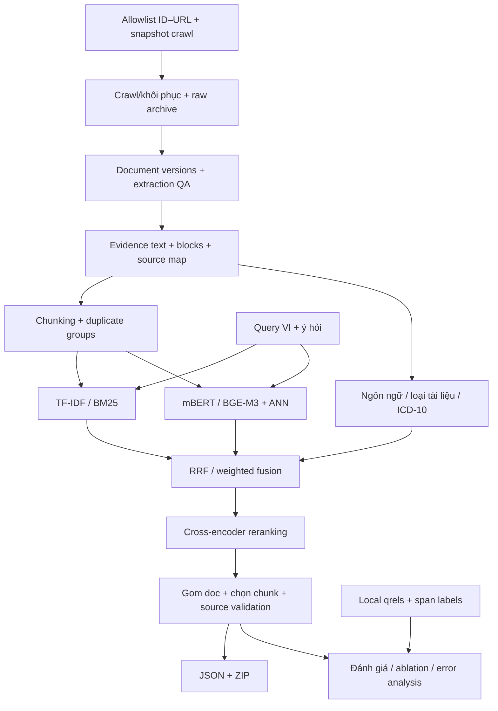

# ViBioMIR — Spec-driven development từ Mentor Day đến hệ thống truy hồi hoàn chỉnh

**Phiên bản:** 1.1 · **Ngày:** 24/10/2026 · **Trạng thái:** đặc tả để triển khai;
đã cập nhật mục tiêu corpus theo thông tin bổ sung của người dùng.

Đích triển khai: hệ thống truy hồi tài liệu và bằng chứng nguyên văn VI–EN–ZH,
đầu vào tiếng Việt, chạy bằng Colab Pro với tối đa 3 tài khoản/phiên được cấp tài
nguyên hợp lệ. Tài liệu này chưa xác nhận các module đề xuất đã được viết.

Nguồn yêu cầu chính: [261012_R2_AI_S3_MentorDay1_summary.md](../261012_R2_AI_S3_MentorDay1_summary.md).
SHA-256 của bản đã đối chiếu:
`8d4a732302dc05e94584aea1fb557a9b1d6a075804911cde0742baf872dbd097`.
Nguồn quy định cuộc thi: [tổng hợp bài toán](BAI_TOAN_VIBIOMIR.md).
Nguồn hiện trạng: [EDA](../reports/eda/REPORT.md),
[corpus summary](../reports/eda/corpus_summary.json),
[đối chiếu chính thức](../reports/eda/references_summary.json).

Các giá trị khởi tạo, ngưỡng QA, ngân sách và lịch trong spec là **quyết định
thiết kế đề xuất**, không phải quy định BTC hoặc benchmark đã đo.

**Thay đổi v1.1:** corpus mục tiêu dùng bản mới của
`links_corpus_vi_en_zh.parquet`: **1.194.469 URL = 714.469 VI + 240.000 ZH +
240.000 EN** theo cập nhật của người dùng. Snapshot/EDA hiện có thuộc bản cũ;
không dùng coverage cũ làm coverage của bản mới. Lần đối chiếu Hugging Face
vẫn thấy số liệu cũ; trạng thái xác minh và thủ tục chuyển bản ở mục 1.4–1.5.

## Cách dùng tài liệu

1. Đọc mục 1–3 để hiểu phần đã có, phần thiếu và phạm vi phải hoàn thành.
2. Dùng hợp đồng dữ liệu mục 4 trước khi viết crawler/chunker/retriever.
3. Triển khai theo các bước S01–S12 ở mục 10; mỗi bước phải vượt cửa nghiệm thu.
4. Đối chiếu yêu cầu R01–R28 với kiểm thử A01–A18 và ma trận Mentor Day ở mục 12.
5. Ghi mọi thay đổi vào decision log; thay đổi dữ liệu/model/chunker phải tạo
   phiên bản artifact mới và đánh giá lại những kết quả phụ thuộc.

## 1. Hiện trạng và khoảng cách cần lấp

### 1.1. Những gì đã có

| Thành phần | Bằng chứng trong workspace | Có thể tái sử dụng |
| --- | --- | --- |
| Đặc tả cuộc thi | `docs/BAI_TOAN_VIBIOMIR.md` | Quy định, công thức, schema submission |
| Snapshot chính thức cũ đang lưu | `Data/official/ViBioMIR/` | Query, ID–URL, README và provenance để đối chiếu chuyển bản; chưa phải allowlist mục tiêu mới |
| Snapshot crawl | `Data/ViBioMIR/shards/{A,B,C}/` | 1.195 Parquet, text, title, blocks và metadata crawl |
| Trạng thái crawl | `state_A/B/C.sqlite3` | Đối chiếu ID, HTTP status; chưa phải job scheduler mới |
| EDA | `exploration/`, `reports/eda/` | Đọc theo lô, thống kê, đối chiếu ID/URL, hash nội dung |
| Kiểm tra EDA | `tests/test_exploration.py` | Fixture cho chuẩn hóa, trùng, thiếu text, tên tệp, coverage |

Đặc biệt, `exploration.common.normalize()` đang phục vụ chuẩn hóa kiểu bộ chấm;
không dùng hàm này để ghi đè văn bản bằng chứng. `language_hint()` chỉ là heuristic.
Không coi `blocks` của crawler là chunk retrieval đã đạt yêu cầu.

### 1.2. Baseline lịch sử của snapshot cũ — cần đối chiếu lại

Các bảng sau là kết quả EDA đã có, đối chiếu với snapshot
`71be0e1239a19dfd7a717e2bc13e3bec21bd0334` gồm 1.220.598 ID. Chưa có số đo
coverage, số domain hoặc missing IDs cho corpus mục tiêu 1.194.469 URL.

| Chỉ số | Giá trị trên snapshot/EDA cũ |
| --- | ---: |
| Query chính thức / ID query khác nhau | 1.200 / 1.200 |
| ID–URL chính thức / tên miền sau chuẩn hóa EDA | 1.220.598 / 94 |
| Dòng crawl / ID khác nhau | 1.105.160 / 855.745 |
| ID có text HTTP 2xx không rỗng | 852.995 — 69,88% corpus chính thức cũ |
| ID chưa có shard | 364.853 |
| ID có nhiều nội dung sau chuẩn hóa | 28.480 |
| Dòng text rỗng / nghi trang chặn | 3.444 / 841 |
| ID ngoài corpus / ID chỉ có URL nguồn không khớp | 0 / 0 |

`HTTP 2xx + text không rỗng` mới là kiểm tra kỹ thuật, chưa xác nhận nội dung
bài viết đúng. EDA tính theo dòng và theo ID ở các bảng khác nhau; không dùng
1.105.160 dòng làm số tài liệu độc lập.

| Nguồn thiếu theo EDA cũ | ID chính thức cũ | Chưa có shard | ID có text 2xx không rỗng |
| --- | ---: | ---: | ---: |
| PubMed | 240.000 | 239.957 | 0 |
| `nhathuoclongchau.com.vn` | 79.598 | 79.598 | 0 |
| `ask.39.net` | 32.772 | 32.772 | 0 |
| `zysjonline.com` | 6.591 | 6.548 | 0 |
| `pmc-ecm-healthblog.beta.pharmacity.io` | 5.333 | 5.292 | 0 |
| `article.iiyi.com` | 729 | 686 | 0 |

Nguồn số liệu: [coverage theo domain](../reports/eda/official_coverage_by_domain.csv).
Sáu nguồn này chứa toàn bộ 364.853 ID chưa có shard **trong snapshot cũ**.
Đây là gợi ý ưu tiên điều tra, chưa phải hàng đợi crawl cho bản mới. Cần tính lại
giao ID–URL với allowlist mới, kể cả ID đã crawl nhưng text chưa dùng được.

### 1.3. Những thành phần chưa có

Chưa có pipeline tái thu thập trong repo, document store chuẩn hóa có phiên bản,
source offsets, chunker, ICD-10 tagger, tokenizer lexical, embedding, index,
retriever, fusion, reranker, bộ nhãn đánh giá, evaluator, notebook Colab, bộ
điều phối artifact hoặc validator/ZIP submission. Năm kiểm tra EDA hiện tại
không phải kiểm thử hệ thống truy hồi.

### 1.4. Giải quyết chênh lệch giữa tài liệu và dữ liệu thực tế

| Vấn đề | Quyết định |
| --- | --- |
| Mentor: 4.394.718 URL, 97 host; snapshot cũ: 1.220.598 ID, 94 domain; mục tiêu mới: 1.194.469 URL | Tách ba mốc. Allowlist triển khai phải lấy từ tệp mới đã xác minh; không tái sử dụng mặc định allowlist cũ, không ép tải 4,39 triệu URL. Số domain bản mới phải đếm lại. |
| Tên `links_corpus.parquet` và `links_corpus_vi_en_zh.parquet` | Dùng tên thực tế thứ hai; giữ hỗ trợ alias và yêu cầu đường dẫn khi có nhiều bản. |
| Split Hugging Face tên `train` | Đây là tên kỹ thuật của config; không có nhãn relevance, không suy ra tập huấn luyện có giám sát. |
| Query min–max công bố 5–283, EDA `str.split()` 5–281 | Giữ cả hai với định nghĩa phép đếm; tokenizer retrieval và tokenizer bộ chấm là hai cấu hình riêng. |
| Mẫu submission dùng ID chuỗi, mô tả dùng integer | Nội bộ dùng `int64`; mặc định export JSON integer. Adapter kiểu ID phải được xác nhận với validator chính thức trước nộp. |
| Chưa có tokenizer LCS/zero-case chính thức | Viết evaluator có profile; ghi kết quả local là proxy cho đến khi đối chiếu bộ chấm. |

**Cơ cấu mục tiêu theo bổ sung của người dùng:**

| Nhóm nguồn | Số URL mục tiêu | Nội dung cập nhật |
| --- | ---: | --- |
| Tiếng Việt | 714.469 | Giữ nguyên theo thông báo bổ sung |
| Tiếng Trung | 240.000 | Rút gọn theo thông báo bổ sung |
| Tiếng Anh | 240.000 | Bổ sung theo thông báo bổ sung |
| **Tổng** | **1.194.469** | Dùng làm quy mô mục tiêu khi xác minh snapshot mới |

**Kết quả đối chiếu web ngày 24/10/2026:**
[dataset card](https://huggingface.co/datasets/AIGuruTinix/ViBioMIR) và
[README raw](https://huggingface.co/datasets/AIGuruTinix/ViBioMIR/raw/main/README.md)
đang công bố 1.220.598 liên kết, gồm 740.598 VI, 240.000 EN, 240.000 ZH.
[Mục Files](https://huggingface.co/datasets/AIGuruTinix/ViBioMIR/tree/main)
hiển thị commit `71be0e1`, trùng tiền tố snapshot cũ đang lưu. Vì vậy chưa
xác minh được revision/checksum của tệp 1.194.469 URL từ lần truy cập này;
không ghi rằng đã tải hoặc kiểm đếm thành công bản mới.

Chênh lệch tổng là 26.129 URL, trùng chênh lệch số VI giữa hai bảng; chưa biết
ID/URL nào bị thêm, bỏ hoặc đổi. Các từ “giữ nguyên”, “rút gọn”, “bổ sung” mô tả
thông báo của người dùng, không chứng minh các tập EN/ZH giống snapshot cũ chỉ
vì cùng số lượng. Ưu tiên cập nhật của người dùng trong thiết kế mục tiêu; khi
chọn artifact phải có tệp/revision đối chiếu được, không tự cắt bớt 26.129 dòng
để tạo một corpus có tổng số phù hợp.

### 1.5. Chuyển snapshot bắt buộc trước full crawl/index

S01 phải thực hiện migration có báo cáo, thay vì thay mỗi con số trong config:

1. Giữ nguyên `Data/official/ViBioMIR/` và EDA cũ. Tải tệp mục tiêu vào thư mục
   riêng theo revision; lưu URL tải, commit đầy đủ, SHA-256, schema, row count,
   unique ID count, duplicate URL count và thời điểm tải. `main` chỉ dùng để
   tìm bản mới, không dùng làm revision tái lập cuối cùng.
2. Kiểm tra tổng 1.194.469 dòng, ID integer không null/không trùng và URL hợp lệ.
   Cơ cấu 714.469/240.000/240.000 là số nhóm nguồn cần đối chiếu với thông tin
   phát hành. Nếu schema vẫn chỉ có `id,url`, không tự coi heuristic LID là
   nhãn ngôn ngữ chính thức: lưu provenance của mapping nhóm nguồn và ghi phần
   chưa xác minh; ngôn ngữ nội dung thực tế được đo riêng sau extraction.
3. Sinh `snapshot_diff`: retained `(id,url)`, added IDs, removed IDs, same ID
   changed URL, same URL changed ID và các trường hợp mapping mơ hồ. Kiểm tra
   `query.parquet`/hash/tập 1.200 ID riêng, không suy đổi corpus là đổi query.
4. Chỉ tái dùng crawl cũ khi mapping nguồn được kiểm chứng. ID giữ nguyên nhưng
   URL đổi phải review/re-crawl; URL giữ nguyên nhưng ID đổi phải tạo mapping
   có provenance về ID mới. ID bị loại lưu trong archive, không đưa vào index
   thi hoặc submission mới. Không coi `canonical_url` giống nhau là đủ bằng
   chứng để tự hợp ID.
5. Chạy lại đối chiếu coverage trên allowlist mới: usable unique IDs, missing
   IDs, unusable IDs, ngoài allowlist, URL mismatch, domain và nhóm ngôn ngữ.
   `coverage_new = usable_verified_ids_in_new_allowlist / 1.194.469` sau khi
   đã xác nhận unique ID count. Không lấy 852.995 hoặc 364.853 làm tử số/số
   thiếu mới; không trừ cơ học 26.129 khỏi các số EDA cũ.
6. Tạo hàng đợi crawl mới và đo lại chunks/storage/CU. Tạo lại manifest,
   lexical global statistics, index ID map, candidate cache và evaluation run
   gắn snapshot mới. Chỉ tái dùng embeddings nếu text/model/tokenizer hashes
   vẫn khớp; kiểm tra lại qrels có ID bị loại/đổi, không sửa nhãn âm thầm.

Đầu ra: `snapshot_manifest`, `snapshot_diff`, `coverage_by_domain`,
`coverage_by_source_language`, `migration_validation`. Nếu tệp lấy được vẫn
là bản 1.220.598 hoặc chưa có revision đúng, đánh dấu `snapshot_unverified`;
vẫn phát triển code/pilot trên bản cũ có nhãn rõ, nhưng chưa freeze corpus,
chạy full crawl/index hay export bản thi theo mục tiêu mới. Lượt cập nhật spec
này chưa tải lại corpus hoặc chạy migration/EDA.

## 2. Mục tiêu, nguyên tắc và định nghĩa hoàn thành

### 2.1. Mục tiêu sản phẩm

- Trả tài liệu và đoạn gốc đúng ý hỏi, kể cả nguồn EN/ZH cho query VI.
- Xử lý câu hỏi nhiều ý; giữ phủ định, số, đơn vị, dấu tiếng Việt và quan hệ Q–A.
- Truy ngược mọi chunk tới đúng ID chính thức, phiên bản nội dung và nguồn.
- So sánh TF-IDF, BM25, mBERT, BGE-M3, hai cách hybrid và reranking bằng cùng
  corpus/query/chunks; phân tích theo ngôn ngữ, ICD-10, intent và chi phí.
- Khôi phục được công việc khi Colab ngắt; chạy tuần tự trên một tài khoản hoặc
  chia partition trên tối đa ba tài khoản mà không thay đổi kết quả logic.
- Sinh JSON đủ 1.200 query và ZIP đúng định dạng đã mô tả trong cuộc thi.

### 2.2. Nguyên tắc bắt buộc

1. Allowlist của snapshot mới đã xác minh là ranh giới submission; nguồn bổ trợ
   phải có provenance. Snapshot cũ chỉ dùng cho pilot có nhãn rõ và migration.
2. Lưu raw payload và evidence text bất biến. Chỉ text dùng tìm kiếm được biến đổi.
3. HTTP thành công, nhãn ICD, cosine cao đều không tự chứng minh relevance.
4. Mỗi thay đổi model/tokenizer/chunker/index phải có hash cấu hình và version.
5. Không dùng mô hình đóng trong pipeline; model công khai ≤15B, phát hành trước
   `2026-08-01T00:00:00+07:00`. Cố định revision weights/tokenizer đã phát hành
   trước mốc này; không chỉ dựa vào tuổi của tên model.
6. ICD-10 mặc định là tín hiệu mềm, cho phép đa nhãn/unknown; không loại ứng viên
   chỉ vì không cùng nhãn dự đoán.
7. Không tối ưu trên private phase hoặc dò đáp án bằng leaderboard. Các query
   chính thức không được dùng làm tập train/dev có nhãn tự tạo để báo điểm holdout.

### 2.3. Hai mức hoàn thành

**Mốc baseline dùng được:** một pipeline BGE-M3 + BM25 + RRF + reranker chạy từ
snapshot tới JSON/ZIP, có provenance, có kiểm thử và có đánh giá local có nhãn.

**Hoàn thành toàn bộ phạm vi Mentor:** tất cả R01–R28 và A01–A18 được nghiệm thu;
chạy đủ ma trận phương pháp/chunking/ICD trong mục 7; có báo cáo kết quả cả tốt
lẫn không cải thiện; có thử khôi phục Colab và bộ hồ sơ tái lập. Phương pháp
thua baseline vẫn được coi là đã khảo sát nếu thí nghiệm hợp lệ được lưu.

Không đặt một điểm F2 leaderboard chưa có căn cứ. Không hứa thu được 100% toàn
văn từ URL đã chết. Hoàn thành quản lý corpus nghĩa là 100% ID có trạng thái,
nguồn và lý do rõ ràng; tỷ lệ lấy được nội dung thực phải báo cáo riêng.

## 3. Danh mục yêu cầu có thể kiểm tra

`R` là yêu cầu; `S` là bước phát triển ở mục 10; `A` là kiểm thử/nghiệm thu ở mục 11.
Tất cả yêu cầu dưới đây thuộc phạm vi bắt buộc, trừ các biến thể tối ưu ghi rõ
optional bên trong thiết kế. Có GPU/TPU trong danh sách khả dụng không có nghĩa
phải tiêu compute để chạy toàn bộ mô hình trên mọi loại phần cứng.

| ID | Yêu cầu và đầu ra chính | Bước | Nghiệm thu |
| --- | --- | --- | --- |
| R01 | Xác minh corpus mục tiêu 1.194.469 URL; migration ID–URL, coverage mới, allowlist và hash phiên bản | S01 | A01 |
| R02 | Crawl có resume; adapter HTML/API/browser/sitemap discovery | S03 | A03 |
| R03 | Khôi phục PubMed bằng PMID và API, giữ ID chính thức | S03 | A04 |
| R04 | Trích xuất main content theo loại tài liệu, giữ heading/list/table/Q–A | S04 | A05 |
| R05 | Metadata đa ngôn ngữ thống nhất, ngày có precision, thiếu thì null | S04 | A05 |
| R06 | Chuẩn hóa an toàn về phủ định, dấu, số và đơn vị | S04 | A06 |
| R07 | LID có confidence; tokenization VI/EN/ZH riêng cho lexical | S04 | A06 |
| R08 | Ba chunker: độ dài, cấu trúc, ngữ nghĩa; sweep overlap | S05 | A07 |
| R09 | Giữ Q–A, đề mục và bảng trong giới hạn độ dài | S05 | A07 |
| R10 | Bằng chứng nguyên văn và source offsets kiểm chứng được | S04–S05 | A08 |
| R11 | Khử trùng có alias map; phân biệt version cùng ID và trùng khác ID | S04–S05 | A09 |
| R12 | Taxonomy 22 chương ICD-10 có phiên bản | S06 | A10 |
| R13 | Gán ICD bằng luật và model; đa nhãn, unknown, soft boost | S06 | A10 |
| R14 | TF-IDF cosine và BM25 với analyzer/tần suất toàn corpus | S07 | A11 |
| R15 | mBERT bi-encoder control, pooling/masking/token budget được công bố | S08 | A12 |
| R16 | BGE-M3 embedding và ANN có đối chiếu exact search | S08 | A12 |
| R17 | RRF và weighted fusion sau chuẩn hóa điểm | S09 | A13 |
| R18 | BGE-reranker-v2-m3 trên tập ứng viên có giới hạn | S09 | A13 |
| R19 | Nhận diện intent/ý hỏi, bảo toàn query gốc, phủ nhiều ý | S09 | A14 |
| R20 | Gom doc, loại overlap, chọn và xuất chunk gốc | S09–S11 | A08, A14 |
| R21 | Document/chunk P, R, F2 theo query rồi macro; LCS đúng định nghĩa | S02 | A02 |
| R22 | Bộ query/qrels/span local; tách train/dev/holdout, nhãn có audit | S02 | A02, A15 |
| R23 | Thí nghiệm có kiểm soát, group metrics, lỗi, thời gian/tài nguyên | S10 | A15 |
| R24 | Validator JSON/ZIP và đủ tập ID 1.200 query | S11 | A16 |
| R25 | Registry model/dataset có license, revision, tham số, ngày phát hành | S01 | A01 |
| R26 | Notebook Colab, partition, checkpoint, hợp artifact 1–3 worker | S01, S12 | A17 |
| R27 | Profiling RAM/VRAM/storage/compute units; fallback T4 và TPU pilot | S01, S08 | A18 |
| R28 | Run manifest, báo cáo, hướng dẫn tái lập và decision log | S10–S12 | A15, A17 |

## 4. Kiến trúc và hợp đồng dữ liệu

### 4.1. Luồng tổng thể



Code nghiệp vụ đặt trong package `vibiomir/` dự kiến; notebook chỉ điều phối
config, mount/copy dữ liệu, gọi module và hiển thị tiến độ. Không sao chép logic
retrieval vào nhiều notebook. Giữ `exploration/` để kiểm kê và audit.

### 4.2. Ba lớp văn bản

| Lớp | Nội dung | Được dùng làm `chunk_text`? |
| --- | --- | --- |
| `raw_payload` | HTML/XML/JSON nhận từ nguồn, hoặc bản legacy lưu được | Không xuất markup trực tiếp |
| `evidence_text` | Văn bản được extractor trích nguyên ý và giữ thứ tự; có source map; bất biến theo version | Có, bằng slice có kiểm chứng |
| `retrieval_text` | Văn bản phục vụ tìm kiếm: chuẩn hóa, tokenize, thêm title/heading/context khi cần | Không xuất nguyên chuỗi này nếu chứa prefix hoặc phần ghép thêm |

Giải mã entity, markup và line break là phép trích xuất xác định được, không phải
viết lại bài. `evidence_text` giữ dấu, chữ số, đơn vị và nội dung phủ định; tránh
áp dụng NFKC/lowercase vào bản này. Text chuẩn hóa theo bộ chấm được tạo khi chấm.

Với shard cũ thiếu HTML, lưu `source_fidelity=legacy_extracted` cùng đường dẫn
shard, row và checksum; có thể dùng text cũ nhưng không tuyên bố đã lưu raw HTML.
Kiểm tra lại nguồn đối với các mẫu nghi lỗi. Không tạo raw giả từ text cũ.

### 4.3. Schema logic bắt buộc

Lưu các bảng lớn bằng Parquet theo partition, UTF-8; JSON dùng cho manifest nhỏ.
ID trong bảng dùng `int64`; số offset tính bằng **Unicode code point Python**,
`[start, end)` trong đúng version `evidence_text`, không dùng byte offset UTF-8.

| Entity | Khóa | Trường tối thiểu |
| --- | --- | --- |
| `official_document` | `doc_id` | `official_url`, `dataset_revision`, `url_host` |
| `crawl_attempt` | `attempt_id` | `doc_id`, request/final URL, UTC timestamp, HTTP status, error class, method, retry count, payload URI/hash, content type |
| `document_version` | `(doc_id, version_id)` | payload/extractor hash, title gốc, abstract gốc nếu có, category, authors[], published/updated date và precision, language+confidence, doc_type+confidence, evidence URI/hash, source_fidelity, content_scope, QA flags |
| `document_selection` | `(snapshot_id, doc_id)` | `selected_version_id` hoặc null, availability, reason, duplicate_group_id |
| `block` | `(doc_id, version_id, block_id)` | kind, parent/heading path, start/end, source selector/XML path/legacy reference, table/Q–A group |
| `chunk` | `chunk_id` | doc/version, start/end, heading path, block IDs, chunker revision, evidence hash, retrieval-text hash, token counts theo tokenizer, ordinal |
| `annotation` | `annotation_id` | doc/query ID, label type ICD/intent/language/QA, labels[], confidence, method, rules/model revision, evidence spans, reviewer |
| `candidate` | `(run_id, query_id, chunk_id, branch, facet_id)` | rank, raw/normalized score, fused score, rerank score, duplicate group; query gốc dùng facet ID `original` |
| `run` | `run_id` | corpus/chunk/query/qrels hashes, model and code revisions, config hash, seed, environment, hardware, timings, peak memory, artifact hashes |

`version_id` phải phân biệt nội dung và extractor. `chunk_id` là hash ổn định của
doc ID, version, start/end và chunker config, không dựa vào thứ tự đọc file.
`published_date=null` nếu thiếu; ngày chỉ có năm lưu `date_precision=year`, không
bịa ngày 01/01. Không tự sinh title, abstract hoặc author để lấp chỗ trống.

`content_scope` gồm `full_article`, `abstract`, `metadata_only`, `partial`;
`availability` gồm `not_attempted`, `retryable`, `usable`, `quarantine`,
`unavailable`. HTTP status và availability là hai trường độc lập.

### 4.4. Invariant phải kiểm tra ở mọi bước

- Mọi `doc_id` của corpus thi và chunk export nằm trong allowlist chính thức.
- Mỗi doc có đúng một bản selection trong một snapshot; lịch sử version không mất.
- `chunk_text == evidence_text[start:end]` và hash trùng; source map truy ra payload
  hoặc legacy shard tương ứng. Offset nằm trong giới hạn và version đúng.
- Không nhầm ordinal vector với doc ID; `vector_id → chunk_id → doc_id` là mapping riêng.
- Nhãn ICD/language/method là metadata, không được chèn vào bằng chứng xuất nộp.
- Artifact không được hợp nếu khác model revision, dimension, pooling, tokenizer,
  normalization, chunk snapshot hoặc config ảnh hưởng nội dung.
- Lỗi validation tạo báo cáo và dừng publish snapshot/index/submission, không bỏ qua âm thầm.

## 5. Đặc tả xây dựng corpus

### 5.1. Kiểm kê, chọn version và lập hàng đợi

Import 1.195 shard cũ theo lô, giữ nguyên file nguồn; ánh xạ qua migration mục
1.5 trước khi đưa vào corpus mới. Dedupe retry cùng ID riêng với dedupe khác ID.
EDA cũ ghi 28.480 ID có text khác nhau; phải đếm lại phần thuộc allowlist mới.
Xếp version bằng: bài hợp lệ →
độ đầy đủ cấu trúc → cờ lỗi → thời điểm thu thập; không chọn chỉ theo text dài nhất
hoặc timestamp mới nhất. Khi thay version phải invalidation chunk/embedding cũ.

Sinh hàng đợi từ allowlist mới đã xác minh, gồm ID chưa crawl và ID đã có nhưng
QA kém; loại ID đã rút khỏi corpus khỏi hàng đợi thi.
Mọi ID chưa lấy được bài cần mã lý do: 404/410, timeout, blocked, no_abstract,
wrong_language_gate, parser_failed, truncated, missing_raw hoặc khác có mô tả.
Không dùng sitemap phát hiện URL ngoài allowlist để tự gán ID dương mới.

### 5.2. Thu thập theo từng nguồn

1. Lập `source_registry` cho các domain trong snapshot mới (94 là số bản cũ,
   không hard-code): adapter, URL pattern, loại bài, rate,
   timeout, retry, selector, license/terms URL nếu có, fixture và trạng thái QA.
2. Pilot ít nhất 20 URL/nguồn ưu tiên, gồm thành công, redirect, lỗi và bài dài;
   nguồn quá nhỏ dùng toàn bộ URL. Chỉ tăng quy mô khi extractor vượt A05.
3. HTML tĩnh là nhánh mặc định; API khi có cấu trúc rõ; browser dành cho trang
   thực sự cần JS; sitemap là adapter phát hiện/canonicalization có allowlist.
4. Rate mặc định đề xuất: tối đa 1 request/giây/domain, 2 request đang chạy/domain;
   giảm theo phản hồi nguồn. Backoff có jitter, tối đa 5 lần cho lỗi tạm thời,
   tôn trọng `Retry-After`; 404/410 không retry vô hạn. Ghi timeout và redirect chain.
5. Một domain chỉ có một worker phụ trách tại một thời điểm để tổng rate không
   tăng ba lần khi chạy ba tài khoản. Không lập vòng lặp đổi tài khoản/IP để vượt chặn.
6. Lưu payload nén theo batch 100–500 MB và index offsets; tránh hàng triệu file
   nhỏ trên Drive. Checkpoint sau mỗi batch đã kiểm tra checksum.

**PubMed:** trích PMID từ URL allowlist, dùng EFetch XML theo batch khởi tạo
100–200 PMID, giữ mapping từng record về `doc_id`. Đối chiếu PMID trả về để phát
hiện record thiếu/sai thứ tự. Lưu title, structured abstract, authors, dates,
MeSH nếu có; đánh dấu `abstract` hoặc `metadata_only` chính xác. Không coi EFetch
là toàn văn bài báo. Nếu bổ sung PMC/full text, cần mapping PMID–PMCID rõ ràng,
quyền truy cập và provenance riêng; không thay ID bằng PMID/PMCID.

Giới hạn NCBI tham khảo: 3 request/giây khi không có key, mặc định 10 khi có key;
pipeline dùng giới hạn tổng thấp hơn hoặc bằng mức được cấp, không nhân theo
tài khoản Colab. Khóa và email cấu hình qua secrets, không ghi vào notebook output.
[Nguồn NCBI](https://www.ncbi.nlm.nih.gov/books/NBK25497/),
[EFetch của NLM](https://www.nlm.nih.gov/dataguide/edirect/efetch.html).

Thứ tự ưu tiên sơ bộ từ EDA cũ: PubMed → Long Châu → `ask.39.net` → ba nguồn
còn lại → các ID đã có nhưng lỗi/thiếu text. Sau migration, xếp lại theo số ID
thiếu/QA kém thực trong allowlist mới; không crawl lại URL đã được loại chỉ để
đạt số thiếu lịch sử. Nguồn EN trên card hiện thấy là PubMed; xác minh domain
của 240.000 URL EN mục tiêu trước khi giao toàn bộ cho adapter PubMed. Các
nguồn CPU/network không được giữ GPU chỉ để chờ HTTP.

### 5.3. Trích xuất, metadata, làm sạch

- Adapter riêng cho Q–A, kiến thức bệnh, sách/cẩm nang, thuốc/dược liệu, tin tức,
  nghiên cứu/abstract. `unknown` là loại hợp lệ để chuyển sang generic extractor.
- Giữ heading hierarchy, paragraph, list, table rows/cells, caption và Q–A group.
  Xóa menu/quảng cáo/widget bằng vùng DOM, không xóa mọi đoạn ngắn một cách máy móc.
- Generic extractor và rule theo domain được đối chiếu trên fixture; nếu không
  xác định main content, quarantine thay vì coi toàn HTML là bài.
- Fixture bắt buộc có Vinmec language gate và bài Long Châu nhiều đề mục theo
  ví dụ Mentor. Kiểm tra sự khớp giữa title, URL và nội dung, không chỉ HTTP 200.
- Chuẩn hóa ngày có locale; giữ ngày gốc và precision; tác giả/ngày không rõ để null.
- Lưu log mọi block bị loại và lý do; không tự loại từ phủ định, đơn vị, số,
  dấu tiếng Việt, tên thuốc. Ký tự replacement hoặc mất bảng làm tăng cờ kiểm tra.

### 5.4. Ngôn ngữ và lexical analyzer

Xây LID thực sự có confidence, đối chiếu tối thiểu VI/EN/ZH/mixed/unknown; có thể
dùng model công khai nhỏ đã qua R25 hoặc rule+review cho giai đoạn đầu. Giữ nhãn
cấp document và ngoại lệ cấp block cho tài liệu mixed. Heuristic EDA chỉ dùng đối chiếu.

Lexical: VI word segmentation cộng từ điển y sinh; EN tokenization bảo toàn thuật
ngữ/số/đơn vị; ZH word segmentation cộng medical dictionary. Giữ phiên bản từ
điển và analyzer; query và tài liệu cùng ngôn ngữ dùng cùng analyzer. Không mặc
định bỏ stopword/phủ định hay stemming mạnh. Có thể thêm char n-gram làm ablation.
Dense dùng tokenizer của model, không đưa chuỗi có dấu gạch dưới từ segmenter
vào dense mặc định.

### 5.5. Trùng lặp và chunking

**Dedupe:** exact hash sau chuẩn hóa để phát hiện nhóm; MinHash/shingle là ứng
viên near-duplicate cần kiểm chứng. Không xóa dựa vào title tương tự hoặc embedding
gần giữa ba ngôn ngữ. Chỉ chia sẻ embedding khi `retrieval_text` thực sự giống
nhau, kể cả prefix. Lưu đầy đủ alias doc/version/span, không gán chunk nguyên văn
của ID này sang ID khác chỉ vì hash chuẩn hóa bằng nhau.

**Ba chunker bắt buộc:**

| Cấu hình | Thuật toán | Khởi tạo để thí nghiệm |
| --- | --- | --- |
| `fixed` | Cửa sổ token có boundary map về evidence text | target 384, max 512, overlap 64 token |
| `structure` | Theo heading/paragraph; ghép block ngắn trong cùng mục | target 384, hard max 512; overlap theo câu ở biên |
| `semantic` | Embedding câu và ngắt tại thay đổi chủ đề, trong cùng section | Cùng min/max budget; threshold chọn trên dev |

Semantic chunker khởi tạo min 128, target 384, max 512 token; tính cosine giữa
các câu kề nhau bằng encoder đã khóa, ưu tiên ngắt ở độ giảm tương đồng lớn.
Chọn threshold từ pilot/dev, ghi giá trị vào config; đoạn cuối hoặc section ngắn
được nhỏ hơn min, section quá dài vẫn phải tách theo hard max. Không ghép qua
section chỉ để đủ min. Fixed/structure không cần đạt min khi nguồn ngắn.

Số token mặc định tính bằng tokenizer BGE-M3 đã cố định. Các giá trị 256/384/512
và overlap 0/32/64 là grid nhỏ đề xuất, không áp dụng Cartesian product cho mọi
thí nghiệm. Không mặc định mỗi block trong 34,7 triệu block EDA là một chunk.

Q–A cùng chunk khi vừa budget. Nếu quá dài, tách answer theo câu, giữ question
trong context phục vụ embedding/rerank; chunk export chỉ chứa span gốc, không
ghép question ở vị trí khác vào `chunk_text`. Bảng chia theo row group; header
lặp cho input tìm kiếm được đánh dấu context-only. Heading prefix cũng theo quy tắc này.

Không ghép các câu không liền nhau thành một chunk bằng chứng. Khi cần nhiều
span rời nhau, xuất nhiều chunk. Mỗi phương pháp chunking phải tạo source offsets
đúng; nếu dùng tokenizer offset mapping, kiểm thử cả dấu tổ hợp và tiếng Trung.

### 5.6. QA và corpus freeze

Audit mẫu khởi tạo 600 tài liệu, tối thiểu 3/domain nếu nguồn có đủ tài liệu,
phủ ba ngôn ngữ và các doc_type. Tách mẫu ngẫu nhiên để đo tỷ lệ lỗi với mẫu
nghi vấn để tìm lỗi. Ít nhất 20% được người thứ hai kiểm tra hoặc adjudication
độc lập ở thời điểm khác; ghi năng lực ngôn ngữ và trường hợp chưa xác nhận.

Ngưỡng kỹ thuật đề xuất trước freeze: 100% ID được accounting; 0 orphan chunk;
0 lỗi nguồn/offset trong kiểm tra tự động; ≥98% mẫu ngẫu nhiên có đúng bài và
main content, 100% fixture bảo toàn phủ định/số/đơn vị. Báo số mẫu và khoảng tin
cậy, không diễn giải 600 mẫu là chứng minh toàn corpus sạch. Domain không đạt
phải sửa adapter hoặc quarantine có lý do. Tỷ lệ thu hồi text báo riêng theo
domain/ngôn ngữ/content_scope; không đặt quota ngôn ngữ dựa vào heuristic.

## 6. Đặc tả ICD-10 và hệ thống truy hồi

### 6.1. ICD-10: taxonomy, luật, model và ứng dụng

Tạo `taxonomy/icd10_chapters.json` chứa đủ 22 chương I–XXII và các dải mã trong
phụ lục Mentor; ghi rõ bản tham chiếu và đối chiếu WHO ICD-10 2019. Khi cách
phân chương khác giữa phiên bản/quốc gia, ghi mapping riêng, không trộn ICD-10-CM
với taxonomy đã chọn. Bản này dùng nhóm chủ đề, không dùng làm chẩn đoán.
[WHO ICD-10](https://icd.who.int/browse10/2019/en/).

Hai tagger phải có cùng output schema:

- `rules`: từ điển VI/EN/ZH, synonym và ngữ cảnh title/abstract/category/body;
  ghi cụm từ và span tạo ra nhãn. Phân biệt bệnh cụ thể với triệu chứng chung.
- `semantic`: dùng embedding BGE-M3 so với mô tả/chỉ dẫn chương và ví dụ đã
  kiểm tra; hiệu chỉnh threshold trên nhãn local. Không coi cosine là xác suất.
- `combined`: hợp bằng rule có độ tin cậy và semantic score; khi xung đột hoặc
  thiếu bằng chứng trả `unknown`, có thể giữ nhiều chương. Nhãn manual có nguồn riêng.

Ví dụ bắt buộc: ba cách viết đái tháo đường type 2 nối chương IV `E00–E90`;
“đau ngực” không được tự động thành bệnh mạch vành; tài liệu nhiều bệnh nhận
nhiều nhãn. Tạo tập audit tối thiểu 300 document có nhãn chương, tách phần hiệu
chỉnh và phần kiểm tra; báo precision/recall đa nhãn, coverage, unknown và lỗi
theo ngôn ngữ. Không gọi tập nhỏ này là nhãn toàn bộ corpus.

ICD được dùng cho EDA và slice metrics trước; soft boost chỉ bật nếu ablation
trên dev có lợi. Query và chunk/doc đều có nhãn có nguồn; unknown không bị phạt.
Không dùng hard filter trong cấu hình nộp mặc định.

### 6.2. Registry model và vai trò

| Model | Vai trò trong spec | Quy mô tham khảo | Lưu ý triển khai |
| --- | --- | --- | --- |
| `google-bert/bert-base-multilingual-cased` | Baseline dense đối chứng | khoảng 0,18B | Masked mean pooling; không coi raw CLS là embedding retrieval đã huấn luyện |
| `BAAI/bge-m3` | Dense chính; semantic chunker và ICD semantic dùng lại khi phù hợp | khoảng 0,57B | Vector 1.024 chiều; model hỗ trợ tối đa 8.192 token nhưng budget pipeline nhỏ hơn |
| `BAAI/bge-reranker-v2-m3` | Multilingual cross-encoder | khoảng 0,57B | Chấm cặp query–passage, không tạo vector để đưa vào ANN |

Quy mô là giá trị lập kế hoạch; registry phải đếm tham số thực tế của checkpoint
được tải và kiểm tra ≤15B. mBERT có nguồn công bố BERT 2018; BGE-M3 có công bố
2024; FlagEmbedding ghi release reranker mới ngày 18/03/2024. Đây là bằng chứng
tuổi dòng model, chưa thay thế việc xác minh revision weights trước cutoff.
[mBERT](https://huggingface.co/google-bert/bert-base-multilingual-cased),
[BGE-M3](https://huggingface.co/BAAI/bge-m3),
[reranker](https://huggingface.co/BAAI/bge-reranker-v2-m3),
[lịch sử phát hành FlagEmbedding](https://github.com/FlagOpen/FlagEmbedding).

Mọi model phụ trợ, kể cả LID, segmenter có học máy, ICD classifier và query
translator nếu bổ sung, đều phải qua registry. Baseline không cần thêm LLM
generative. Fine-tuning mBERT/BGE/reranker là nhánh cải tiến có điều kiện dữ liệu
và ngân sách, không phải yêu cầu bắt buộc từ việc slide liệt kê tên model.

### 6.3. Lexical: TF-IDF và BM25

TF-IDF là baseline riêng có cosine và L2 normalization. Định nghĩa khởi tạo:

```text
tf(t,d)  = 1 + ln(count(t,d)) khi count > 0, ngược lại 0
idf(t)   = ln((N + 1)/(df(t) + 1)) + 1
w(t,d)   = tf(t,d) × idf(t)
score    = cosine(w_query, w_chunk)
```

BM25 khởi tạo `k1=1.2`, `b=0.75`, query term frequency tính một lần cho mỗi term:

```text
f(t,d) = count(t,d)  # số lần xuất hiện thô, không dùng log-tf của TF-IDF
idf(t) = ln(1 + (N - df(t) + 0.5)/(df(t) + 0.5))
BM25(q,d) = Σ[t∈unique(q)] idf(t) ×
            f(t,d)×(k1+1) / (f(t,d)+k1×(1-b+b×|d|/avgdl))
```

Đây là công thức triển khai được spec bổ sung; slide chỉ nêu TF-IDF tổng quát
và tính chất BM25. `N`, `df`, `avgdl` phải tính trên cùng frozen chunk corpus.
Index vật lý có thể chia shard nhưng phải dùng thống kê toàn cục để điểm có
thể hợp. Nếu engine không bảo đảm điều này, một coordinator build global index.
Không cộng điểm từ các index ngôn ngữ có IDF khác nhau như cùng một thang điểm.

Ưu tiên inverted index lưu trên đĩa; không dùng object Python chứa toàn bộ
token của vài triệu chunk. Chọn engine hỗ trợ custom analyzer/scoring, pin
version sau pilot; kiểm thử vài tài liệu bằng công thức trên để xác nhận engine.

Baseline lexical chạy query VI gốc. Biến thể thuật ngữ đa ngôn ngữ chỉ mở rộng
bằng dictionary có provenance; giữ branch riêng và đánh giá riêng. Không tuyên
bố BM25 có cross-lingual matching nếu chưa có từ vựng tương ứng.

### 6.4. Dense encoding và vector index

- mBERT: masked mean của hidden states, loại padding/special tokens, L2 normalize;
  cùng pooling cho query/chunk, eval mode. Ghi rõ đây là control chưa fine-tune
  retrieval. Nếu fine-tune, chỉ dùng train split của local data hoặc dữ liệu mở
  có nguồn; cần hard negatives và kiểm tra false negative đa ngôn ngữ.
- BGE-M3: dùng dense output theo model card, L2 normalize; không tự thêm instruction
  từ model khác. Query giữ nguyên dấu; title/heading chỉ nằm trong retrieval view.
- Không truncate âm thầm query dài hoặc chunk vượt context của một model. Kiểm
  tra bằng tokenizer của từng encoder; dùng window có mapping và aggregation
  đã công bố nếu mBERT 512 token không chứa đủ. Common chunk corpus không đổi
  chỉ để làm model này có lợi hơn; thống kê số window/truncation bằng 0 phần bị mất.
- Lưu float16 vectors trên đĩa cùng mapping; thực hiện score/validation cần độ
  ổn định bằng float32. Precision/dtype là thành phần của manifest.

Lộ trình index:

1. Pilot exact `IndexFlatIP` hoặc matrix multiply theo batch, dùng cosine của vector đã chuẩn hóa.
2. Full: IVF-PQ CPU là lựa chọn khi RAM không đủ; exact blockwise scan là fallback
   đúng thuật toán nhưng chậm. Không giả định FAISS CPU Flat dùng RAM float16 chỉ
   vì file embeddings là float16.
3. Khởi tạo IVF-PQ: `nlist=4096`, `m=64`, `nbits=8`, `nprobe=32`; giảm nlist theo
   cỡ pilot và tăng nprobe theo kiểm tra. Train bằng sample có seed, phân tầng
   ngôn ngữ/domain, đủ số vector cho clustering; dùng tối đa khoảng 200k vector
   ở cấu hình đầu rồi đo RAM. Không train index bằng vector lấy từ query test.
4. So ANN với exact trên cùng vector corpus/query kỹ thuật. Mục tiêu kỹ thuật
   `ANN recall@200 ≥ 0,95`; đây là độ khôi phục hàng xóm exact, không phải relevance Recall.
   Nếu không đạt, tăng nprobe, đổi index hoặc fallback và ghi chi phí.

Tham khảo [hướng dẫn chọn FAISS index](https://github.com/facebookresearch/faiss/wiki/Guidelines-to-choose-an-index)
và [kích thước các index](https://github.com/facebookresearch/faiss/wiki/Faiss-indexes).

### 6.5. Query nhiều ý, hybrid và reranking

Query processor giữ `original_query`, các facet có offsets và intent; các nhóm
khởi tạo gồm định nghĩa, triệu chứng, chẩn đoán, điều trị, thuốc/liều, dự phòng,
tiên lượng và multi-intent. Tách theo mệnh đề/cấu trúc hỏi có kiểm tra phủ định,
đối tượng, tuổi, thời gian. Không sinh một bệnh mới hoặc bỏ điều kiện lâm sàng.
Query đầy đủ luôn có một retrieval branch; facet là các branch bổ sung.

Config khởi tạo để đo, không phải tham số đã tối ưu:

```yaml
retrieval:
  lexical_top_k: 500
  dense_top_k: 500
  max_facet_branches: 3       # ngoài query gốc; phần không tách vẫn nằm ở query gốc
  fused_top_k: 1000
  rerank_top_k: 200
  rrf_k: 60
selection:
  max_docs: 20
  max_chunks: 40
  max_chunks_per_doc: 4
  overlap_iou_threshold: 0.8
```

RRF trên identity chunk, rank bắt đầu từ 1:

```text
RRF(c) = Σ_b weight_b / (k + rank_b(c))
```

Chunk vắng ở branch đóng góp 0. Giới hạn tổng trọng số mỗi họ retriever để ba
facet lexical không lấn át một dense branch chỉ vì số branch nhiều hơn.
Ties sắp xếp bằng stable chunk ID. Giữ nguồn score/rank để debug.

Weighted fusion là biến thể riêng: `α × s_lex_norm + (1−α) × s_dense_norm`,
normalization min–max trong candidate list mỗi query/branch, constant list trả
0; missing score bằng 0. Thử `α ∈ {0.25, 0.5, 0.75}` trên dev, ghi rõ hạn chế
phụ thuộc candidate pool. Không cộng trực tiếp BM25 với cosine.

Reranker nhận query gốc/facet và passage retrieval view có nguồn, chỉ xử lý top
ứng viên đã giới hạn. Pair token budget khởi tạo 1.024; bucket theo độ dài, không
truncate mất ý âm thầm. Query quá dài được chấm theo facet có mapping và giữ kết
quả chấm query đầy đủ khi model budget cho phép. Raw logit/sigmoid không được
gọi là xác suất relevance đã hiệu chỉnh. Cache theo model+query+passage hash.

Đo candidate coverage trước và sau rerank riêng. Trường hợp đúng triệu chứng EN/ZH
nhưng candidate VI chỉ nói chẩn đoán phải có trong test fixture. Nếu không đưa
được bằng chứng vào candidate pool, xử lý retrieval trước, không chỉ tăng reranker.

### 6.6. Chọn tài liệu, bằng chứng và xuất kết quả

Gom chunk theo doc; baseline doc score là max chunk score. Thử top-3 aggregation
như ablation để giảm thiên lệch tài liệu nhiều đoạn, không cộng mọi chunk vô hạn.
Chọn doc trước, rồi chọn chunk trong các doc đó; tối ưu `max_docs`, `max_chunks`,
ngưỡng và phủ facet bằng dev F2 ở cả hai cấp.

Loại exact duplicate và overlap lớn trong **cùng doc/version**. Chỉ gộp hai đoạn
khi span hợp là một slice liên tục của evidence text, vẫn đủ budget và không
xuyên qua vùng ngoài bài; nếu không, giữ hai chunk. Không để dedupe semantic
loại một chunk khác ý hỏi. Cross-doc duplicate group chỉ giúp chia sẻ tính toán;
mọi alias chính thức vẫn có thể được trả với span thật của chính doc đó.

Mỗi output trace ghi selected/rejected reason, matched facets, source offsets,
score theo bước. Export từ evidence store, không lấy text đã tokenize, title
prefix nhân tạo hoặc đoạn do model viết lại. Project invariant mạnh hơn schema
cuộc thi: doc của mỗi chunk phải có trong `relevant_docs`; hai danh sách đều có
thể rỗng, nhưng exporter không tự bỏ cả query.

## 7. Đánh giá và ma trận thí nghiệm

### 7.1. Tạo tập local có nhãn trước khi tuning

Chưa có qrels chính thức trong workspace. Tạo `local_eval_v1` độc lập với 1.200
query thi: pilot 30 query, mục tiêu ban đầu 180 query do người soạn từ các nguồn
đã xác minh; 60 train, 60 dev, 60 holdout. Chia theo nhóm ý hỏi/case/biến thể
dịch để tránh cùng một câu hoặc case lọt sang nhiều split. Đây là quy mô đề xuất,
cần đo công annotation trên pilot; không giả định ba tài khoản là ba annotator.

Mỗi split hướng tới ≥20 query có bằng chứng chính ở mỗi ngôn ngữ VI/EN/ZH,
có câu hỏi nhiều ý và các intent chính. Một query có thể có bằng chứng nhiều
ngôn ngữ. Ngôn ngữ tài liệu phải được review, không dùng 422 dòng Latin của EDA
như nhãn tiếng Anh. Nhóm bệnh hiếm chỉ báo khi có đủ support; không ép phủ đều 22 chương.

Pool ứng viên từ nhiều retriever và tìm kiếm thủ công; khởi tạo tối đa 40 doc/query
để kiểm soát công sức, mở rộng khi phát hiện bằng chứng còn thiếu. Annotator
đánh giá doc relevance và đánh dấu span bằng chứng trong evidence text, với đúng
doc/version. Ghi `judged=true/false`; không biến mọi doc ngoài pool thành nhãn âm
thật. Recall trên pooled qrels phải ghi là local/pool-relative, báo judged@k.
Mọi kết quả mới lọt top-k của holdout mà chưa được xét cần adjudication độc lập
trước so sánh cuối; không dùng nhãn holdout để chỉnh tham số.

Tối thiểu 20% nhãn được kiểm tra lại; tranh chấp relevance/biên chunk phải có
decision record. Không dùng bản dịch hoặc câu trả lời của mô hình đóng để gán
nhãn. Các câu hỏi chính thức chỉ dùng chạy inference/submission sau khi đóng cấu hình.

Schema nhãn:

```text
queries: query_id, query_text, split, case_group, intent[], facet_spans[], origin
doc_qrels: query_id, doc_id, relevant, judged, annotator, adjudication
chunk_qrels: query_id, doc_id, version_id, start, end, text_hash, annotator
```

Gold chunk là span bằng chứng do người gán, độc lập với ranh giới chunker của
hệ thống. Đổi chunking không được đổi gold để làm điểm tăng.

### 7.2. Evaluator

Tính document Precision/Recall trên tập ID; tính chunk đúng theo cùng query,
cùng doc và `LCS_tokens(c,g)/len(g) ≥ 0.40`. Chuẩn hóa chính xác theo thứ tự
NFKC → HTML entity decode → lowercase → collapse whitespace/strip.

Mỗi predicted chunk khớp ít nhất một gold được đếm đúng một lần; mỗi gold được
phủ bởi ít nhất một prediction được đếm tìm thấy một lần. Không áp đặt matching
một-một. LCS là subsequence giữ thứ tự, không phải substring hay bag intersection.

`F2_q = 5P_qR_q/(4P_q+R_q)`; macro là trung bình **từng F2_q** và tính riêng
P/R/F2 của document và chunk. Không suy macro F2 từ macro P/R.

`scorer_profile` bắt buộc ghi:

- Tokenizer LCS: `official` khi có; trước đó `whitespace_proxy_v1` và một profile
  tách CJK để phân tích độ nhạy, không gọi profile nào là bộ chấm chính thức.
- Local zero-case: Precision=0 nếu không có prediction; Recall=0 nếu gold rỗng;
  F2=0 khi mẫu số bằng 0. Đây là quy ước local chờ BTC xác nhận.
- Gold text rỗng bị reject là lỗi annotation; query không có gold được báo riêng.
- Duplicate predictions được giữ đúng semantics profile khi chấm; pipeline
  output tự loại lặp. Không tăng gold Recall chỉ vì lặp prediction.

Tối ưu LCS chỉ sau khi có reference implementation và golden tests: lọc doc ID
trước, cache tokenized gold, dùng cận độ dài để bỏ cặp chắc chắn không đạt; mọi
implementation nhanh phải cho kết quả chính xác như DP tham chiếu.

### 7.3. Thí nghiệm bắt buộc

Freeze `benchmark_v1`: corpus có văn bản đã QA, query splits, qrels và chunk
snapshot. Có thể dùng benchmark pilot nhỏ để debug; báo cáo lựa chọn cuối phải
nêu rõ corpus thực tế. Các phương pháp được so trực tiếp phải chạy cùng snapshot,
không so BM25 trên corpus thiếu PubMed với dense trên corpus đã bổ sung.

| Run | Thay đổi so với điều kiện chuẩn | Mục đích |
| --- | --- | --- |
| E01 | TF-IDF cosine | Mốc lexical đơn giản |
| E02 | BM25 | Đo lợi ích length normalization/saturation |
| E03 | mBERT masked mean pooling | Dense control; công bố chưa retrieval-tuned |
| E04 | BGE-M3 dense | Cross-lingual retrieval được huấn luyện sẵn |
| E05 | BM25 + BGE-M3, RRF | Hợp ứng viên bằng thứ hạng |
| E06 | BM25 + BGE-M3, weighted normalized scores | So với RRF |
| E07 | Hybrid thắng trên dev + BGE-reranker-v2-m3 | Đo reranking sau cùng candidate budget |
| E08 | Fixed / structure / semantic chunks | Cùng corpus/query/gold; thay riêng chunker và rebuild index |
| E09 | ICD off / rules / semantic / combined soft boost | Đo lợi ích và lỗi nhãn chủ đề |
| E10 | Query gốc / thêm facet, postprocess off/on | Đúng ý hỏi và chống chunk lặp |
| E11 | Sweep nhỏ chunk size, overlap, top-k, output caps | Tối ưu Recall/F2 và chi phí |
| E12 | Exact / ANN, checkpoint restart, 1/2/3 worker | Độ chính xác kỹ thuật và khả năng vận hành |

E01–E07 dùng cùng chunker chuẩn và output policy. E08–E11 đổi một họ tham số
mỗi lần rồi chọn bằng dev; holdout chỉ dùng sau khi khóa config. Không bắt buộc
chạy tất cả tổ hợp của mọi grid. E03 fine-tuning là `E03-ft` optional khi có đủ
pairs train, có provenance và không ảnh hưởng tiến độ baseline chính.

Báo cáo mỗi run: document/chunk macro P/R/F2, candidate gold coverage, judged@k,
số chunk/query, top-k, p50/p95 latency, encode/index wall time, peak RAM/VRAM,
disk, GPU-hours, compute units quan sát được; warm/cold latency đo riêng. Phân
nhóm theo ngôn ngữ gold, ICD, intent, độ dài/multi-intent và domain; nhóm thiếu
nhãn ngôn ngữ/ICD ghi unknown, luôn có support count.

Chọn cấu hình theo Pareto của hai F2 và chi phí; không tự đặt công thức gộp hai
cấp làm “điểm chính thức”. Bootstrap theo query (seed cố định, ví dụ 1.000 lần)
để báo bất định. Thành phần phức tạp hơn được giữ khi cải thiện có căn cứ, hoặc
có trade-off Recall/chi phí được ghi bằng decision record; không bắt ép reranker
phải thắng để hoàn thành thí nghiệm.

Error analysis phải phân biệt: chưa crawl → sai extraction → chunk mất ngữ cảnh
→ lexical/tokenization → dense sai ý → candidate thiếu → reranker sai → selection
loại mất → mapping/export sai. Mỗi nhóm lỗi có ví dụ VI/EN/ZH và hành động sửa.

### 7.4. Submission và release

Validator đối chiếu **tập ID query thật**, không chỉ đếm 1.200 phần tử. Reject
ID query trùng/thiếu/thừa, bool giả integer, doc ID ngoài allowlist, chunk rỗng,
source slice sai, chunk_order âm/noninteger và schema sai. Default ID tài liệu
JSON integer; việc đổi sang chuỗi số phải qua adapter đã được xác nhận, không
tạo ID dạng `doc_id1` hoặc dùng PMID làm ID thi.

ZIP chỉ một JSON UTF-8 ở root, không thư mục con/file phụ. Sinh release manifest
ngoài ZIP: hash JSON/ZIP, corpus/model/config revisions, số query/doc/chunk,
validation result và giới hạn scorer local. Người dùng nộp lên dashboard; không
tự động nộp liên tiếp để tối ưu tham số. Thiếu validator chính thức là việc cần
xác nhận trước lần nộp thật, không phải lý do ngừng viết validator local.

## 8. Thiết kế vận hành trên Colab Pro, tối đa 3 tài khoản

### 8.1. Ràng buộc và vai trò phần cứng

Colab cấp tài nguyên theo tình trạng khả dụng; gói Pro không bảo đảm luôn có
một GPU cụ thể, dung lượng RAM cố định hoặc phiên chạy đủ lâu. Thiết kế dùng
các job ngắn có checkpoint, không phụ thuộc vào phiên liên tục 24 giờ.
Tối đa ba tài khoản chỉ chạy các phiên được cấp hợp lệ, không xoay tài khoản
để vượt giới hạn truy cập/tài nguyên; đây là ràng buộc trong
[Colab FAQ](https://research.google.com/colaboratory/faq.html).

| Accelerator người dùng có thể chọn | Thông số tham chiếu, phải kiểm tra trong runtime | Vai trò đề xuất |
| --- | --- | --- |
| T4 | GPU thường có 16 GB; dùng FP16 | Baseline đầy đủ bằng batch nhỏ; encode, rerank |
| L4 | GPU thường có 24 GB; kiểm tra BF16/FP16 | Encode/rerank thường xuyên |
| A100 | Có biến thể 40/80 GB; đọc dung lượng thực | Encode khối lượng lớn, benchmark batch lớn |
| G4 | Dòng G4 trên Google Cloud dùng RTX PRO 6000 Blackwell; có cấu hình chia GPU | Chỉ chọn batch sau preflight; kiểm tra CUDA/PyTorch hỗ trợ thiết bị |
| v6e-1 TPU | v6e có 32 GiB HBM/chip | Nhánh thử nghiệm encoding qua PyTorch/XLA |
| v5e-1 TPU | v5e có 16 GiB HBM/chip | Nhánh thử nghiệm encoding qua PyTorch/XLA, batch nhỏ hơn |

Thông số Google Cloud là tham chiếu, không cam kết cấu hình Colab nhận được:
[GPU](https://docs.cloud.google.com/compute/docs/gpus),
[TPU v6e](https://docs.cloud.google.com/tpu/docs/v6e),
[TPU v5e](https://docs.cloud.google.com/tpu/docs/v5e).
Không đồng nhất tên G4 với T4 hoặc mặc định runtime G4 có đủ 96 GB VRAM.

Mỗi phiên chạy `preflight` và lưu: accelerator name/count/memory, CPU, RAM,
disk trống, Python/package lock, CUDA hoặc XLA, model revision, dtype, kết quả
forward nhỏ và đường dẫn persistent storage. T4 là cấu hình GPU tối thiểu
để nghiệm thu pipeline; index lớn được tìm kiếm trên CPU/đĩa khi VRAM thiếu.

Batch khởi tạo để **đo**, không phải cấu hình đã benchmark:

| Runtime | Embedding, passage tối đa 512 tokens | Reranker, pair tối đa 1.024 tokens |
| --- | ---: | ---: |
| T4 FP16 | 8 | 2 |
| L4 FP16 hoặc BF16 đã kiểm tra | 16 | 4 |
| A100 BF16 | 32 | 8 |
| G4 dtype đã kiểm tra | 32 | 8 |

Bucket theo độ dài; autotune tăng dần trong ngân sách VRAM, mục tiêu dùng tối đa
80% bộ nhớ khả dụng. OOM giảm batch một nửa, retry cùng job, không bỏ chunk.
Batch 1 vẫn lỗi thì ghi lỗi có thể tái hiện và dùng policy chia cửa sổ đã khai
báo; không tự cắt text rồi đánh dấu thành công. GPU không tương thích kernel
tối ưu thì thử kernel PyTorch chuẩn hoặc GPU khác đã có profile đạt kiểm tra.

### 8.2. Chia việc giữa 1–3 phiên

| Giai đoạn | Phiên 1 | Phiên 2 nếu có | Phiên 3 nếu có |
| --- | --- | --- | --- |
| Thu thập | Nguồn EN đã xác minh, PubMed nếu có + điều phối rate limit | Nguồn VI còn thiếu sau migration, ưu tiên Long Châu nếu còn trong allowlist | Nguồn ZH/nguồn còn lại theo hàng đợi mới |
| Chuẩn hóa/chunk | Partition CPU được giao | Partition CPU được giao | Partition CPU được giao |
| Embedding | Partition GPU được giao | Partition GPU được giao | Partition GPU được giao |
| Index | Một tiến trình xây/merge index | Encode job còn lại hoặc tắt phiên | Encode job còn lại hoặc tắt phiên |
| Retrieval/rerank | Query batch được giao | Query batch được giao | Query batch được giao |
| Tổng hợp | Merge, evaluate, validate, export | Tắt khi hết việc | Tắt khi hết việc |

Không giữ GPU chỉ để chờ crawl. Không coi ba phiên là một GPU có tổng VRAM,
không dùng DDP/NCCL liên Colab. Một phiên phải xử lý được toàn bộ danh sách job
tuần tự. Phân chia theo công việc/chi phí ước lượng, tránh chia toàn bộ một
ngôn ngữ cho một GPU rồi so sánh chất lượng giữa các snapshot khác nhau.

Giao thức điều phối:

1. Một coordinator tạo manifest bất biến, ví dụ 64 partition bằng
   `official_doc_id % 64`; mọi phiên đọc cùng snapshot/config/model hashes.
2. Mỗi job có `job_id`, input checksums, expected record IDs, stage, owner,
   attempt number và output prefix. Coordinator giao từng job cho một owner;
   chỉ coordinator được đổi owner sau khi xác nhận attempt trước đã dừng.
3. Worker ghi ở `/content/work/...`, sau đó copy artifact hoàn chỉnh và manifest
   checksum sang persistent storage dưới `job_id/attempt_id/` riêng.
4. Ghi marker `DONE` sau khi upload và kiểm tra checksum/count. Coordinator
   chỉ nhận artifact đầy đủ; không giả định rename trên Drive mount là atomic.
5. Khi resume, bỏ qua job có output đã được kiểm chứng; chạy lại job thiếu/hỏng.
   Nếu có hai attempt hợp lệ, chọn theo manifest coordinator, không gộp đôi.
6. Merge kiểm tra tập ID, số dòng và hashes; lỗi khác config phải dừng. Index
   ID map được xây từ thứ tự chunk ID ổn định, không từ thứ tự worker hoàn tất.

Không cho nhiều phiên cùng ghi một SQLite/Parquet trên Google Drive. SQLite
cục bộ thuộc một writer; trao đổi giữa phiên bằng shard + manifest. Rate limit
theo domain/API key là giới hạn toàn nhóm, không nhân ba theo số tài khoản.

Nếu chỉ có một phiên khả dụng, kiểm tra tính đúng của 2/3 worker bằng các worker
logic trên cùng máy với job manifests riêng. Báo rõ đó là kiểm tra điều phối,
không phải benchmark ba Colab đồng thời; chỉ công bố speedup liên phiên khi đã
đo trên số phiên vật lý tương ứng.

### 8.3. Lưu trữ và dự toán trước full run

`/content` chỉ là working storage có thể mất. Dùng Google Drive hoặc persistent
storage sẵn có của người dùng cho input snapshot, output và checkpoint. Dung
lượng Drive phải được kiểm tra riêng; không giả định Colab Pro cung cấp sẵn
dung lượng lưu toàn bộ artifact. Copy archive/shard về máy chạy để xử lý, hạn
chế thao tác hàng triệu file nhỏ qua mount.

Với BGE-M3 1.024 chiều, riêng ma trận vector có dung lượng lý thuyết:

| Số chunk giả định | FP16 trên đĩa | FP32 cho Flat index |
| --- | ---: | ---: |
| 2 triệu | 3,81 GiB | 7,63 GiB |
| 4 triệu | 7,63 GiB | 15,26 GiB |
| 8 triệu | 15,26 GiB | 30,52 GiB |

Đây là các kịch bản, **chưa phải số chunk của corpus hiện tại**. Công thức là
`N × dimensions × bytes_per_value / 2^30`; FP16 embeddings và FP32 index có thể
cùng tồn tại. mBERT có thêm ma trận 768 chiều riêng. IVF-PQ `m=64, nbits=8`
dùng khoảng 64 byte mã + 8 byte ID/vector, chưa gồm centroid, cấu trúc index,
training buffers và text store. Xem [FAISS index sizes](https://github.com/facebookresearch/faiss/wiki/Faiss-indexes).

Trước full run phải dự toán cả raw payload, document/chunk text, metadata,
lexical postings, embeddings, indices, bản staging và checkpoint. Disk trống
phải vượt nhu cầu peak đã ước lượng ít nhất 30%. Nếu thiếu: chia shard, encode
streaming, dùng index nén hoặc giảm số experiment đồng thời; không tự loại
nguồn/ngôn ngữ để vừa RAM. Lưu ít nhất release đã chọn và manifest của các run
so sánh; chính sách archive/xóa artifact trung gian phải được khai báo.

Pilot gồm 10.000 chunks phân tầng domain/ngôn ngữ/độ dài và 2.000 query–passage
pairs. Đo warmup riêng, tốc độ ổn định, peak RAM/VRAM, thời gian IO/upload và
compute units trước/sau theo giao diện Colab nếu không có API đo tự động.

```text
embedding_seconds ≈ total_chunks / sum(measured_chunks_per_second_per_worker)
                    + measured_IO_and_coordination_overhead
reranking_pairs   = sum(actual_pairs_scored_for_each_query)
reranking_seconds ≈ reranking_pairs / measured_pairs_per_second
```

Với một lần chấm query gốc cho mỗi candidate, 1.200 × 200 = 240.000 pairs.
Nếu chấm thêm facet, phải cộng số pairs đó vào ngân sách, không giữ nguyên
ước lượng 240.000. Log cả GPU-hours và compute units; không quy đổi bằng một
hệ số CU/giờ tự giả định. Full run chỉ mở sau khi có ngân sách CU do người
triển khai cấu hình và dự toán pilot nằm trong ngân sách còn lại.

Gợi ý phân bổ ngân sách thực nghiệm: pilot 5%, embeddings 50%, reranking 20%,
ablation khác 15%, dự phòng 10%. Điều chỉnh theo số đo; giới hạn này bao gồm
mọi retry và chi phí các runtime được sử dụng, không chỉ lần chạy thành công.

### 8.4. Nhánh TPU có điều kiện

Tạo environment lock riêng với [PyTorch/XLA](https://github.com/pytorch/xla);
không coi FlagEmbedding/FAISS CUDA là có thể chuyển thẳng sang TPU. Bước thử:

1. Kiểm tra model forward/pooling/tokenization tương đương GPU FP32 reference.
2. Chạy BF16, bucket chiều dài và batch shape ổn định; đo thời gian compile.
3. Trên cùng pilot, so vector cosine và top-k với GPU; đo throughput gồm cả
   compile, upload, tải weights và retry. Sai lệch phải có báo cáo; ngưỡng khởi
   tạo median cosine ≥0,999 và top-20 agreement ≥0,98 trên sample không tie.
4. Chỉ dùng TPU cho full encoding khi chất lượng đạt và chi phí tổng có lợi;
   output vẫn cùng schema NumPy/Parquet để xây FAISS trên CPU/GPU.

Nếu không có phiên TPU hoặc stack không tương thích, ghi kết quả capability
probe, dùng GPU baseline. Chạy đầy đủ hệ thống trên TPU **không phải yêu cầu
Mentor Day** và không chặn nghiệm thu khi GPU fallback đạt A18.

## 9. Cấu trúc code, configuration và notebook cần xây

Đây là **layout đề xuất**, các module/lệnh dưới đây chưa tồn tại. Giữ nguyên
`exploration/` phục vụ EDA và dùng package mới cho pipeline truy hồi.

```text
configs/
  data.yaml                    # snapshot, paths, allowed domains/IDs
  models.yaml                  # revisions, licenses, parameter counts, dates
  pipeline.yaml                # selection, chunking, ICD, retrieval
  runtime.yaml                 # worker, device, CU/disk limits, resume
  experiments/                 # E01–E12, chỉ thay tham số được phép
src/vibiomir/
  contracts.py                 # schema + invariant validation
  cli.py
  data/{manifest,ingest,extract,quality,versions,dedup}.py
  text/{language,analyzers,chunking,icd}.py
  retrieval/{lexical,dense,index,fusion,rerank,select}.py
  evaluation/{qrels,normalize,lcs,metrics,experiments}.py
  runtime/{preflight,jobs,checkpoints,budget}.py
  submission/{validate,export}.py
notebooks/
  00_preflight.ipynb
  01_ingest.ipynb
  02_prepare.ipynb
  03_chunks_icd.ipynb
  04_lexical.ipynb
  05_dense.ipynb
  06_retrieve_rerank.ipynb
  07_evaluate.ipynb
  08_export.ipynb
  09_resume_audit.ipynb
tests/{unit,integration,fixtures}/
docs/decisions/                 # ADR: quyết định, lý do, tác động, validation
artifacts/<snapshot>/<run>/     # chỉ manifest/config nhỏ đưa vào version control
reports/retrieval/<run>/
pyproject.toml
requirements/{cpu,gpu,tpu}.lock
```

Notebook chỉ gọi package/CLI, không sao chép logic mô hình hoặc scorer vào từng
notebook. Cell đầu tiên kiểm tra commit package, mount/input/output, worker ID,
config và ngân sách. Bí mật/API keys qua secret storage, không lưu notebook
output hoặc config được commit. Log chỉ metadata cần thiết; dữ liệu nguồn có
chính sách chia sẻ riêng theo license.

Ví dụ configuration khởi tạo; các giá trị `null` cần được S01 giải quyết trước
full run, không dùng để tự chọn revision mới nhất:

```yaml
snapshot:
  repository: AIGuruTinix/ViBioMIR
  corpus_file: links_corpus_vi_en_zh.parquet
  official_revision: null       # điền commit đã xác minh của bản mục tiêu mới
  corpus_sha256: null
  verification_status: pending
  expected_corpus_rows: 1194469
  expected_source_language_counts: {vi: 714469, zh: 240000, en: 240000}
  legacy_revision: 71be0e1239a19dfd7a717e2bc13e3bec21bd0334
  corpus_manifest: null
models:
  embedding: BAAI/bge-m3
  embedding_revision: null
  reranker: BAAI/bge-reranker-v2-m3
  reranker_revision: null
chunking:
  strategy: structure
  target_tokens: 384
  max_tokens: 512
  overlap_tokens: 64
retrieval:
  lexical_top_k: 500
  dense_top_k: 500
  max_facet_branches: 3
  fusion: rrf
  rrf_k: 60
  fused_top_k: 1000
  rerank_top_k: 200
selection:
  max_docs: 20
  max_chunks: 40
  max_chunks_per_doc: 4
  overlap_iou_threshold: 0.8
runtime:
  workers: 1
  partitions: 64
  resume: true
  compute_units_budget: null
  persistent_root: null
```

CLI dự kiến:

```bash
python -m vibiomir preflight --config configs/runtime.yaml
python -m vibiomir manifest --config configs/data.yaml
python -m vibiomir ingest --jobs artifacts/jobs.jsonl --worker-id 0
python -m vibiomir prepare --config configs/pipeline.yaml
python -m vibiomir chunk --config configs/pipeline.yaml
python -m vibiomir annotate-icd --config configs/pipeline.yaml
python -m vibiomir build-lexical --config configs/pipeline.yaml
python -m vibiomir encode --jobs artifacts/encode_jobs.jsonl --worker-id 0
python -m vibiomir build-dense --config configs/pipeline.yaml
python -m vibiomir retrieve --config configs/pipeline.yaml
python -m vibiomir evaluate --run artifacts/selected_run --qrels artifacts/local_qrels
python -m vibiomir export --run artifacts/selected_run --output artifacts/submission.zip
```

Mọi CLI nhận `--dry-run` để báo input/output, số job và ước lượng; nhận config
paths rõ ràng, không quét nhầm các bản sao dữ liệu. `--resume` chỉ dùng khi
hashes tương thích; không tự ghi đè output của run khác.

## 10. Backlog triển khai và các cửa nghiệm thu

Mỗi bước thực hiện theo chu trình: **spec → fixture/acceptance → implementation
→ chạy kiểm chứng → lưu bằng chứng → cập nhật decision log**. Không đánh dấu
hoàn tất chỉ vì notebook chạy hết cell. Trạng thái ban đầu của S01–S12 đều là
**chưa triển khai**; phần EDA được tái sử dụng là input, không thay thế các bước.

| Bước | Công việc cụ thể | Phụ thuộc | Đầu ra và cửa nghiệm thu |
| --- | --- | --- | --- |
| S01 — Nền tảng | Xác minh bản 1.194.469 URL theo mục 1.5; migration ID–URL và coverage; đóng băng snapshot; schema; registry; preflight; jobs; locks; budget pilot | EDA/snapshot cũ và tệp mục tiêu mới cần xác minh | `snapshot_manifest`, `snapshot_diff`, coverage mới, registry, runtime report; A01 và phần preflight A18 |
| S02 — Evaluation trước model | Viết scorer/profile, fixtures; thiết kế annotation; 30 query pilot rồi 180 query local; split và quy trình review | S01; hoàn tất annotation sau S04 và có candidate pool từ S07–S09 | Evaluator, versioned qrels, annotation guide; A02, A15 phần dữ liệu |
| S03 — Phục hồi nguồn | Adapter HTML/API/browser/sitemap; PubMed khi URL phù hợp; xử lý nguồn thiếu theo coverage mới, dùng sáu nguồn cũ làm gợi ý; retry/checkpoint/status toàn allowlist mới | S01 đã xác minh snapshot | Crawl attempts/raw payloads; A03, A04; coverage delta trên cùng snapshot có lý do |
| S04 — Document store | Version selection; structured extraction; metadata; LID; analyzers; exact/near dedup; QA 600 mẫu | S01, S03; có thể pilot ngay trên dữ liệu cũ | Frozen documents/blocks, aliases, QA report; A05, A06, A09 |
| S05 — Chunk store | Fixed/structure/semantic strategies; token budgets; offsets; headings/Q&A/tables; semantic boundary pilot | S04; encoder pilot S08 cho semantic strategy | Ba chunk manifests có provenance; A07, A08 |
| S06 — ICD | Taxonomy 22 chương; rules; semantic classifier; combined/unknown; review 300 tài liệu | S04, registry/encoder pilot S08 | Labels/confidence, audit report; A10 |
| S07 — Lexical | Analyzer VI/EN/ZH; disk TF-IDF/BM25; global stats; deterministic top-k; CPU benchmark | S05 fixed/structure chunks | Hai index + ID maps + E01/E02; A11 |
| S08 — Dense | mBERT/BGE encoding; batching; checkpoints; exact/IVF-PQ; ANN pilot; GPU baseline/TPU probe | S01; full index cần S05 | Encoder pilot trước, rồi embeddings/indexes E03/E04; A12, A18 |
| S09 — Hybrid/rerank | RRF + weighted fusion; original/facet branches; rerank; doc/chunk selection; source validation | S07, S08; ICD boost sau S06 | E05–E07 candidates/predictions; A13, A14 |
| S10 — Thí nghiệm | Hoàn tất pools/nhãn S02; E01–E12; tuning dev; khóa config; holdout; lỗi/slices/cost | S02, S05–S09 | Experiment table, selected config, error analysis; A15 |
| S11 — Export | Chạy toàn bộ query chính thức; kiểm ID/chunk; JSON/ZIP; manifest ngoài ZIP | S09, cấu hình khóa S10 | Submission và validation report; A16 |
| S12 — Vận hành/release | Hoàn thiện notebook/runbook; kiểm ngắt/resume và 1/2/3 worker; rebuild release từ manifest | Checkpoint scaffold S01; pipeline S03–S11 | Reproducibility bundle, resume audit; A17, A18 |

Để tránh vòng phụ thuộc: S08 có **encoder pilot** chạy trên raw sample đã chọn
trước S05/S06; full dense index chỉ chạy khi chunk manifest được đóng băng.
S02 viết scorer và guide từ đầu; nhãn pool hoàn chỉnh đến sau các retriever.
Không tuning cấu hình bằng gold pilot rồi gọi cùng gold đó là holdout.
Checkpoint được xây sớm trong S01/S03/S08, S12 kiểm chứng toàn hệ thống.

### 10.1. Thứ tự ưu tiên thực tế

1. **M0 — Hợp đồng và phép đo:** S01, gồm xác minh/migration corpus mới, +
   scorer S02 + encoder pilot S08. Có fixtures đúng và coverage mới trước khi
   chi compute cho corpus lớn; pilot cũ phải ghi rõ snapshot.
2. **M1 — Corpus dùng được:** S03/S04, ưu tiên theo coverage sau migration; fixed và
   structure chunk trong S05. Công bố coverage/QA và version selection.
3. **M2 — Baseline đầu-cuối:** S07 + BGE S08 + RRF/reranker S09 + validator
   pilot S11. Có JSON thử trên fixture/local queries, chưa coi là final release.
4. **M3 — Đủ phương pháp Mentor:** semantic chunker, mBERT, weighted fusion,
   ICD S06, facet/postprocess; hoàn tất qrels S02 và thí nghiệm S10.
5. **M4 — Chốt kết quả:** khóa config, chạy holdout, đủ 1.200 queries S11,
   resume/reproducibility S12; lập báo cáo đạt/chưa đạt từng R và A.

Các hạng mục có thể chia cho nhiều người nếu đội có nhân lực, nhưng ba tài
khoản Colab không đồng nghĩa ba lập trình viên/người gán nhãn. Sau M0 mới lập
lịch theo throughput, annotation time và ngân sách thực; chưa đủ cơ sở chốt
ngày hoàn thành hay số CU cho toàn bộ đề án.

### 10.2. Quy tắc thay đổi và phát hành

Mỗi thay đổi có ID, yêu cầu R bị tác động, lý do, input/output schema diff,
test A cần chạy lại và chi phí rebuild. Thay chunker làm mất hiệu lực embeddings,
indices và predictions phụ thuộc; thay reranker không bắt buộc encode corpus
lại; thay tokenizer scorer phải ghi phiên bản điểm mới, không so trực tiếp với
điểm cũ. Gold sửa sau review phải bump qrels version và chấm lại mọi run so sánh.

Artifact lỗi nằm ở trạng thái failed/quarantined, không xóa dấu vết để biến run
thành thành công. Có thể release baseline ở M2 nếu ghi rõ phạm vi còn thiếu;
chỉ gọi là hoàn thành toàn bộ Mentor sau M4 và đủ traceability mục 12.

## 11. Bộ nghiệm thu A01–A18

Các ví dụ dưới đây là specification của kiểm thử cần viết, chưa phải test đã
chạy trong repo. Fixture tổng hợp nhỏ dùng cho correctness; pilot và tập đã
review dùng cho chất lượng/hiệu năng, không dùng mock để chứng minh F2 thực.

| ID | Given / When | Then — điều kiện đạt |
| --- | --- | --- |
| A01 | Đọc snapshot/registry; thử đưa bản cũ 1.220.598 vào config mới; sửa checksum; thêm/xóa ID; giữ ID đổi URL; giữ URL đổi ID; model revision quá hạn | Bản mục tiêu đủ 1.194.469 unique IDs có revision/hash, đối chiếu cơ cấu nguồn; migration đúng mappings, coverage tính lại; mismatch/unverified chặn full run/export; kiểm ≤15B và ngày phát hành mọi PLM |
| A02 | Chấm fixtures document sets và chunk LCS; nhiều query có P/R khác nhau | G={d2,d5,d9}, D={d2,d5}: F2=5/7; D có 5 docs gồm đủ G: F2=15/17. Macro F2 là trung bình F2 từng query; không lấy F2 của macro P/R |
| A03 | HTML/API/browser fixtures; sitemap; timeout/429; ngắt giữa batch | Retry có giới hạn, tuân thủ rate limit chung; sitemap chỉ discovery; resume không mất/nhân đôi ID; HTTP 200 gate bị gắn lỗi; mỗi ID có trạng thái |
| A04 | PubMed batch trả XML đảo thứ tự, PMID thiếu, bài không abstract và abstract nhiều section | Map PMID→official ID đúng; giữ section; không gán metadata thành full text; missing/retry rõ; không thay ID thi bằng PMID |
| A05 | Bài VI/EN/ZH, Q&A, thuốc, bài có list/table, language gate Vinmec và heading Long Châu | Đúng vùng bài viết, cấu trúc và metadata; thiếu giá trị là null; ngày mơ hồ giữ raw/precision; audit ≥98% đúng nội dung chính trên mẫu đã review |
| A06 | Chuỗi có “không”, “not”, “无”, 5 mg/50 mg, dấu tiếng Việt, NFKC/entity, CJK không khoảng trắng | Evidence không đổi nghĩa/đơn vị/phủ định; normalization chỉ trên bản tìm kiếm/chấm; analyzer không dùng whitespace làm tokenizer duy nhất cho ZH; LID có unknown |
| A07 | Chạy ba chunker trên cùng documents có headings, Q&A dài/ngắn, bảng và câu vượt budget | Không vượt token cap đã khai báo; Q&A ngắn cùng chunk; dài có mapping cửa sổ; heading context chỉ phục vụ retrieval nếu không liền source span; chunk IDs ổn định |
| A08 | Unicode, HTML entities, overlap, nhiều phiên bản cùng doc ID; cố tình sửa một ký tự output | Mọi chunk bằng chính xác source slice đúng version; sai offset/text/version bị reject; không đưa generated title/context vào evidence; 0 orphan IDs |
| A09 | Hai ID có text giống nhau, một ID có hai version, ba ngôn ngữ cùng chủ đề | Tính toán có thể dùng representative, nhưng giữ aliases và provenance; không tự gộp bản dịch/đồng chủ đề; export kiểm slice trên từng ID được chọn |
| A10 | Đủ 22 chương; diabetes VI/EN/ZH, chest pain, đa bệnh, nội dung ngoài taxonomy | Rules/semantic/combined đều chạy; đa nhãn/unknown được giữ; không suy chest pain thành chẩn đoán chắc chắn; ICD không hard-filter; báo lỗi trên audit 300 docs |
| A11 | Corpus nhỏ có đáp án TF-IDF/BM25 tính tay; chia 1 hoặc nhiều partition | Scores/top-k khớp reference trong tolerance; global DF/N/avgdl đúng; ID map/tie-break ổn định; truy vấn không có term trả empty hợp lệ |
| A12 | Cùng text/model/revision trên batch khác nhau; Flat và ANN cùng normalized embeddings | Pooling/token cap/dimensions đúng; 0 NaN; mapping đúng; ANN recall@200 so exact ≥0,95 trên pilot; sai số dtype được log; không nhầm với Recall relevance |
| A13 | Rank lists có ties, thiếu candidate ở một nhánh, scores hằng; reranker đầu vào đã giới hạn | RRF/weighted fusion đúng công thức; không chia 0; cùng candidate budget khi so; reranker không sinh thêm ứng viên ngoài pool; cache phân biệt revision/query/text |
| A14 | Query hỏi triệu chứng nhưng có passage chẩn đoán; query nhiều ý có phủ định/tuổi/liều | Query gốc luôn có nhánh; facets không mất điều kiện; lỗi intent được báo trên gold; output caps và overlap dedup đúng; mọi chunk thuộc doc được xuất |
| A15 | E01–E12 có manifest và qrels; thử thay corpus hoặc dùng holdout cho chọn tham số | So sánh không tương thích bị chặn/ghi rõ; split không leakage; có cả hai cấp P/R/F2, support slices, judged@k, chi phí; chọn config trước holdout; báo cả run không cải thiện |
| A16 | Export 1.200 ID thật rồi thử thiếu/trùng/thừa, bool ID, doc lạ, chunk giả, ZIP thêm file | Bản chuẩn qua; tất cả mutation lỗi bị từ chối; ZIP đúng một JSON root; manifest bên ngoài; ghi scorer/official-schema compatibility còn cần xác nhận |
| A17 | Ngắt sau encode trước upload, upload dở, sau DONE trước merge; chạy lại 1/2/3 worker | Resume chỉ nhận checksum đầy đủ; không mất/nhân đôi chunk; manifest/ID set bằng chạy liên tục; predictions tương đương trong tolerance số học và tie policy đã định |
| A18 | Preflight T4, full-corpus streaming/index dry-run, pilot GPU và TPU capability probe nếu có | RAM/disk/VRAM/CU trong budget; OOM retry có kiểm soát; pipeline có đường CPU-index + T4; unsupported TPU fallback có ghi lý do; không cần ba phiên để hoàn thành |

A02 cần thêm các trường hợp LCS: 39/100 không đạt, 40/100 và 45/100 đạt;
token chung nhưng đảo thứ tự khác với longest common substring; cùng text khác
doc ID không match; một predicted chunk khớp nhiều gold chunks và ngược lại;
gold text rỗng bị loại ở validation. Precision đếm predicted chunks đúng,
Recall đếm **gold chunks riêng biệt** được phủ, không dùng matching một-một.

Mọi ngưỡng chất lượng trong A05/A12/A18 là cửa kỹ thuật đề xuất. Không coi các
test unit intent/ICD là chứng minh độ chính xác trên dữ liệu thực; báo cáo qrels
và audit phải chứa lỗi còn tồn tại, kích thước mẫu và cách lấy mẫu.

## 12. Ma trận đối chiếu toàn bộ tài liệu Mentor Day

| Phần nguồn | Nội dung được chuyển thành công việc | Yêu cầu / bước / nghiệm thu |
| --- | --- | --- |
| 1.1 | Query VI, nguồn VI/EN/ZH, document + evidence | R14–R20; S07–S11; A11–A16 |
| 1.2, ví dụ F2 | Set document, chunk precision/recall, macro F2, ưu tiên recall | R21–R23; S02/S10; A02/A15 |
| 1.3 | Normalization, LCS subsequence, threshold 40%, cùng query/doc | R21; S02; A02 |
| 2.1 | Quy mô ban đầu, skew host; tách snapshot cũ và corpus mục tiêu 1.194.469 URL; migration | R01/R02; S01/S03; A01/A03; mục 1.4–1.5 của spec |
| 2.2 | Q&A, bài chuyên đề, sách/cẩm nang, thuốc/dược liệu, tin | R04/R09; S04/S05; A05/A07 |
| 2.3 | HTML chưa chắc đúng bài; Vinmec language gate; Long Châu headings | R04/R06; S04; A05/A06 |
| 2.4 | HTML, API, browser, sitemap; URL→index | R02–R05; S03/S04; A03–A05 |
| 2.5 | Title/abstract/category/language/author/date/type/topic; metadata đa ngôn ngữ | R05/R07; S04; A05/A06 |
| 2.6 | Bỏ giao diện, giữ nghĩa, phủ định, số/liều, dấu và cấu trúc | R06/R10; S04/S05; A06/A08 |
| 2.7 | VI segmentation, EN tokenizer, ZH segmentation, thuật ngữ xuyên ngôn ngữ | R07/R14/R16; S04/S07/S08; A06/A11/A12 |
| 2.8 | Fixed/structure/semantic; độ dài, overlap; heading; Q&A | R08–R10; S05; A07/A08; E08/E11 |
| 2.9 | Exact/near duplicate, cùng chủ đề không phải duplicate, QA/source | R04/R11; S04/S05; A05/A09 |
| 3.1 | ICD rules + semantic + combined; diabetes 3 ngôn ngữ; unknown/multilabel; slices/soft priority | R12/R13; S06/S10; A10/A15; E09 |
| 3.2 | Lexical/dense/hybrid/reranker có implementation riêng | R14–R18; S07–S09; A11–A13 |
| 3.3 | Kiến trúc đầu-cuối, provenance | R01–R28; mục 4 và S01–S12 |
| 3.4 | TF-IDF/BM25, cosine, term frequency, saturation/length normalization, hạn chế lexical | R14; S07/S10; A11/A15; E01/E02 |
| 3.5 | mBERT control và BGE-M3, multilingual vectors, sai ý/chi phí | R15/R16/R27; S08/S10; A12/A18; E03/E04 |
| 3.6 | RRF và normalized weighted fusion; hiệu quả/chi phí | R17; S09/S10; A13/A15; E05/E06 |
| 3.7 | BGE multilingual cross-encoder; giới hạn candidate pool | R18; S09/S10; A13/A15; E07 |
| 3.8 | Triệu chứng sỏi thận vs chẩn đoán; kiểm intent VI/EN/ZH | R19/R23; S09/S10; A14/A15 |
| 3.9 | Gom document, chọn evidence, dedup overlap, giữ nguồn | R10/R20/R24; S09/S11; A08/A14/A16 |
| 3.10 | So sánh công bằng, cả hai cấp, ngôn ngữ/chủ đề/intent, latency/chi phí | R22/R23/R28; S02/S10; A15 |
| 4 — Phụ lục A | Đủ 22 chương ICD-10 và khoảng mã theo phiên bản khóa | R12; S06; A10 |
| 5.1/5.2 — Phụ lục B | Công thức TF-IDF cụ thể, cosine; BM25 tf saturation và length | R14; S07; A11; mục 6.3 |
| 6.1–6.3 | Dữ liệu tốt, nhiều hướng retrieval, bằng chứng có nguồn, quy trình lặp | R01–R28; QA gates và decision log |
| 7 — Tham khảo | Pin nguồn/model/license, trích dẫn WHO, IR và model cards | R25/R28; S01/S12; A01/A17; mục 14 |
| 8 — Đối chiếu 48 trang | Bao phủ các phần chuyên môn qua các dòng trên; bìa, phân chương và trang cảm ơn không tạo chức năng riêng | Kiểm tra traceability khi release |

Các thuật ngữ “có thể dùng” trong slide được triển khai thành phương án có thí
nghiệm đối chiếu, không ép dùng tất cả phương án trong cấu hình cuối cùng.
Điều kiện hạ tầng/checkpoint/model cutoff/submission được bổ sung từ hiện trạng
dự án và quy định cuộc thi, không gán nhầm thành yêu cầu riêng của Mentor.

## 13. Rủi ro, quyết định còn mở và điều kiện hoàn thành

| Chưa chắc chắn / rủi ro | Cách giải quyết trong triển khai | Có chặn việc viết code? |
| --- | --- | --- |
| Cập nhật người dùng là 1.194.469 URL nhưng HF đang hiển thị 1.220.598 | Mục tiêu spec theo bổ sung; tìm và xác minh tệp/revision đúng, báo diff; không tự cắt dòng hoặc gán commit cũ cho bản mới | Không chặn code/pilot cũ; chặn freeze/full crawl/index/export mục tiêu mới khi chưa xác minh |
| Tokenizer LCS, zero-case và ID JSON của scorer chính thức | Xin/đối chiếu validator BTC khi có; scorer profile và adapter export tách biệt | Không; chặn tuyên bố local = official và cần xử lý trước nộp thật |
| Nguồn không còn truy cập hoặc chỉ abstract | Ghi trạng thái/content scope, thử đường hợp lệ khác, báo coverage còn thiếu | Không; không bịa toàn văn hoặc hứa Recall không đo được |
| 28.480 ID nhiều text versions trong EDA cũ | Đếm lại trên allowlist mới; chọn version có audit/provenance; giữ bản review; gold gắn đúng ID/version sau migration | Chặn freeze document store nếu mapping/policy chưa xác định |
| Ngân sách CU, Drive và thời gian đội chưa biết | Đo M0, điền runtime budget, tính peak storage và annotation time | Chỉ chặn full run vượt khả năng, không chặn pilot/code |
| Thiếu GPU cụ thể/ba phiên đồng thời | T4 + CPU index, job queue tuần tự; resume và batch nhỏ | Không |
| G4/TPU chưa tương thích environment | Capability probe, lock riêng, fallback GPU đã kiểm chứng | Không chặn baseline |
| Local qrels nhỏ hoặc pool lệch | Mở rộng pool từ các hệ khác nhau, adjudicate unjudged, báo judged@k và uncertainty | Chặn tuyên bố cải thiện đáng tin khi chưa đủ bằng chứng |
| ICD sai hoặc query nhiều bệnh | Multilabel/unknown; soft boost; ablation off/on | Không |
| Ngưỡng output tối ưu trên một nhóm | Dev tuning có slices; khóa config trước holdout; giới hạn số cấu hình | Không |
| Có model/nguồn bổ trợ mới | Registry provenance/license/date/parameter count trước khi dùng | Chặn artifact dùng nguồn/model chưa được kiểm tra |

Release hoàn chỉnh gồm: source code + locks; configs và ADRs; dataset/model
registries; corpus/chunk/index manifests; qrels guide và phiên bản nhãn; bảng
E01–E12; báo cáo lỗi và chi phí; Colab notebooks/runbook; audit resume; JSON/ZIP
và validation report. Không yêu cầu đưa toàn bộ dữ liệu/weights vào Git.

Checklist đóng spec:

- [ ] Tệp corpus mục tiêu đã xác minh revision/hash, 1.194.469 URL và cơ cấu
      nguồn; có migration report và coverage mới, không còn dùng allowlist cũ
      làm mặc định. Chênh lệch với trang HF đã có căn cứ giải quyết.
- [ ] R01–R28 đều có artifact và người thực hiện ghi trạng thái.
- [ ] A01–A18 có kết quả, phiên bản input/config và bằng chứng chạy thực.
- [ ] Các ví dụ và phương pháp ở ma trận Mentor được kiểm chứng; kết quả âm
      được lưu, không bỏ khỏi báo cáo để chọn phương pháp có lợi.
- [ ] Baseline chạy được trên một phiên T4; parallel/restart giữ ID mapping,
      provenance và kết quả trong tolerance đã công bố.
- [ ] Dữ liệu thiếu, scorer proxy, scope abstract và các giới hạn còn lại được
      nêu rõ trong release; không gọi metric proxy là điểm leaderboard.
- [ ] Submission có đủ tập query chính thức, chunks nguyên văn và ZIP đúng.

## 14. Nguồn tham chiếu và căn cứ thiết kế

Ngày đối chiếu nguồn trực tuyến cho spec: **24/10/2026**. Tính năng runtime có
thể thay đổi; preflight đo môi trường thực mỗi lần chạy. Quy định được người
dùng cung cấp vẫn là căn cứ giới hạn model/cuộc thi; model cards chỉ hỗ trợ
chọn ứng viên, không thay bước xác minh revision.

| Nguồn | Dùng cho |
| --- | --- |
| [Mentor Day summary](../261012_R2_AI_S3_MentorDay1_summary.md) | Toàn bộ yêu cầu chuyên môn và ví dụ cần đối chiếu |
| [Tài liệu bài toán](BAI_TOAN_VIBIOMIR.md), [EDA](../reports/eda/REPORT.md) | Quy định, hiện trạng và số liệu baseline |
| Bổ sung của người dùng trong phiên làm việc | Mục tiêu mới 1.194.469 URL: 714.469 VI, 240.000 ZH, 240.000 EN; chưa xác minh được artifact tương ứng trên HF |
| [Hugging Face ViBioMIR](https://huggingface.co/datasets/AIGuruTinix/ViBioMIR), [Files](https://huggingface.co/datasets/AIGuruTinix/ViBioMIR/tree/main) | Đối chiếu trực tuyến; lần kiểm tra này vẫn hiển thị số cũ, không coi là xác nhận bản mục tiêu |
| [Hugging Face ViBioMIR — snapshot cũ đã khóa](https://huggingface.co/datasets/AIGuruTinix/ViBioMIR/tree/71be0e1239a19dfd7a717e2bc13e3bec21bd0334) | Provenance corpus/query cũ và đầu vào migration; không phải revision đã xác minh cho bản mới |
| [Colab FAQ](https://research.google.com/colaboratory/faq.html) | Tài nguyên biến động, lifecycle, storage và sử dụng nhiều tài khoản |
| [Google Cloud GPU](https://docs.cloud.google.com/compute/docs/gpus) | Nhận diện hardware, không cam kết allocation Colab |
| [TPU v6e](https://docs.cloud.google.com/tpu/docs/v6e), [TPU v5e](https://docs.cloud.google.com/tpu/docs/v5e), [PyTorch/XLA](https://github.com/pytorch/xla) | Nhánh TPU và yêu cầu environment riêng |
| [BGE-M3 model card](https://huggingface.co/BAAI/bge-m3), [bài báo BGE-M3](https://arxiv.org/abs/2402.03216) | Dense model, pooling/API phải kiểm tra theo revision |
| [BGE reranker model card](https://huggingface.co/BAAI/bge-reranker-v2-m3), [FlagEmbedding](https://github.com/FlagOpen/FlagEmbedding) | Cross-encoder và lịch sử release công khai |
| [mBERT model card](https://huggingface.co/google-bert/bert-base-multilingual-cased) | Baseline encoder đa ngôn ngữ, không mặc định retrieval-trained |
| [FAISS index choice](https://github.com/facebookresearch/faiss/wiki/Guidelines-to-choose-an-index), [index sizes](https://github.com/facebookresearch/faiss/wiki/Faiss-indexes) | Flat/IVF-PQ, RAM và ANN pilot |
| [NCBI E-utilities](https://www.nlm.nih.gov/dataguide/eutilities/how_eutilities_works.html), [EFetch](https://www.nlm.nih.gov/dataguide/edirect/efetch.html), [usage guidance](https://www.ncbi.nlm.nih.gov/books/NBK25497/) | PubMed XML, định danh, batching và rate limits |
| [WHO ICD-10 2019](https://icd.who.int/browse10/2019/en/) | Taxonomy có phiên bản, 22 chương và nguồn mã |
| [Introduction to Information Retrieval](https://nlp.stanford.edu/IR-book/) | Căn cứ lexical retrieval; công thức triển khai cụ thể được khóa trong mục 6.3 |
