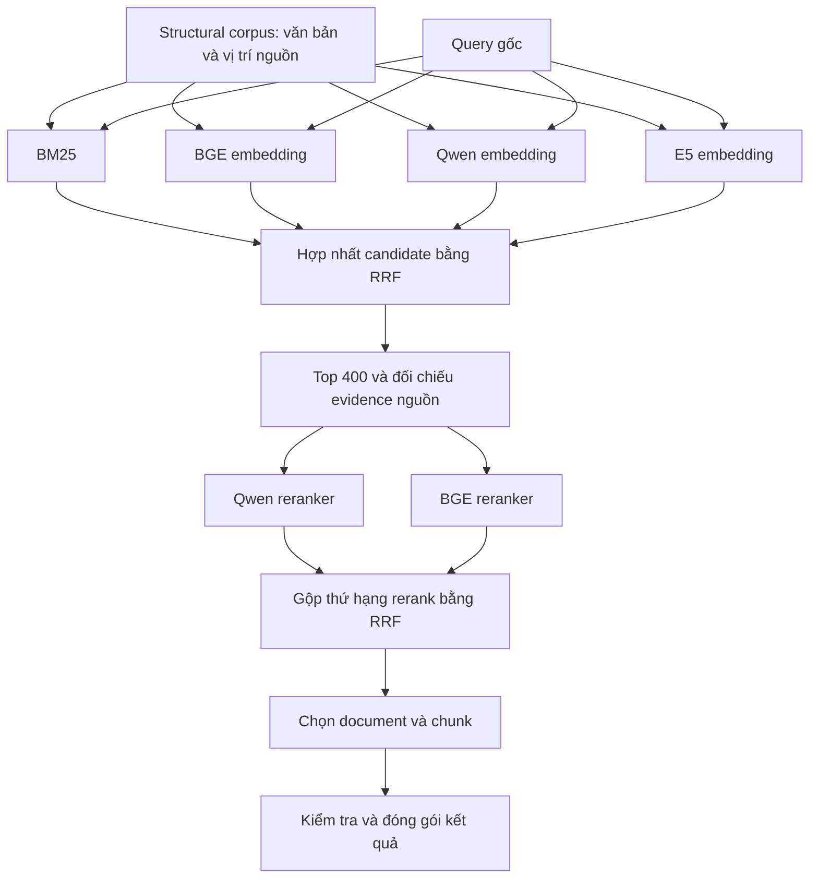

# Thuyết minh cải tiến pipeline tìm kiếm tài liệu và chọn evidence

**Dành cho:** thành viên mới, người phụ trách dữ liệu, người chạy Colab và người tổng hợp kết quả.  
**Cập nhật:** 03/11/2026.  
**Phạm vi:** giải thích bộ notebook `stage9_corpus_*` đã tạo trong repository. Hướng dẫn thao tác chi tiết nằm trong [COLAB_CORPUS_MULTIRETRIEVAL.md](COLAB_CORPUS_MULTIRETRIEVAL.md).

> Mục tiêu của lần cải tiến này là tìm được candidate mới từ corpus, sau đó dùng hai reranker để chọn document và evidence. Đây là một thí nghiệm đã có code và kiểm thử luồng offline; chưa có bằng chứng rằng nó tăng điểm thi. Kết quả đồng thuận của model không được coi là ground truth.

## 1. Chúng ta đang giải bài toán gì?

Đầu vào gồm một tập câu hỏi và kho tài liệu đa ngữ. Với mỗi câu hỏi, hệ thống phải trả về:

- **Document liên quan:** tài liệu nào có khả năng giúp trả lời câu hỏi.
- **Evidence:** đoạn văn cụ thể trong tài liệu làm bằng chứng.

Ví dụ minh họa, không phải đáp án y khoa hay nhãn chuẩn:

```text
Query: “Tôi muốn tìm thông tin về phản ứng sau tiêm vaccine ở trẻ nhỏ.”

Document A: một bài viết về vaccine.
  Đoạn 1: lịch sử nghiên cứu vaccine.
  Đoạn 2: các phản ứng sau tiêm ở trẻ nhỏ.
  Đoạn 3: thông tin liên hệ cơ sở tiêm chủng.

Hệ thống cần tìm được document A và ưu tiên đoạn 2.
```

Tìm đúng chủ đề tài liệu chưa đủ. Nếu xuất một đoạn chỉ có menu, thông tin liên hệ hoặc nội dung lệch ý hỏi, phần evidence vẫn có thể bị chấm sai.

## 2. Những từ cần hiểu trước khi đọc tiếp

| Thuật ngữ | Hiểu đơn giản | Trong dự án này |
|---|---|---|
| Query | Câu hỏi đầu vào | 1.200 câu trong file query chính thức |
| Corpus | Toàn bộ kho dữ liệu để tìm kiếm | Structural snapshot gồm 855.745 document |
| Document | Một tài liệu | Có ID riêng; có thể chứa nhiều chunk |
| Chunk | Một phần văn bản đã chia từ document | Đơn vị được tìm và đưa vào pool candidate |
| Candidate | Ứng viên được bước tìm kiếm lấy ra | Chưa có nghĩa là đã liên quan |
| Embedding | Chuyển văn bản thành vector số | Query và chunk dùng cùng model trong từng nhánh |
| Retrieval | Tìm một tập ứng viên trong corpus | BM25 hoặc so sánh vector |
| Rerank | Chấm lại từng cặp query–candidate | Qwen reranker và BGE reranker |
| Evidence | Đoạn bằng chứng được chọn để xuất | Hiện giữ nguyên `chunk_text` từ nguồn |
| RRF | Gộp nhiều danh sách theo thứ hạng | Dùng sau retrieval và sau rerank |
| GT / ground truth | Nhãn đáp án được xác nhận | Dự án chưa có bộ GT đủ để đo chất lượng toàn pipeline |
| Pilot | Lần chạy thử nhỏ | Kiểm tra vận hành, không đại diện điểm thi |
| Shard | Phần công việc giao cho một worker | Chia batch cho dense hoặc chia query cho rerank |

**Embedding và reranker là hai vai trò khác nhau.** Qwen embedding tìm candidate bằng vector; Qwen reranker đọc cặp query–candidate để chấm. BGE cũng có hai model riêng cho hai vai trò. Không dùng vector của Qwen để tìm trong kho vector E5/BGE.

## 3. Vì sao phải mở rộng từ submission sang corpus?

Trước bộ notebook mới, chúng ta có một thử nghiệm chấm lại các chunk trong `submission_17.zip`:

```text
Evidence đã có trong submission_17
             ↓
       Qwen/BGE chấm lại
             ↓
       Lọc và xuất ZIP mới
```

Cách này triển khai nhanh và hữu ích để thử chính sách chọn evidence. Tuy nhiên, model chỉ được nhìn những đoạn đã có trong ZIP. Nếu pipeline trước bỏ sót một tài liệu hoặc chunk tốt, reranker không có cơ hội tìm lại nó.

Phân tích local của `RRF_80_cap2.zip` cho thấy:

| Quan sát đã kiểm tra | Ý nghĩa |
|---|---|
| Giữ nguyên danh sách document ở cả 1.200 query | Không mở rộng được tập document dự đoán |
| Chunk giảm từ 144.000 xuống 95.913 | Thử loại bớt evidence, chưa chứng minh loại đúng |
| Toàn bộ chunk được giữ đều khớp nguyên văn với baseline | Không sinh evidence mới hoặc đoạn con mới |
| Độ dài chunk trung bình từ khoảng 880 lên 892 ký tự | Lọc bớt chunk không đồng nghĩa rút gọn từng chunk |

Chi tiết: [báo cáo so sánh RRF_80_cap2](../reports/rrf_80_cap2_analysis_20261102/README.md).

Vì vậy, bộ mới thay đổi **phạm vi tìm kiếm**: bắt đầu từ query và corpus. Nó có thể tìm thêm candidate mà submission cũ không chứa. Khả năng này cần được đo; thêm model không tự động bảo đảm kết quả tốt hơn.

## 4. Pipeline mới hoạt động như thế nào?



**Bốn nhánh retrieval chạy độc lập trên cùng phạm vi corpus.** Không có bước “BM25 loại trước, rồi dense chỉ tìm trong phần còn lại”. Một chunk bị BM25 bỏ qua vẫn có thể được Qwen, BGE hoặc E5 tìm thấy.

### Bước A — Dùng chung một nguồn structural chunk

Tất cả nhánh phải tìm trên cùng snapshot:

- 855.745 document.
- 5.512.624 chunk.
- 1.712 batch.

Nguồn được lấy từ sáu ZIP đầu vào Stage 8 tại `dense_stage8_bge_structure/bundles`. Các file ZIP này có văn bản chunk; không chỉ chứa embedding hoặc tọa độ ánh xạ.

Hiện chỉ dùng **structural chunk**. Fixed chunk và semantic chunk chưa tham gia lần thí nghiệm này. Chúng vẫn là lựa chọn cho thí nghiệm chunking sau, nhưng cần mapping nguồn và index phù hợp; không thể thay thư mục rồi giữ nguyên danh tính dữ liệu cũ.

Giữ một loại chunk trong lần này giúp tập trung kiểm tra tác dụng của retrieval đa nhánh. Việc thêm đồng thời nhiều model và nhiều kiểu chunk sẽ khiến khó giải thích nguyên nhân thay đổi kết quả hơn.

### Bước B — Tìm candidate bằng BM25

BM25 ưu tiên các chunk có từ/cụm từ phù hợp với query. Nhánh này có thể hữu ích khi câu hỏi chứa tên thuốc, tên bệnh, chữ viết tắt hoặc thuật ngữ cụ thể.

Đó là giả thuyết sử dụng, không phải kết luận nhánh BM25 hiện đã xử lý tốt các tình huống đó. Code hiện dùng SQLite FTS5, phân từ Unicode và bổ sung ký tự/cặp ký tự CJK; chưa có tách từ tiếng Việt hoặc chuẩn hóa thuật ngữ y khoa chuyên biệt. Query BM25 giới hạn 128 term khác nhau theo thứ tự xuất hiện.

### Bước C — Tìm candidate bằng ba model embedding

Trong từng nhánh:

1. Encode văn bản corpus thành vector bằng model của nhánh.
2. Encode query bằng chính model đó, với đúng cách định dạng query.
3. So sánh vector để tìm các chunk gần query.

| Nhánh | Model được dùng | Mục đích thí nghiệm |
|---|---|---|
| BGE | `BAAI/bge-m3` | Một nhánh dense làm điểm so sánh với họ BGE đã dùng trước |
| Qwen | `Qwen/Qwen3-Embedding-0.6B` | Thử tập candidate từ một họ model khác |
| E5 | `intfloat/multilingual-e5-large` | Kiểm tra liệu E5 bổ sung candidate có ích hay chỉ lặp lại hai nhánh kia |

Ví dụ, một tài liệu tiếng Trung diễn đạt đúng ý hỏi nhưng không trùng từ tiếng Việt có thể được nhánh embedding đa ngữ tìm ra. Không phải mọi câu hỏi đa ngữ đều được giải quyết đúng; cần kiểm tra kết quả thực tế.

Ba nhánh tạo ba kho vector độc lập. Notebook hiện **tạo lại embedding BGE**, chưa nhập index BGE cũ. Đây là lựa chọn của phiên bản thử nghiệm hiện tại; không có nghĩa artifact BGE cũ vô dụng.

Vector được tìm bằng tích vô hướng sau chuẩn hóa, lần lượt theo batch. Hiện chưa xây FAISS/HNSW ANN index. Vì vậy có thể gọi đây là tìm kiếm vector, nhưng chưa phải hệ thống ANN tối ưu cho phục vụ truy vấn lâu dài.

### Bước D — Hợp nhất candidate của bốn nhánh

Mỗi nhánh giữ tối đa 500 chunk/query. Hợp của bốn nhánh có tối đa 2.000 chunk trước khi loại trùng; thường ít hơn do các nhánh cùng tìm thấy một chunk.

Hệ thống nhận diện trùng bằng `chunk_id`, cộng điểm RRF và giữ tối đa 400 chunk để rerank.

RRF ưu tiên thứ hạng thay vì cộng trực tiếp điểm model:

```text
Đóng góp của một nhánh = 1 / (60 + thứ hạng trong nhánh)
Điểm hợp nhất = tổng đóng góp của các nhánh tìm thấy chunk đó
```

Ví dụ minh họa:

| Chunk | BM25 | BGE | Qwen | E5 |
|---|---:|---:|---:|---:|
| A | Hạng 3 | Hạng 8 | Không có | Hạng 12 |
| B | Không có | Không có | Hạng 1 | Không có |

A có thể được xếp trên B vì xuất hiện khá cao ở nhiều nhánh. Cách này tránh cộng những thang điểm khác nhau, nhưng cũng có đánh đổi: **một kết quả đúng chỉ được một model tìm ra vẫn có thể bị kết quả phổ biến hơn lấn át**. RRF không phải bộ xác nhận chân lý.

Top 500 và top 400 là thông số khởi đầu để thử nghiệm, chưa được chứng minh là tối ưu.

### Bước E — Đọc lại evidence từ nguồn

Sau khi đã chọn pool, hệ thống đọc lại các chunk tương ứng trong source ZIP và tạo packet cho từng query. Packet chứa cả văn bản và mapping nguồn, không chỉ ID hoặc vector.

Hai trường cần phân biệt:

| Trường | Dùng ở đâu? |
|---|---|
| `retrieval_text` | Embedding và reranker; có thể chứa title/context đã có từ bước xử lý nguồn |
| `chunk_text` | Evidence nguyên văn để xuất vào submission |

Checksum dùng để phát hiện văn bản/file bị thay đổi. Nó không xác nhận đoạn đó có trả lời đúng câu hỏi hay không.

### Bước F — Hai reranker chấm cùng pool

Qwen reranker và BGE reranker đều chấm tối đa 400 candidate của cùng một query. Cả hai dùng đúng packet đã cố định ở bước trước.

Những gì cần kỳ vọng từ reranker là phân biệt candidate gần đúng về chủ đề với candidate sát yêu cầu query hơn. Ví dụ: tài liệu nói chung về vaccine và đoạn tập trung vào phản ứng sau tiêm ở trẻ nhỏ.

Sau đó hệ thống gộp **thứ hạng của hai reranker bằng RRF**, không cộng trực tiếp logit BGE với logit Qwen.

Phiên bản này không có bước LLM viết câu trả lời, tự viết evidence hoặc tranh luận để tạo GT. Các score chỉ là đánh giá của model về mức liên quan.

### Bước G — Chọn document và evidence

Từ thứ hạng sau rerank:

- Chọn tối đa 120 document/query, dựa trên chunk xếp cao nhất của từng document.
- Chọn tối đa 120 chunk/query.
- Mỗi document có tối đa 6 chunk.
- Trong một document, giữ một phiên bản nội dung để tránh trộn các derived version.
- Loại văn bản trùng nguyên văn trong cùng document và các đoạn chồng lấn nguồn với IoU ≥ 0,8 trong cùng vùng.

Giới hạn toàn query có thể làm một số document còn trong `relevant_docs` nhưng không có chunk được chọn. Đây là hành vi lựa chọn hiện tại, cần theo dõi khi đánh giá độ phủ evidence.

## 5. Cải tiến này đã giải quyết gì, chưa giải quyết gì?

| Vấn đề | Bộ mới làm được | Phần còn lại |
|---|---|---|
| Chỉ nhìn được chunk trong submission cũ | Tìm lại trên corpus đã chọn | Chất lượng retrieval mới chưa được đo |
| Phụ thuộc một tập candidate dense | Thêm Qwen/E5 và một nhánh lexical | Chưa biết nhánh nào đem lại lợi ích thực tế |
| Điểm các model khác thang | Gộp theo thứ hạng RRF | Trọng số và kích thước pool chưa được tối ưu |
| Không truy lại được nguồn evidence chỉ từ ZIP | Giữ chunk ID, version, batch và vị trí nguồn | Chưa có đánh giá nội dung của con người/GT |
| Runtime bị ngắt, dễ dùng nhầm score | Checkpoint và identity gắn nguồn/query/model/code | Vẫn có chi phí đọc Drive và làm lại phần chưa backup |
| Chunk dài có thể khó khớp đáp án | Giữ nguyên văn bản nguồn để có đối chứng rõ | Chưa tách đoạn con, chưa tối ưu độ dài evidence |
| Không biết metric thật của từng module | Có báo cáo độ đa dạng candidate và kiểm tra kỹ thuật | Chưa có recall@K/F2 theo GT để kết luận module yếu |

**Đây là một pipeline mở rộng khả năng tìm và chọn evidence, chưa phải lời giải hoàn chỉnh cho mọi điểm yếu.**

## 6. Liên hệ với luật chấm chunk mới của BTC

Theo thông báo BTC đã cung cấp trong dự án, một chunk chỉ khớp khi đồng thời:

```text
LCS / số token của chunk đáp án  ≥ 0,4
LCS / số token của chunk dự đoán ≥ 0,4
```

LCS là độ dài dãy token chung dài nhất giữ nguyên thứ tự. Token phải theo tokenizer của evaluator; không được thay bằng số ký tự hay số từ tách bằng khoảng trắng để khẳng định đạt luật.

Ví dụ số học giả định:

- Chunk đáp án: 100 token.
- Chunk dự đoán: 300 token.
- LCS: 80 token.
- Theo đáp án: 80/100 = 80%, đạt.
- Theo dự đoán: 80/300 ≈ 26,7%, không đạt.

Bộ mới chưa có chunk đáp án để tính hai tỷ lệ này. Nó cũng chưa chia chunk thành đoạn con. Vì vậy, ngay cả khi tìm đúng tài liệu và rerank tốt hơn, điểm chunk vẫn có thể bị giới hạn bởi biên và độ dài evidence.

Ngưỡng IoU 0,8 trong bước loại trùng là độ chồng lấn tọa độ nguồn giữa hai prediction. Nó khác với ngưỡng LCS 0,4 dùng khi so prediction với đáp án.

## 7. Nhóm sẽ chạy những file nào?

| Thứ tự | File | Công việc | Khi nào được chuyển bước? |
|---|---|---|---|
| 1 | [stage9_corpus_retrieval_colab.ipynb](../colab/stage9_corpus_retrieval_colab.ipynb) | Chạy BM25, BGE embedding, Qwen embedding, E5 embedding | Đủ mọi nhánh và shard báo `complete` |
| 2a | [stage9_corpus_rerank_colab.ipynb](../colab/stage9_corpus_rerank_colab.ipynb), `MODE='prepare'` | Hợp nhất candidate và đọc lại evidence | Prepare hoàn tất trên một phiên |
| 2b | Cùng notebook, `MODE='rerank'` | Qwen và BGE chấm độc lập | Cả hai có điểm của mọi query trong plan |
| 3 | [stage9_corpus_export_colab.ipynb](../colab/stage9_corpus_export_colab.ipynb) | Gộp rerank, chọn kết quả, xuất file | Pilot hoặc full được xuất đúng phạm vi |

### Cách phân công dễ quản lý

| Người/nhóm phụ trách | Công việc chính | Thông tin cần bàn giao |
|---|---|---|
| Điều phối dữ liệu | Kiểm tra source ZIP, query, links và dung lượng | Đường dẫn Drive dùng chung; snapshot đúng |
| Retrieval | Chạy bốn role; chia GPU khi cần | RUN, role, shard, trạng thái, thời gian và lỗi nếu có |
| Chuẩn bị và rerank | Chạy prepare một lần; hai role rerank | Cùng RUN và packet; số query còn thiếu |
| Đánh giá | Kiểm tra báo cáo, lưu ZIP/hash và receipt BTC | Cấu hình, điểm từng thành phần, kết luận có điều kiện |

Một người có thể đảm nhiệm nhiều vai trò và chạy tuần tự. Không bắt buộc có bốn GPU cùng lúc. Khi chạy song song, mọi phiên phải đọc/ghi cùng thư mục Drive thực tế, không chỉ các thư mục có cùng tên ở các tài khoản khác nhau.

## 8. Chạy thử nhỏ trước, mở rộng sau

### Giai đoạn 1 — Pilot vận hành

Cấu hình mặc định dùng 20 query đầu và 4 batch đầu. Worker retrieval dừng sau 2 batch mới để kiểm tra thời gian; đổi `STOP_AFTER_BATCHES=None` rồi chạy lại cell worker để hoàn tất phạm vi pilot.

Rerank mặc định dừng sau 5 query mới; tương tự, đổi `STOP_AFTER_QUERIES=None` để hoàn tất 20 query.

Pilot đạt khi:

- Đọc đúng source và query, tải được model.
- Các nhánh có candidate, đủ coverage của phạm vi pilot.
- Cả hai reranker chấm xong; chạy lại nhận đúng checkpoint.
- Export tạo dự đoán pilot và báo cáo mà không xuất ZIP nộp bài.

Không dùng pilot này để tuyên bố model nào tốt nhất. Bốn batch đầu không phải mẫu ngẫu nhiên đại diện corpus; một query có thể không có tài liệu liên quan trong phạm vi nhỏ đó.

### Giai đoạn 2 — Full run

Chỉ chuyển sau khi pilot chạy ổn và nhóm đã ước lượng chi phí. Đổi `QUERY_LIMIT=None` và `SOURCE_BATCH_LIMIT=None` trong mọi phiên retrieval. Đây là plan mới, có đường dẫn RUN mới.

Khi hoàn tất:

- Mỗi nhánh bao phủ đủ 1.712 batch và tìm cho đủ 1.200 query.
- Prepare xác minh đủ nhánh/shard.
- Hai reranker có điểm cho toàn bộ query.
- Export kiểm tra ID theo links chính thức và tạo submission đầy đủ.

Không sửa trạng thái `paused` thành `complete` bằng tay; hai trạng thái này khác nhau về lượng công việc đã làm. Không trộn packet hoặc score giữa pilot và full.

## 9. Nhóm nhận được các artifact nào?

Mỗi run được lưu dưới `corpus_retrieval_trials/<CAMPAIGN>/<plan_signature>/` trên Drive.

| Artifact | Ý nghĩa | Có thể kết luận gì? |
|---|---|---|
| `PLAN.json` | Nguồn, query, phạm vi, model và cấu hình của run | Biết các kết quả có cùng thí nghiệm hay không |
| `retrieval/<role>/part-*/result.json` | Candidate và trạng thái của worker | Biết nhánh/shard hoàn tất chưa |
| `embeddings-*.npy` khi bật lưu vector | Vector theo source batch | Có dữ liệu embedding để dùng lại trong cùng policy |
| `prepared/query-*.json` | Pool cố định và văn bản nguồn cho rerank | Biết model thực sự được nhìn những chunk nào |
| `prepared/RETRIEVAL_DIAGNOSTICS.json` | Candidate từng nhánh, số độc quyền, độ lớn hợp và phần vào pool | Đo mức bổ sung candidate, chưa đo độ đúng |
| `rerank/qwen/query-*.json`, `rerank/bge/query-*.json` | Điểm chấm gắn với packet và model | Có thể truy lại lần chấm, chưa phải nhãn GT |
| `EVIDENCE_PROVENANCE.jsonl` | Nguồn của evidence được chọn | Truy được chunk/document/version/batch/vị trí |
| `REPORT.json` | Phạm vi và kiểm tra của lần export | Biết pilot/full, số query/chunk và hash khi full |
| `submission.zip` | File dự đoán cho full run | Chỉ biết điểm thi sau khi được chấm |

Pilot xuất `PILOT_PREDICTIONS.json` thay cho submission ZIP.

## 10. Đánh giá cải tiến thế nào khi chưa có GT?

Cần tách ba câu hỏi:

| Câu hỏi | Bằng chứng cần có |
|---|---|
| Pipeline có chạy đúng dữ liệu và đủ phạm vi không? | Checksum, coverage, checkpoint, schema, allowlist và kiểm thử |
| Các nhánh có tìm được những candidate khác nhau không? | Retrieval diagnostics, số candidate độc quyền và mức giao nhau |
| Candidate mới có đúng và làm tăng điểm không? | GT phù hợp, review mẫu hoặc kết quả chấm BTC cùng cơ chế |

Một nhánh tìm nhiều candidate độc quyền có thể hữu ích, cũng có thể mang thêm nhiễu. Hai reranker cùng xếp cao một chunk vẫn có thể cùng sai. Do đó không đổi tên “model đồng thuận” thành “GT” trong báo cáo.

Khi có điểm BTC, ghi riêng:

- `DOCS_F2MACRO`, precision và recall document.
- `CHUNKS_F2MACRO`, precision và recall chunk.
- `FINAL_SCORE`.
- ZIP SHA256, plan signature, thời điểm nộp và phiên bản luật chấm nếu biết.

Không so hai điểm như một phép thử có kiểm soát nếu evaluator hoặc snapshot nhãn thay đổi giữa hai lần chấm.

Để tìm nguyên nhân tăng/giảm điểm, bước tiếp theo là **ablation**: chỉ thay đổi một thành phần tại một lần so sánh. Ví dụ bỏ E5 hoặc giữ cùng pool nhưng dùng một reranker. Bộ hiện tại yêu cầu đủ bốn nhánh và gộp hai reranker; các chế độ ablation này **chưa có nút cấu hình sẵn**, cần bổ sung nếu nhóm quyết định triển khai. Không sửa bừa result/plan để giả lập việc bỏ nhánh.

## 11. Chi phí và hạn chế cần biết trước khi chạy full

**Dung lượng:** 5.512.624 vector × 1.024 chiều × 4 byte ≈ 22,6 GB cho một model, khoảng 67,7 GB cho ba nhánh. Đây là ước lượng vector float32, chưa cộng weights, BM25 database, packet, checkpoint và dữ liệu nguồn. GB ở đây tính theo hệ thập phân.

`SAVE_EMBEDDINGS=False` giảm dung lượng lưu vector, nhưng vẫn phải chạy embedding thật. Đây là tham số thuộc identity; không đổi giữa chừng trong cùng worker output.

**Thời gian:** chạy ba model trên hơn 5,5 triệu chunk là công việc lớn. Chưa có số đo full run để hứa số giờ cụ thể. Từ pilot, nhóm nên ghi thời gian tải model, encode, đọc nguồn và ghi Drive riêng; không lấy tổng thời gian pilot nhân máy móc vì lần đầu có chi phí khởi tạo.

**Checkpoint:** dense ghi sau mỗi batch. BM25 commit batch ở local nhưng chỉ copy backup database lên Drive khi cell trả về. Runtime mất đột ngột có thể phải làm lại phần BM25 sau backup gần nhất. Rerank lưu theo query.

**Ngữ cảnh dài:** embedding chia window overlap 64 token và gộp vector; đó là policy thử nghiệm, có thể làm loãng chi tiết. Reranker hiện từ chối cặp vượt 4.096 token, chưa có cơ chế window rerank trong bộ này.

**Chi phí ghi Drive:** lưu vector, đọc ZIP và ghi top candidate nhiều lần có thể thành nút thắt. Nhiều GPU không giúp nếu tất cả cùng bị chậm ở Drive. Pilot cần đo cả CPU/disk, không chỉ GPU utilization.

**Giới hạn về evidence:** hiện xuất structural chunk nguyên văn. Tách đoạn con theo câu/đoạn là một thí nghiệm tiếp theo, chưa được tích hợp trong bộ corpus mới.

## 12. Phân biệt trạng thái triển khai và kế hoạch tiếp theo

| Hạng mục | Trạng thái tại thời điểm viết |
|---|---|
| BM25 + ba nhánh dense từ source ZIP | Đã có code |
| Hợp nhất top candidate và đối chiếu nguồn | Đã có code |
| Qwen/BGE rerank cùng packet | Đã có code |
| Chọn document/evidence và xuất pilot/full | Đã có code |
| Kiểm thử resume, shard, hash, chọn evidence, dtype và notebook | Đã qua 10 kiểm thử offline; luồng retrieval dùng encoder/scorer giả, pooling có forward Qwen3 nhỏ với trọng số ngẫu nhiên trên CPU |
| Chạy pretrained weights trên GPU cho bộ corpus mới | Chưa được xác nhận trong phiên phát triển |
| Chạy đủ toàn corpus và có điểm thi mới | Chưa có kết quả được cung cấp |
| ANN index phục vụ retrieval nhanh hơn | Chưa triển khai trong bộ này |
| Ablation từng nhánh/model | Chưa có cấu hình sẵn |
| Tách evidence ngắn hơn, query decomposition, dịch query | Chưa triển khai trong bộ này |
| GT hoặc đánh giá LCS chính thức tại local | Chưa có |

## 13. Việc nhóm nên làm ngay

1. Chọn một người điều phối, thống nhất thư mục Drive, CAMPAIGN và phạm vi pilot.
2. Chạy pilot đủ bốn nhánh → prepare → hai reranker → export pilot.
3. Lưu RUN cùng số đo thời gian/dung lượng; đọc retrieval diagnostics và xem một số prediction để phát hiện lỗi vận hành rõ ràng.
4. Khi pilot ổn, quyết định tài nguyên cho full run; không coi pilot là bằng chứng chất lượng.
5. Sau full run, lưu ZIP/hash và điểm BTC, rồi quyết định có cần ablation hoặc thử tách evidence.

### Mẫu ghi một lần thí nghiệm

| Trường | Nội dung cần điền |
|---|---|
| Người điều phối / ngày chạy | … |
| CAMPAIGN / RUN | … |
| Pilot hay full | … |
| Role và shard của từng phiên | … |
| GPU / RAM / dung lượng Drive khả dụng | … |
| Thời gian mỗi bước | … |
| Số query/batch hoàn tất | … |
| ZIP SHA256 nếu có | … |
| Điểm document / chunk / final nếu đã được chấm | … |
| Nhận xét và điều chưa xác minh | … |

## Tài liệu để đọc tiếp

- [Hướng dẫn chạy Colab và xử lý cấu hình](COLAB_CORPUS_MULTIRETRIEVAL.md).
- [Mã pipeline đang được nhúng vào notebook](../scripts/corpus_multiretrieval.py).
- [Kiểm thử luồng corpus mới](../tests/test_corpus_multiretrieval.py).
- [Tổng quan hiện trạng và lộ trình rộng hơn của dự án](PIPELINE_HIEN_TRANG_VA_LO_TRINH_CAI_TIEN.md).
- [Phân tích query chính thức](../reports/query_analysis_20261101/README.md).
- [Tài liệu chunking Stage 5](CHUNKING_STAGE5.md).
