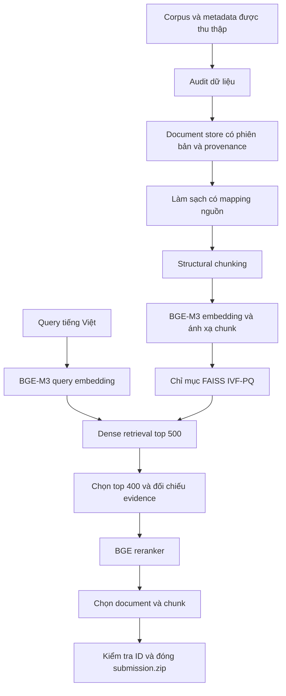

# Thuyết minh sản phẩm ViBioMIR

**Đội:** onlyrelu. **Người đại diện:** Võ Trần Duy Hoàng. **Ngày:** 04/11/2026. **Bài private được đội xác nhận:** submission_17.zip.

## 1. Mục tiêu và phạm vi

Hệ thống nhận câu hỏi tiếng Việt và trả về danh sách tài liệu cùng đoạn evidence y sinh liên quan từ corpus đa ngữ Việt–Anh–Trung. Đầu ra là dự đoán truy hồi, không phải câu trả lời tư vấn y khoa được sinh bởi LLM. Văn bản evidence được giữ theo dữ liệu nguồn.

Danh tính đội, link bàn giao và bài private test cuối cùng được khai báo trong LINKS.json và FINAL_SUBMISSION.json cùng thư mục. Hash submission_17.zip và submission.json khớp REPORT của export dense V1 trên Drive, xác minh ngày 04/11/2026; EXPERIMENT.json xác nhận dense-only cross-encoder, top400 và selection 120/120/6/0,8. Bản sao ba JSON nguồn nằm trong evidence/. Hồ sơ không giả định rằng các nhánh Qwen/E5/fallback góp phần vào bài private này.

## 2. Kiến trúc tổng thể



Sơ đồ mô tả đường dense V1 hoàn chỉnh đã được chạy và dùng làm cơ sở tái hiện. Ngoài ra repository có baseline hybrid BM25+BGE, lựa chọn lại evidence bằng Qwen/BGE và nhánh partial fallback; các khác biệt được trình bày ở phần 6.

## 3. Tiền xử lý và chunking

Audit kiểm tra shard, schema, ID, văn bản, trùng lặp/phiên bản và các dấu hiệu lỗi trích xuất. Document store giữ nhiều version của cùng document cùng checksum và provenance, thay vì ghi đè nguồn cũ.

Bước cleaning dùng quy tắc được review để xử lý control/footer/feed và tận dụng block/HTML local khi có thể khôi phục. Các trường hợp không đủ bằng chứng được giữ trạng thái chưa phục hồi hoặc cần kiểm tra; không tự viết lại nội dung y khoa. Mỗi phần cắt bỏ có vị trí nguồn và revision rule. Những đặc điểm như số, đơn vị và phủ định được bảo vệ bởi các điều kiện veto trong rule.

Structural chunking chia theo cấu trúc section/đoạn/câu và sử dụng token-offset window cho phần quá dài. Không nối qua khoảng nguồn đã bị loại. Tham số cấu hình gốc: target 384 token, max 512, overlap 64, min 128, context 48; các ràng buộc cấu trúc và phần ngắn có thể làm kích thước thực khác target.

chunk_text là evidence nguyên văn. retrieval_text là biểu diễn phục vụ tìm kiếm, có thể thêm context/title từ nguồn. Mapping lưu document ID, derived version, region, offsets, batch/row/chunk order và hash văn bản.

Snapshot structural đầy đủ: **855.745 document / 5.512.624 chunk / 1.712 batch**. Corpus semantic 9.036.279 chunk là artifact khác, không thay thế tương đương snapshot structural.

## 4. Xây chỉ mục và truy hồi dense

BGE-M3 được khóa revision, output 1.024 chiều. Dữ liệu dài được chia window phủ nội dung thay vì cắt bỏ token vượt giới hạn. Mỗi window dùng CLS pooling và L2 normalization; vector chunk được gộp theo trọng số số token rồi L2 normalize lại. Vector lưu float16; phép gộp/chấm dùng float32. Chính sách window cụ thể của Stage 8 được ghi trong plan/config, không thay bằng policy của notebook embedding thử nghiệm mới.

Các source batch được giao cho sáu logical worker độc lập. Output từng batch gồm vector, mapping và manifest; khi merge phải đủ batch và khớp source/model/plan.

Chỉ mục baseline dùng FAISS IVF-PQ: nlist=4096, m=64, nbits=8, nprobe=32, tối đa 200.000 vector corpus làm mẫu train và seed=270126. Train ở đây là lượng tử hóa chỉ mục, không fine-tune model và không dùng nhãn query. Code có thể giảm số centroid/bit cho corpus nhỏ; manifest ghi thông số thực.

Query dùng cùng encoder/pooling policy với corpus của nhánh. Dense V1 trả tối đa 500 candidate/query kèm chunk ID, source mapping và score. Chỉ mục approximate có thể bỏ sót candidate; việc xây index thành công không phải chứng nhận recall theo GT.

## 5. Rerank và chọn đầu ra

Đường dense recovery nhận top 400 candidate/query từ Dense V1, đọc lại source text và kiểm tra chunk/document/version/hash. BGE reranker-v2-m3 chấm query–retrieval_text. Frozen S09 worker hỗ trợ window input dài và cache theo đúng query/passage/policy; không reuse score chỉ vì chunk ID giống nhau.

Các tham số đầu ra của đường dense recovery:

| Tham số | Giá trị |
|---|---:|
| Candidate Dense V1 | Tối đa 500/query |
| Pool rerank | Tối đa 400/query |
| Document xuất | Tối đa 120/query |
| Chunk xuất | Tối đa 120/query |
| Chunk/document | Tối đa 6 |
| Ngưỡng loại chồng lấn nguồn | IoU 0,8 |

Document được xếp dựa trên score chunk cao nhất. Evidence được chọn trong giới hạn toàn query/per-document, loại exact duplicate trong document, giữ một derived version/document và loại overlap lớn trong cùng vùng. Một số document có thể không còn chunk sau giới hạn toàn query; mọi chunk xuất vẫn phải có parent document trong relevant_docs.

Schema đầu ra:

```json
[
  {
    "id": 1,
    "relevant_docs": [123],
    "relevant_chunks": [
      {"doc_id": 123, "chunk_text": "Đoạn evidence nguyên văn từ nguồn.", "chunk_order": 0}
    ]
  }
]
```

Ví dụ chỉ minh họa schema, không phải đáp án của query 1. chunk_order ở submission là thứ tự xuất, không đại diện offset nguồn. ZIP chỉ chứa submission.json ở thư mục gốc.

## 6. Các phiên bản triển khai và trạng thái

| Luồng | Nội dung | Trạng thái bằng chứng |
|---|---|---|
| Hybrid S07–S09 cũ | BM25 + BGE, RRF, BGE rerank | Có artifact hoàn chỉnh và validation trong run registry; config gốc top200, 20docs/40chunks khác dense recovery |
| Dense V1 recovery | Candidate BGE top500, rerank top400, 120docs/120chunks | Đã chạy theo báo cáo người vận hành; điểm 0,1706 do người vận hành cung cấp, chưa có receipt gắn hash trong hồ sơ hiện tại |
| Multimodel trên submission | Qwen/BGE rerank evidence trong ZIP, gộp RRF | Đã có RRF_80_cap2.zip local và audit; chưa có điểm mới được xác nhận |
| Corpus retrieval mới | BM25 + BGE + Qwen + E5 từ corpus | Các log được cung cấp cho thấy chưa hoàn tất; không trình bày là full run đã được chấm |
| Partial retrieval fallback | Snapshot candidate đã quét + evidence baseline; một reranker chấm chung; query chưa xử lý giữ baseline | Có code/notebook và kiểm thử offline; file cuối cùng cần xác nhận qua FINAL_SUBMISSION.json |

Partial fallback không coi thiếu một nhánh là có đủ corpus. Mỗi checkpoint được kiểm tra identity/coverage và copy thành snapshot bất biến. Candidate mới được hydrate từ source; baseline evidence chỉ được xác nhận từ ZIP. Cả hai chấm bằng chunk_text để thống nhất đầu vào. Mặc định giữ relevant_docs cũ; UPDATE_DOCUMENTS=True cho phép xếp lại/thêm document. Score lỗi hoặc thiếu khiến toàn bộ query dùng baseline.

## 7. Model, dữ liệu huấn luyện và API

Các model inference tải từ checkpoint công khai đã khóa revision; không có fine-tuning neural model trong các đường nêu trên. Không có closed-model API trong đường inference được mô tả. Prompt/instruction Qwen là cấu hình reranker/embedding, không dùng để sinh hoặc sửa evidence. Danh mục checkpoint và cách tải nằm trong MO_HINH.md.

Repository có công cụ silver/proxy và review mẫu phục vụ phát triển, nhưng chưa có GT được xác nhận để khẳng định chất lượng toàn corpus. Các ví dụ do assistant soạn không được trình bày là nhãn BTC hoặc GT đã review.

## 8. Kết quả và giới hạn đánh giá

Người vận hành đã cung cấp bộ metric sau cho một lần dense recovery:

| Metric | Giá trị được báo cáo |
|---|---:|
| FINAL_SCORE | 0,1706 |
| DOCS_F2MACRO | 0,2534 |
| CHUNKS_F2MACRO | 0,0877 |
| DOCS_PRECISION | 0,1842 |
| DOCS_RECALL | 0,3336 |
| CHUNKS_PRECISION | 0,0669 |
| CHUNKS_RECALL | 0,1160 |

Đây không phải điểm private cuối cùng mặc định. Cần ghi đúng submission ID/receipt/hash trong FINAL_SUBMISSION.json nếu báo cáo nó như kết quả bài nộp cuối.

Theo thông báo BTC được đội cung cấp, chunk match cần đồng thời LCS/độ dài đáp án ≥0,4 và LCS/độ dài dự đoán ≥0,4. Hồ sơ không có evaluator và nhãn chính thức để tự xác nhận hai điều kiện này. IoU 0,8 giữa prediction là quy tắc loại trùng nguồn, khác với LCS 0,4 khi so đáp án.

Validation trong code đo integrity, coverage, source mapping, schema và allowlist, không đo độ đúng lâm sàng. Baseline/fallback không tự bảo đảm model đồng thuận là đúng. Thử nghiệm chưa hoàn tất không được gán điểm của một pipeline khác.

## 9. Truy xuất mã nguồn và tái hiện

Mã chính: vibiomir/ cho audit nối tiếp, document store, cleaning, chunking, lexical/dense index, S09; scripts/ cho adapter, notebook builders, fallback và phân tích artifact; colab/ cho workflow GPU; configs/ và requirements-stage*.txt cho cấu hình/phụ thuộc. Run registry và reports giữ bằng chứng kỹ thuật của các lần trước.

TAI_HIEN.md mô tả cả đường khôi phục từ artifact và đường xây từ dữ liệu gốc. Model/config/source/packet hashes bảo vệ việc resume. Không sửa manifest để làm một artifact khác nguồn trở thành hợp lệ. Để đối chiếu bài nộp theo byte, cần cùng prepared packet và score đã lưu; rebuild GPU từ đầu chỉ kỳ vọng tương đương quy trình, không cam kết bitwise trên phần cứng khác.
