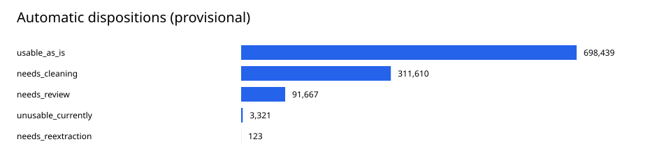
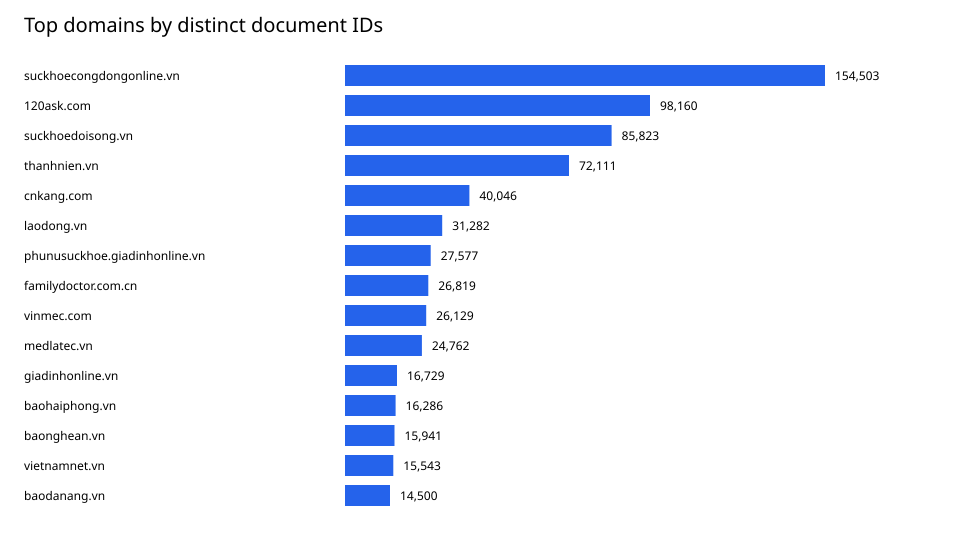

# Full local-data audit — delivery 2

The full automatic audit is complete. All counts below describe local collected data, not the announced URL list or relevance labels.

| Metric | Value |
| --- | --- |
| records | 1,105,160 |
| distinct_doc_ids | 855,745 |
| doc_ids_with_text | 852,995 |
| doc_ids_without_text | 2,750 |
| doc_ids_with_multiple_records | 248,909 |
| doc_ids_with_conflicting_normalized_text | 28,480 |
| rows_with_nonempty_html | 78,739 |
| total_blocks | 34,658,787 |

## Conclusions for implementation

Start with versioned documents and provenance-aware metadata; then implement domain-specific cleaning on source spans, and only then freeze chunks/indexes.
Retry/version duplication makes row counts larger than document counts. Nonempty text, structural agreement and automatic dispositions do not establish relevance or clinical validity.
The source cases demonstrate whole-document false positives from reCAPTCHA footers and CJK word-overlap checks, plus confirmed binary-as-text failures. Use these as regression counterexamples.
Retained HTML exists in 78,739 records; this limits where DOM/JSON-LD repair is available. Unknown metadata must remain unknown.
English-source availability is not established by Latin-script hints. PubMed metadata-only failures must not be described as retrieved English evidence.
## Review status

The packet contains 600 domain-stratified random samples plus targeted cases. 26 source-excerpt cases across 20 domains have explicit assistant observations.
Source-consistency validation checked 646 unique packet records, including all 600 random samples, across 442 source files, with zero failures and 3,161 verified signal spans.

Targeted language review also found English material outside PubMed (MEDLATEC and an English passage under a Chinese title). Do not assign document language from its domain. A short HTTP-200 record containing only `404 Not Found` is a counterexample to treating nonempty 2xx text as a valid article.

Independent human/clinical sample review remains pending. No 98% QA, relevance P/R/F2 or medical accuracy claim is made.

## Read next

- [Concrete processing plan](PROCESSING_PLAN.md).
- [Source-excerpt findings](REVIEW_FINDINGS.md).
- [Document/domain summary](summary.json) and [implementation backlog](IMPLEMENTATION_BACKLOG.csv).
- [Automatic audit report](../REPORT.md), [scan status](../scan_status.json), [runtime upgrade provenance](../RUNTIME_UPGRADE.json).

Source-check details: [sample consistency summary](../sample_validation/sample_consistency_summary.json), [full source validation](../FULL_RUN_VALIDATION.json).
