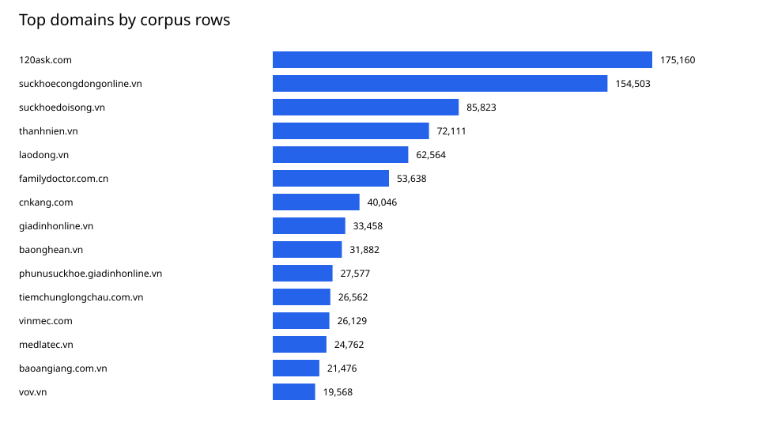
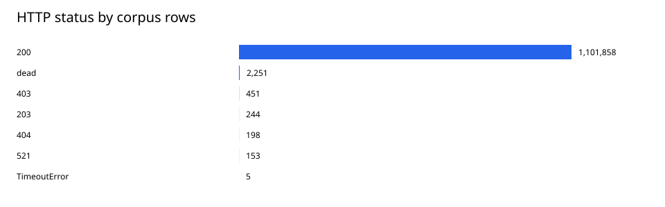
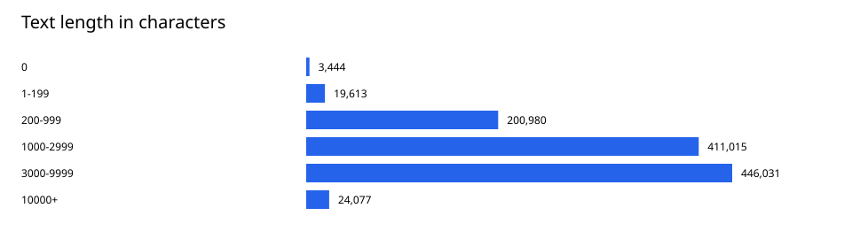

# ViBioMIR data exploration report

Generated at (Vietnam time): 2026-10-24T23:29:51+07:00

Local data analysis; no data downloads, model inference, or API calls. This report is rendered from saved analysis artifacts; its generation time is not a new corpus scan timestamp.

## Inventory

Source: `/home/duyhoang/Downloads/AI_Guru/Data`.

| Metric | Value |
| --- | --- |
| Parquet files | 1197 |
| Parquet size (bytes) | 2466230403 |
| Metadata row count (all Parquet files) | 2326958 |
| Schema variants | 4 |
| Inventory errors | 0 |

Schema and error details: [inventory.json](inventory.json); file inventory: [files.csv](files.csv).

## Corpus

All discovered corpus shards were scanned.

| Metric | Value |
| --- | --- |
| Selected shards | 1195 |
| Discovered shards | 1195 |
| Successfully read rows | 1105160 |
| Distinct document IDs | 855745 |
| IDs with conflicting text versions | 28480 |
| Shard read errors | 0 |

### Quality (flags may overlap)

| Flag | Rows |
| --- | --- |
| missing_or_invalid_id | 0 |
| empty_text | 3444 |
| short_text | 19613 |
| missing_title | 3512 |
| invalid_url | 0 |
| non_2xx_status | 3058 |
| text_len_mismatch | 0 |
| html_in_text | 1391 |
| replacement_character | 84 |
| possible_block_page | 841 |
| invalid_blocks | 0 |
| missing_text_column | 853 |

`short_text` uses the raw character count of nonempty text, with threshold 200. `text_len_mismatch` compares `text_len` with Python `len(text)`. HTML/block-page flags are heuristics requiring sample review.

Examples for reviewing the original records: [quality_examples.csv](quality_examples.csv).

### Length distributions

| Unit | Min | P50 | P90 | P99 | Max | Mean |
| --- | --- | --- | --- | --- | --- | --- |
| Characters | 0 | 2492 | 6244 | 11693 | 336970 | 3089.7728057475842 |
| Whitespace units | 0 | 503 | 1360 | 2533 | 66214 | 625.2311583843064 |

Quantiles use the element at floor((n−1)×q) in the sorted sequence. Whitespace units **are not model/LCS tokens** and should not be used to compare information volume between Chinese and Vietnamese/English.

### Duplicate records

| Key | Duplicate groups | Extra rows |
| --- | --- | --- |
| id | 248909 | 249415 |
| url | 248909 | 249415 |
| normalized_text_sha256 | 223088 | 225574 |

Extra rows = sum(group size − 1). SHA-256 hashes cover the entire text after NFKC → HTML unescape → lowercase → whitespace collapse. Empty text is excluded from content duplicate counts. URLs are compared verbatim without URL normalization. Content matches are exact after normalization; near-duplicates are not detected. Duplicate CSVs contain at most 1,000 groups; JSON totals cover the entire scanned scope.

### Language hints

| Heuristic | Rows |
| --- | --- |
| cjk_likely_zh | 314350 |
| latin_undetermined | 422 |
| other_or_mixed | 3 |
| unknown | 3444 |
| vi_diacritics | 786941 |

The heuristic examines at most the first 4,000 characters: CJK share ≥20% → `cjk_likely_zh`; Vietnamese-specific diacritics → `vi_diacritics`; substantial ASCII Latin text → `latin_undetermined`. CJK does not confirm Chinese; Latin does not confirm English. No language identification model is used, and domains are not treated as language labels.

### Crawl-state reconciliation

| Group | State IDs | State IDs without shards | Shard IDs without state | HTTP 2xx IDs without nonempty 2xx text |
| --- | --- | --- | --- | --- |
| A | 147786 | 0 | 0 | 120 |
| B | 429143 | 0 | 0 | 16 |
| C | 527636 | 0 | 0 | 49 |

IDs are reconciled within each A/B/C group. The crawl-state SQLite database is not the official document list; HTTP 2xx does not establish content correctness. Missing-shard counts from a sample scan do not describe the full corpus. A `last_run` log describes only the latest run.

### Content block structure

| Metric | Value |
| --- | --- |
| Rows with valid blocks | 1101858 |
| Total blocks | 34658787 |
| Mean blocks per row with valid blocks | 31.45485806701045 |
| Maximum blocks | 8728 |

Crawler content blocks are not automatically retrieval chunks. A valid structure is a list of string pairs `[block_kind, text]`; EDA does not modify block text.

## Queries and official document list

Source: [AIGuruTinix/ViBioMIR](https://huggingface.co/datasets/AIGuruTinix/ViBioMIR); revision `71be0e1239a19dfd7a717e2bc13e3bec21bd0334`. Retrieved at: 2026-10-24T02:00:16+07:00. Local manifest: `/home/duyhoang/Downloads/AI_Guru/Data/official/ViBioMIR/provenance.json`.

### Queries

| Metric | Value |
| --- | --- |
| file | /home/duyhoang/Downloads/AI_Guru/Data/official/ViBioMIR/query.parquet |
| rows | 1200 |
| unique_valid_ids | 1200 |
| expected_rows | 1200 |
| has_1200_unique_valid_ids | True |
| duplicate_id_groups | 0 |
| duplicate_normalized_query_groups | 0 |
| quality_flags | {} |
| mean_characters | 129.50583333333333 |
| median_characters_lower | 81 |
| max_characters | 1243 |
| whitespace_units | {"min": 5, "p50_lower": 18, "p95_lower": 84, "max": 281} |
| language_hints | {"vi_diacritics": 1200} |

### Document list

| Metric | Value |
| --- | --- |
| file | /home/duyhoang/Downloads/AI_Guru/Data/official/ViBioMIR/links_corpus_vi_en_zh.parquet |
| rows | 1220598 |
| unique_valid_ids | 1220598 |
| invalid_ids | 0 |
| invalid_urls | 0 |
| domains | 94 |
| duplicate_id_extra_rows | 0 |
| official_ids_with_shard | 855745 |
| official_ids_with_nonempty_2xx_text | 852995 |
| official_ids_with_only_mismatched_source_urls | 0 |
| shard_ids_outside_official_corpus | 0 |
| official_ids_without_shard | 364853 |
| nonempty_2xx_id_coverage | 0.6988336864389422 |
| note | Coverage refers to the scanned shards; a partial run understates full coverage. Domain coverage counts unique IDs, using MIN(domain) for ambiguous duplicate official IDs. Source URL matching is exact; redirects/encoding differences need manual review. |

Coverage of IDs with at least one nonempty HTTP 2xx text version: **69.88%**. This is acquisition coverage; it does not establish content correctness or retrieval Recall.

### Domains with missing IDs relative to the official list

| Domain | Official IDs | IDs without shards | IDs with nonempty HTTP 2xx text |
| --- | --- | --- | --- |
| pubmed.ncbi.nlm.nih.gov | 240000 | 239957 | 0 |
| nhathuoclongchau.com.vn | 79598 | 79598 | 0 |
| ask.39.net | 32772 | 32772 | 0 |
| zysjonline.com | 6591 | 6548 | 0 |
| pmc-ecm-healthblog.beta.pharmacity.io | 5333 | 5292 | 0 |
| article.iiyi.com | 729 | 686 | 0 |

Up to 15 domains, ranked by missing ID count. Full statistics: [official_coverage_by_domain.csv](official_coverage_by_domain.csv). Source URLs without verbatim matches: [official_url_mismatch_examples.csv](official_url_mismatch_examples.csv).

Query length here uses `str.split()`, with quantiles at floor((n−1)×q). The dataset card reports a word-count range of 5–283; the analyzed file yields 5–281 under this counting method. The published tokenization method is unspecified; query text is preserved.

## Limitations and next steps

- Review quality flags by domain before filtering; EDA does not remove or modify source records.
- Review missing IDs and sources without usable text in the official coverage statistics.
- Preserve original IDs when handling duplicate content across documents.
- Reference relevance labels are unavailable, so Precision/Recall/F2 and retrieval quality are not assessed.
- `--inspect-blocks` adds block counts and JSON/structure flags; empty blocks are not treated as malformed JSON.

Detailed data: [corpus_summary.json](corpus_summary.json), [references_summary.json](references_summary.json), [metrics.sqlite3](metrics.sqlite3).
